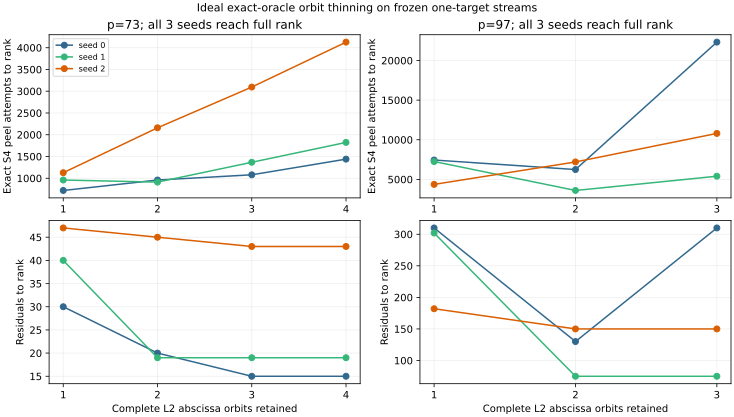

# Orbit-complete line-2 thinning in quartic-twist index calculus

23 October 2026. This is the [preregistered](QUARTIC_TWIST_LINE_PROTOCOL.md)
ideal exact-oracle survey of **all** 21 orbit-complete `L2` subsets on the
six previously frozen one-target `p=73/97` streams. It follows the
[polynomial scaling and occupancy panel](K1_SCALING_REPORT.md) but does
not change that panel's results. [First run](K1_ORBIT_THINNING_v1.json)
and [A/A run](K1_ORBIT_THINNING_aa_v1.json) are byte-identical. The
[executable survey](survey_k1_orbit_thinning.py), [figure](k1_orbit_thinning.svg),
and [PDF](K1_ORBIT_THINNING.pdf) reproduce the result.

## Why this is a twist-specific base choice

Each nonzero line-2 abscissa orbit has exactly 12 physical points under
the transported Frobenius/cubic action, but contributes only **one**
folded factor-log column. The restricted `k=1` polynomial collector
peels every signed line-2 point, so an additional orbit asks for up to
24 more `S4` systems **per residual**. It also supplies more mixed
decompositions and adds one unknown log. The net relation and matrix
effect is therefore a concrete factor-base tradeoff, not a free
symmetry multiplier.

This survey keeps every `L0` point and its frozen sign. It orders `L2`
orbits by their smallest physical index in the original full base and
keeps the first `j` orbits, `j=1…4` at p=73 and `j=1…3` at p=97. No
orbit is selected by its observed hits. For each frozen residual, a
scalar-keyed exact group oracle independently rebuilds the **full**
signed `k=1` set and matches its SHA-256 to the previously audited
point-keyed census. Filtering by the single `L2` factor then gives the
exact subset set. The survey rebuilds every folded row, fixes the
public generator factor log, accepts every rank-increasing relation
in sorted order, and stops after a full-rank solve. A separate Python
`Fp⁴` curve implementation checks each solved representative log and
the target by scalar multiplication. The `p=73` seed-one full-base
ideal oracle can stop one query earlier than its partial polynomial
producer because the latter missed two real relations.

## All frozen outcomes

Every one of the 21 group-oracle cases reaches anchored full rank within
its original recorded stream; there are no censored subset cases.
`S4 peels` counts exact signed line-2 residuals attempted through the
rank-completing query, excluding infinity residuals. It counts systems
the candidate would ask for, **not** the cost of solving them.

| `p/seed` | `L2` orbits | Physical `L2` | Folded columns | Residuals to rank | Exact prefix relations | `S4` peels | Full-stream exact relations |
| --- | ---: | ---: | ---: | ---: | ---: | ---: | ---: |
| 73/0 | 1 | 12 | 5 | 30 | 6 | 720 | 28 |
| 73/0 | 2 | 24 | 6 | 20 | 6 | 960 | 44 |
| 73/0 | 3 | 36 | 7 | 15 | 7 | 1,080 | 65 |
| 73/0 | 4 | 48 | 8 | 15 | 8 | 1,440 | 77 |
| 73/1 | 1 | 12 | 5 | 40 | 6 | 960 | 12 |
| 73/1 | 2 | 24 | 6 | 19 | 8 | 912 | 22 |
| 73/1 | 3 | 36 | 7 | 19 | 9 | 1,368 | 38 |
| 73/1 | 4 | 48 | 8 | 19 | 10 | 1,824 | 45 |
| 73/2 | 1 | 12 | 5 | 47 | 5 | 1,128 | 11 |
| 73/2 | 2 | 24 | 6 | 45 | 6 | 2,160 | 17 |
| 73/2 | 3 | 36 | 7 | 43 | 11 | 3,096 | 33 |
| 73/2 | 4 | 48 | 8 | 43 | 15 | 4,128 | 45 |
| 97/0 | 1 | 12 | 4 | 310 | 4 | 7,440 | 5 |
| 97/0 | 2 | 24 | 5 | 130 | 8 | 6,240 | 23 |
| 97/0 | 3 | 36 | 6 | 310 | 16 | 22,320 | 27 |
| 97/1 | 1 | 12 | 4 | 302 | 4 | 7,248 | 13 |
| 97/1 | 2 | 24 | 5 | 75 | 5 | 3,600 | 21 |
| 97/1 | 3 | 36 | 6 | 75 | 6 | 5,400 | 32 |
| 97/2 | 1 | 12 | 4 | 182 | 4 | 4,368 | 7 |
| 97/2 | 2 | 24 | 5 | 150 | 5 | 7,200 | 15 |
| 97/2 | 3 | 36 | 6 | 150 | 6 | 10,800 | 20 |

The minimum *ideal peel count* within each frozen grid is lower than
the full-base count by 1.5–3.66×, but the best `j` varies by seed. For
example, p97 seed zero uses 6,240 peels with two orbits and 22,320
with all three; p97 seed one uses 3,600 with two and 5,400 with three.
Choosing `j` after seeing these outcomes would bias a one-target
speed claim. The next native experiment therefore freezes and runs the
entire `j` grid, retaining algebraic failures, rather than publishing a
winner chosen from this group-oracle survey.

## Cost boundary

The full signed sets and subgroup logs are used **only by this reference
oracle and its audit**. The measured polynomial `S4` solver has not
been run on the thinned bases. Its cost per system need not be constant;
its p=73 seed-one failure demonstrates that ideal oracle rows can be
missing from a native run. Base construction, orbit-map work, algebraic
solves, hash/allocator CPU, matrix work, memory, matched rho and isolated
time must be charged afresh in a native one-target experiment. This
survey supplies an exact rank/system-count discriminator, not a priced
index-calculus improvement or a new ECDLP complexity claim.
