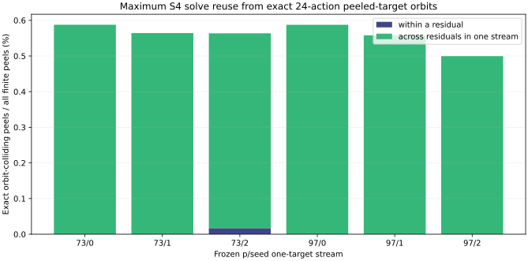
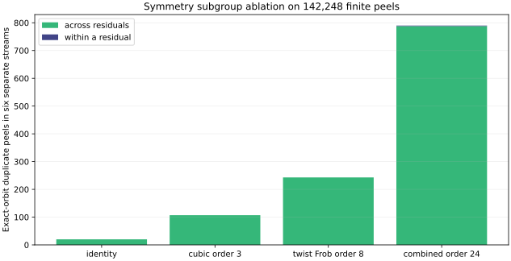

# Can twist symmetry reuse peeled S4 systems?

23 October 2026. This exact scalar/group diagnostic uses every residual of the six frozen p=73/97 mixed-line streams, including those after the polynomial one-target stop. Its [protocol](QUARTIC_TWIST_LINE_PROTOCOL.md) was committed as `8801c22aaa` before this calculation. [Executable source](analyze_k1_peeled_orbits.py), [machine record](K1_PEELED_ORBIT_REUSE_v1.json), [subgroup ablation](K1_PEELED_SUBGROUP_REUSE_v1.json), [figure](k1_peeled_orbit_reuse.svg), and [PDF](K1_PEELED_ORBIT_REUSE.pdf) reproduce the result.

## Exact test

For each frozen residual `R=[a]G+[b]Q` and every signed physical line-2 factor `T`, the diagnostic computes `R−T` modulo the prime subgroup order. It identifies peeled targets under all 24 products of the independently checked Frobenius and cubic eigenvalues. Because the line-0 base is invariant, two peeled targets in the same orbit have symmetry-equivalent S4 solution sets in principle. This is an *upper bound on exact-orbit solver-call reuse*: moving solutions back, sign reconstruction, cache lookup and canonicalization would still cost work in a native collector.

There is also a direct obstruction to the tempting 12-fold reuse within one line-2 factor orbit. If `T′=λT` and its peeled target were the `λ` image of `R−T`, then `R−λT=λ(R−T)` would force `(1−λ)R=0`. On a prime-order subgroup, every nonidentity action has `λ≠1`, so this requires `R=O`. All 1,856 residuals tested here are nonzero. A duplicate can still occur with a *different* line-2 factor satisfying `T′=(1−λ)R+λT`; the exact count below finds those exceptional coincidences.

The code checks that each eigenvalue group has exactly 24 elements, the signed line-2 set is closed, all 24 images of every finite peeled target have the same canonical representative, and a one-unit perturbation of the Frobenius eigenvalue breaks closure. The factor logs are the original producer's group-verified logs and each six-run independent point-keyed/BSGS audit verifies all physical base logs and the target. No polynomial solver or relation oracle runs in this diagnostic.

## All six complete-stream results

`Local` counts duplicates *within one residual*; `cross` counts additional duplicates in later residuals after local deduplication. The final column is the maximal exact-orbit cache ratio if an unbounded cache were shared through that one stream.

| p/seed | Residuals | Signed L2 factors | Finite peels | Infinity | Local duplicates | Cross duplicates | Max stream cache ratio |
|:--|--:|--:|--:|--:|--:|--:|--:|
| 73/0 | 117 | 96 | 11,232 | 0 | 0 | 66 | 1.005911× |
| 73/1 | 120 | 96 | 11,520 | 0 | 0 | 65 | 1.005674× |
| 73/2 | 122 | 96 | 11,712 | 0 | 2 | 64 | 1.005667× |
| 97/0 | 558 | 72 | 40,176 | 0 | 0 | 236 | 1.005909× |
| 97/1 | 458 | 72 | 32,976 | 0 | 0 | 184 | 1.005611× |
| 97/2 | 481 | 72 | 34,632 | 0 | 0 | 173 | 1.005020× |

## Identity, cubic, twist Frobenius and combined action

A separately frozen [subgroup ablation](analyze_k1_peeled_subgroups.py) repeats the same exact count under identity, the cubic order-three action, transported Frobenius order eight, and their combined order-24 action. It checks all subgroup orders and containment, signed-factor closure, monotone unique counts and exact reproduction of the earlier combined-action record. Each row sums six separate one-target streams; a cache is not shared between seeds.

| Action | Order | Local duplicates | Cross-residual duplicates | Unique targets within streams | Ideal stream cache ratio |
|:--|--:|--:|--:|--:|--:|
| identity | 1 | 0 | 20 | 142,228 | 1.000141× |
| cubic | 3 | 0 | 107 | 142,141 | 1.000753× |
| frob | 8 | 0 | 243 | 142,005 | 1.001711× |
| full24 | 24 | 2 | 788 | 141,458 | 1.005585× |

The combined twist/cubic action identifies 770 more peeled targets than an identity-only cache (141,458 versus 142,228 unique targets within the six separate streams). Cubic alone identifies 87 more than identity and transported Frobenius alone 223 more. Combined action adds 683 relative to cubic alone. These are exact call-count upper bounds, with no native cache implementation or priced cost.

Across six separate streams, 142,248 finite peels have 2 local and 788 further within-stream orbit collisions. At most 790 of 142,248 S4 calls could be eliminated by an ideal exact-orbit cache on these specific streams (1.005585× call-count ratio after local and within-stream collisions). Only two duplicate peels occur inside one residual. The count does not pool caches across different seeds or targets.

## Interpretation and limits

The 24-action makes the factor base and equations covariant, but a generic fixed residual has no stabilizer that makes all 12 physical members of one line-2 orbit equivalent *at that same residual*. The observed two local collisions are consistent with that distinction; they do not prove a universal absence of symmetry reuse. A native canonicalized S4 cache could realize less saving once lookup, transformation and extra memory are charged. These six small-field streams do not test other factor-base shapes, target-generation rules, or larger curves. The separately audited [native thinning grid](K1_THIN_NATIVE_REPORT.md) addresses the different mechanism of reducing the number of signed line-2 peels in the first place.
