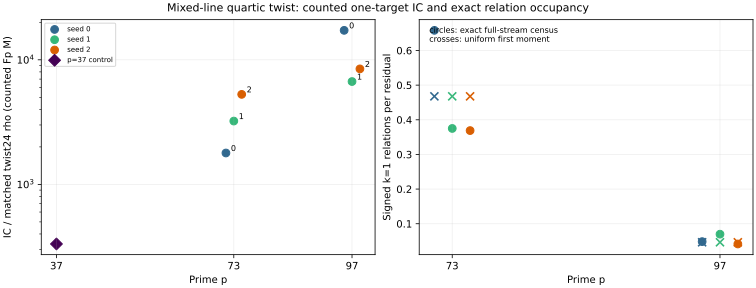

# Twist symmetry in mixed-component polynomial index calculus

23 October 2026. This is a six-workload extension of the [p=37 mixed-polynomial
study](MIXED_POLYNOMIAL_REPORT.md), on public synthetic quartic twists at
`p=73` and `p=97`. Each workload solves one target `Q=[271]G` on its own
frozen seed stream. The [protocol](QUARTIC_TWIST_LINE_PROTOCOL.md) was
registered before the generalized collector, scaling runs, full-stream
census, scalar-keyed census audit, and orbit-row check respectively. The
[one-target run index](K1_SCALE_RUNS.md) and [complete-stream census run
index](K1_CENSUS_RUNS.md) retain every raw record, independent audit,
graph and PDF. The p=73 seed-one algebraic miss remains visible.

## Mechanism and what the 24-action can buy

On `E/Fp⁴: y²=x³+b₀t³`, with `t⁴=d` for the least quadratic nonsquare
`d∈Fp`, the transported Frobenius `ψ` and cubic automorphism `ι` give a
24-element signed point action on these prime-order subgroups. The usable
abscissa components `L0=Fp` and `L2=t²Fp` are stable under both. All
nonzero abscissa orbits tested here have size 12. The `p=73` physical
base has 48 points on each line, or 96 physical factor logs but **eight**
folded log columns; `p=97` has 36 on each line, or 72 physical logs but
**six** columns. The factor bases and point signs are identical to the
previous exact mixed-line oracle experiment, and each physical log was
independently recovered and group-verified in the current audit.

For the restricted mixed pattern, write a signed relation as three
distinct `L0` factors plus one `L2` factor. Peeling the signed `L2`
point leaves a symmetrised degree-four summation polynomial `S4` in
three `L0` abscissae. The producer solves all such systems on each frozen
residual, reconstructs signs, re-adds each four-point sum, retains rank
raising rows, and verifies the factor logs and target. The factor-base
fold lowers the number of independent rows needed; the mixed tag gives
the cheaper `S4` path compared with the native single-line `S5` path.

The action does **not** multiply independent equations by 24. If a
folded row is `v·X=c`, applying an action with subgroup eigenvalue `λ`
to every factor and the residual produces `(λv)·X=λc`; it has the same
one-dimensional row span. A separate [orbit-row verifier](verify_k1_orbit_rows.py)
used independently BSGS-verified physical logs to remap all 42 selected
relations under all 24 actions. Its [machine record](quartic_twist_k1_orbit_row_audit_v1.json)
passes 12,096 factor-image closure checks and **1,008 exact row/RHS
scaling checks**. This rules out a free 24-fold rank or relation-count
multiplier for the tested folded base. It does not rule out a cheaper
implementation of one polynomial system or a better factor-base shape.

## Frozen one-target polynomial panel

The six workloads use the `L0∪L2` point sets and residual `(a,b)` traces
already recorded in [the mixed-line exact experiment](quartic_twist_mixed_v1.ndjson).
Each run processes the trace in order until anchored full rank or the
recorded end. The p=73 trace lengths are 117/120/122 and the p=97 lengths
558/458/481; stopping earlier does not treat later exact-oracle hits as
candidate IC work. The producer and independent point-keyed auditor had
8 GiB address-space and 1,200 s watchdog bounds per run. The auditor
recomputes every processed signed `k=1` set, twist coefficients and rank,
and uses an independent BSGS table to recover and verify every physical
factor log. The candidate's relation finder never reads the public
known-answer scalar; it is used after recovery for checking.

| `p/seed` | IC residuals | Exact signed set / polynomial set on processed prefix | Anchored rank | Counted IC `Fp M` / group ops | Same-target twist24 rho `Fp M` | IC/rho `Fp M` ratio | Audit |
| --- | ---: | ---: | ---: | ---: | ---: | ---: | --- |
| 73/0 | 15 | 8 / 8 | 8/8 | 888,203,272 / 9,988 | 496,841 | 1,788 | [pass](quartic_twist_k1_scale_p73_seed0_audit_v1.json) |
| 73/1 | 20 | **11 / 9** | 8/8 | 1,183,617,228 / 10,891 | 366,965 | 3,225 | [partial](quartic_twist_k1_scale_p73_seed1_audit_v1.json) |
| 73/2 | 43 | 15 / 15 | 8/8 | 2,542,727,892 / 15,084 | 481,339 | 5,283 | [pass](quartic_twist_k1_scale_p73_seed2_audit_v1.json) |
| 97/0 | 310 | 16 / 16 | 6/6 | 13,839,508,536 / 53,111 | 802,322 | 17,249 | [pass](quartic_twist_k1_scale_p97_seed0_audit_v1.json) |
| 97/1 | 75 | 6 / 6 | 6/6 | 3,349,559,070 / 17,475 | 500,318 | 6,695 | [pass](quartic_twist_k1_scale_p97_seed1_audit_v1.json) |
| 97/2 | 150 | 6 / 6 | 6/6 | 6,696,848,851 / 28,588 | 791,504 | 8,461 | [pass](quartic_twist_k1_scale_p97_seed2_audit_v1.json) |

All six target logs are 271 and pass independent scalar multiplication.
The first and A/A runs have identical non-timing fields; their empty
diffs and audit records are linked from the run index. The p=73 seed-one
producer encountered **one S4 system failure** at query index 18 and
missed two independently verified signed relations. A separate
[post-run scalar-keyed diagnosis](quartic_twist_k1_missing_diagnostic_v1.json)
enumerates every processed difference across all six runs: both missing
relations peel the same signed `L2` factor `(54,+1)`, and no polynomial
run emits a false signed relation. The candidate still had eight
independent selected rows and recovered the target. It is a *partial
relation finder*, not an exact polynomial oracle on that stream; the
missing relations are not silently added to its row count or cost.

The displayed `Fp M` number sums recorded model, twist geometry,
eigenvalue, base, orbit map, `S4` interpolation, residual generation,
every attempted polynomial system, root filtering and final verification.
Group operations and modular matrix operations are recorded separately.
Construction of the public known-answer input is explicit but excluded
from both target-solving intervals. Polynomial hash/tree and allocator
CPU, requested peak bytes, rho hash/table CPU, a calibrated group/field
equivalence band, and isolated timing are absent. Thus the arithmetic
ratios above are **not** a priced whole-method `S` or wall-time speed
ratio. None of these rows qualifies for leaderboard tables A–C or a
claim that the implementation beats rho, msolve or Magma. They do show
that this particular restricted polynomial implementation has much more
counted field work than matched twist-folded rho at these sizes. The
p=37 control was 116,050,118 versus 348,941 `Fp M` (332.6×) on its
different 36+12 base; the six larger-curve ratios span 1,788–17,249×.
Three small primes do not establish an asymptotic trend.

## Entire-stream relation yield, independently cross-checked

For `B₀` physical `L0` points, `B₂` physical `L2` points and subgroup
order `r`, there are exactly `16·C(B₀,3)·B₂` signed distinct-index
`k=1` tuples. If a residual is uniform in the prime group, its expected
signed set size is therefore

`λ₁ = 16·C(B₀,3)·B₂ / r`.

This is a first-moment identity under uniform residual sampling, even
if several tuples share one group sum; it is not a Poisson law, a rank
guarantee, or an assertion that a finite pseudorandom trace is uniform.
Here `λ₁≈0.46759` at `p=73` and `λ₁≈0.04645` at `p=97`. A **separate
complete-stream point-keyed group-pair census** enumerated every signed
set, including queries after the polynomial arm stopped. Its 12 first
and A/A records were byte-identical in six pairs. The [independent
scalar-keyed auditor](../../examples/quartic_twist_k1_census_audit.rs)
recovered all factor and target logs by BSGS, built a scalar-sum pair
table, and matched all **1,856 per-query signed-set digests**, counts,
cumulative counts and metadata. A [one-count mutation control](quartic_twist_k1_census_mutation_control_v1.json)
was rejected at query zero.

| `p/seed` | Full residuals | Exact signed `k=1` relations | Zero-yield residuals | First hit, zero based | Uniform first-moment total | All-pattern exact hits |
| --- | ---: | ---: | ---: | ---: | ---: | ---: |
| 73/0 | 117 | 77 | 57 | 1 | 54.71 | 235 |
| 73/1 | 120 | 45 | 80 | 7 | 56.11 | 199 |
| 73/2 | 122 | 45 | 88 | 1 | 57.05 | 222 |
| 97/0 | 558 | 27 | 535 | 70 | 25.92 | 94 |
| 97/1 | 458 | 32 | 427 | 19 | 21.27 | 78 |
| 97/2 | 481 | 20 | 461 | 39 | 22.34 | 80 |

The p=73 total is 167 exact `k=1` relations in 359 residuals versus
167.87 expected under uniform sampling; p=97 has 79 in 1,497 versus
69.54. The p=97 census has **1,423 zero-yield residuals**. These
aggregates are descriptive across three separate one-target streams,
not a pooled multi-target IC cost or statistical independence claim.
The previously recorded all-pattern exact oracle found substantially
more decompositions, so the restricted `k=1` polynomial path gives up
roughly 59–80% of the full-stream signed hits on these six traces. The
full-pattern set includes polynomial cases with different and sometimes
failed `S5`/`S4` paths; its group-oracle hits cannot be credited to the
restricted polynomial IC.

## Interpretation and next discriminators

The twist provides a verified **linear-algebra discount** and stable
component tags that permit a lower-degree peeled relation system. It
does not itself increase independent relation yield on a fixed physical
base or turn the 24 images of a relation into 24 equations. On p=97 the
exact group census and polynomial producer agree on every processed
query, so sparse physical occupancy, rather than a hidden solver miss,
explains the long 75–310-query collection paths. The p=73 seed-one miss
is a separate, explicit algebraic completeness problem.

The next discriminating work is (1) a separately frozen fallback or
same-input external `S4` solve for the p=73 failed system, with the
failure's full cost retained; (2) a matched, complete-cost comparison of
`k=1` against a fixed-column mixed or two-dimensional invariant base,
measuring rank per attempted target as well as relation yield; and (3)
native hash/allocation and memory accounting, calibrated `0/0.1/1`
group-arithmetic bands, isolated interleaved timing, and same-input
msolve/Magma on the current systems. The [named pricing
problem](../../problems/quartic-twist-polynomial-ic-pricing.md) tracks
those unresolved gates. A group-oracle census, a failed bounded solve,
and a finite three-prime panel cannot establish a new asymptotic ECDLP
attack or a security statement about deployed curves.

[PDF summary](K1_SCALING_REPORT.pdf) · [Run-level PDFs](K1_SCALE_RUNS.md) ·
[Census PDFs](K1_CENSUS_RUNS.md)

## Follow-up: native base thinning and symmetry-reuse ablation

The separately preregistered [21-case native orbit-complete thinning grid](K1_THIN_NATIVE_REPORT.md)
now addresses the base-shape part of discriminator (2) above on these
same frozen streams. Every path reaches full anchored rank and recovers
271; 17 of 21 processed-prefix relation sets are exact, with the same
two missing p=73 seed-one relations in all four subset choices. The
best *observed* proper-subset counted `Fp M` ratios against same-seed
full bases are 3.653× at p=73 seed two with one L2 orbit and 3.575×
at p=97 seed zero with two. The p=97 seed-one one-orbit choice regresses
to 0.745× because it needs 302 residuals rather than 75. These are
counted-field observations across the **entire** frozen grid, not
post hoc recipe selection or priced whole-method `S`.

The [peeled-target orbit-reuse test](K1_PEELED_ORBIT_REUSE.md) finds
only two same-residual 24-action collisions among 142,248 finite signed
L2 peels on the complete streams. Its identity/cubic/Frobenius/full
ablation finds 20/107/243/790 total within-stream cache duplicates.
The twist-specific extra cache opportunities are small on these
streams; the native base-shape tradeoff remains the measured path for
reducing the number of attempted S4 systems. Full native CPU/memory,
isolated timing, solver completeness and external comparison are still
open in the [named problem](../../problems/quartic-twist-polynomial-ic-pricing.md).
