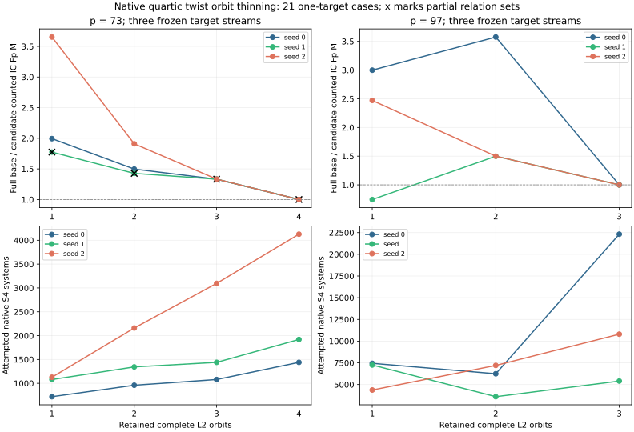

# Native orbit-complete thinning in quartic-twist polynomial index calculus

23 October 2026. This is the complete native test of the 21 choices frozen in the [protocol](QUARTIC_TWIST_LINE_PROTOCOL.md), following the [ideal exact-oracle survey](K1_ORBIT_THINNING.md). The public synthetic target is `[271]G` on each of six frozen p=73/97 residual streams. The [run index](K1_THIN_NATIVE_RUNS.md) links all 42 first/A/A raw records, independent audits, plots, PDFs, and exact source and record hashes. The [machine validator](K1_THIN_NATIVE_VALIDATION.json) recomputes the grid summary from those records.

## Question and method

The 24-action on the quartic twist makes each complete nonzero `L2` orbit 12 physical factors but one folded log column. The restricted mixed `k=1` collector peels each signed `L2` factor, solves one symmetrised `S4` system for three `L0` factors, and keeps every rank-increasing verified relation. Thinning reduces systems and unknown columns, but can reduce relation yield and increase the number of residuals needed. The ideal oracle predicted the tradeoff; this native run executes the polynomial solver on every preselected subset, without selecting an apparent winner after seeing its hits.

Every candidate retains all `L0` points and the first `j` complete `L2` orbits by original physical index. It constructs the full base and verified full orbit map first, then charges the proper-subset map too. The target, full-base signs, residual `(a,b)` order, interpolation RNG, solver, row selection, 8 GiB address-space cap and 1,200 s per-process watchdog are frozen. Each first run has an A/A repeat. The independent point-keyed auditor reconstructs each subset from the original full base, computes complete signed sets for every processed residual, independently obtains factor logs by BSGS, rebuilds the folded matrix, and checks `[271]G=Q`.

## Every native one-target result

`Exact/poly` compares complete signed group relations with the native polynomial output on the *processed prefix*. `Full/candidate` is the same-seed full-base counted IC `Fp M` divided by the candidate count. `IC/rho` is candidate counted `Fp M` divided by the same-target twist24 rho count. Neither ratio is a priced `S` or timing ratio. Every row reaches full anchored rank and independently recovers 271.

| p/seed | L2 orbits | Physical base / columns | Residuals | Exact/poly | S4 attempts/failures | Counted IC Fp M | IC group ops | Full/candidate Fp M | IC/rho Fp M | Audit |
|:--|--:|:--|--:|:--|:--|--:|--:|--:|--:|:--|
| 73/0 | 1 | 60/5 | 30 | 6/6 | 720/0 | 445,445,605 | 10,701 | 1.994× | 897× | [pass](quartic_twist_k1_thin_p73_seed0_j1_audit_v1.json) |
| 73/0 | 2 | 72/6 | 20 | 6/6 | 960/0 | 593,181,104 | 11,095 | 1.497× | 1,194× | [pass](quartic_twist_k1_thin_p73_seed0_j2_audit_v1.json) |
| 73/0 | 3 | 84/7 | 15 | 7/7 | 1,080/0 | 666,998,170 | 11,760 | 1.332× | 1,342× | [pass](quartic_twist_k1_thin_p73_seed0_j3_audit_v1.json) |
| 73/0 | 4 | 96/8 | 15 | 8/8 | 1,440/0 | 888,203,272 | 9,988 | 1.000× | 1,788× | [pass](quartic_twist_k1_thin_p73_seed0_j4_audit_v1.json) |
| 73/1 | 1 | 60/5 | 45 | 8/6 | 1,080/1 | 667,133,505 | 12,209 | 1.774× | 1,818× | [partial](quartic_twist_k1_thin_p73_seed1_j1_audit_v1.json) |
| 73/1 | 2 | 72/6 | 28 | 9/7 | 1,344/1 | 829,490,482 | 12,141 | 1.427× | 2,260× | [partial](quartic_twist_k1_thin_p73_seed1_j2_audit_v1.json) |
| 73/1 | 3 | 84/7 | 20 | 10/8 | 1,440/1 | 888,451,433 | 12,564 | 1.332× | 2,421× | [partial](quartic_twist_k1_thin_p73_seed1_j3_audit_v1.json) |
| 73/1 | 4 | 96/8 | 20 | 11/9 | 1,920/1 | 1,183,617,228 | 10,891 | 1.000× | 3,225× | [partial](quartic_twist_k1_thin_p73_seed1_j4_audit_v1.json) |
| 73/2 | 1 | 60/5 | 47 | 5/5 | 1,128/0 | 696,092,141 | 12,281 | 3.653× | 1,446× | [pass](quartic_twist_k1_thin_p73_seed2_j1_audit_v1.json) |
| 73/2 | 2 | 72/6 | 45 | 6/6 | 2,160/0 | 1,331,570,891 | 14,074 | 1.910× | 2,766× | [pass](quartic_twist_k1_thin_p73_seed2_j2_audit_v1.json) |
| 73/2 | 3 | 84/7 | 43 | 11/11 | 3,096/0 | 1,907,506,701 | 16,014 | 1.333× | 3,963× | [pass](quartic_twist_k1_thin_p73_seed2_j3_audit_v1.json) |
| 73/2 | 4 | 96/8 | 43 | 15/15 | 4,128/0 | 2,542,727,892 | 15,084 | 1.000× | 5,283× | [pass](quartic_twist_k1_thin_p73_seed2_j4_audit_v1.json) |
| 97/0 | 1 | 48/4 | 310 | 4/4 | 7,440/0 | 4,616,280,829 | 38,187 | 2.998× | 5,754× | [pass](quartic_twist_k1_thin_p97_seed0_j1_audit_v1.json) |
| 97/0 | 2 | 60/5 | 130 | 8/8 | 6,240/0 | 3,870,889,536 | 24,149 | 3.575× | 4,825× | [pass](quartic_twist_k1_thin_p97_seed0_j2_audit_v1.json) |
| 97/0 | 3 | 72/6 | 310 | 16/16 | 22,320/0 | 13,839,508,536 | 53,111 | 1.000× | 17,249× | [pass](quartic_twist_k1_thin_p97_seed0_j3_audit_v1.json) |
| 97/1 | 1 | 48/4 | 302 | 4/4 | 7,248/0 | 4,496,535,068 | 37,541 | 0.745× | 8,987× | [pass](quartic_twist_k1_thin_p97_seed1_j1_audit_v1.json) |
| 97/1 | 2 | 60/5 | 75 | 5/5 | 3,600/0 | 2,233,996,578 | 17,273 | 1.499× | 4,465× | [pass](quartic_twist_k1_thin_p97_seed1_j2_audit_v1.json) |
| 97/1 | 3 | 72/6 | 75 | 6/6 | 5,400/0 | 3,349,559,070 | 17,475 | 1.000× | 6,695× | [pass](quartic_twist_k1_thin_p97_seed1_j3_audit_v1.json) |
| 97/2 | 1 | 48/4 | 182 | 4/4 | 4,368/0 | 2,710,417,878 | 25,189 | 2.471× | 3,424× | [pass](quartic_twist_k1_thin_p97_seed2_j1_audit_v1.json) |
| 97/2 | 2 | 60/5 | 150 | 5/5 | 7,200/0 | 4,465,588,225 | 26,573 | 1.500× | 5,642× | [pass](quartic_twist_k1_thin_p97_seed2_j2_audit_v1.json) |
| 97/2 | 3 | 72/6 | 150 | 6/6 | 10,800/0 | 6,696,848,851 | 28,588 | 1.000× | 8,461× | [pass](quartic_twist_k1_thin_p97_seed2_j3_audit_v1.json) |

The largest *observed* same-seed full/candidate counted `Fp M` ratio among proper subsets is 3.653× at p=73 seed 2, j=1, and 3.575× at p=97 seed 0, j=2. These maxima are descriptive post hoc statistics; they are not a preselected one-target speed claim. The plotted curves and table retain every slower or partial choice.

## Audit and failure accounting

The validator confirms 21/21 full-rank scalar recoveries, exact phase-sum field and group counters, 21 empty first/A/A non-timing diffs, byte-identical independent audit outputs, six exact full-base source parities against the older producer, and a rejected subset-index mutation. It checks the ideal oracle's exact prefix count, the S4 peel-attempt count, and every recorded exit code. There are 17/21 exact native relation-set cases. All four p=73 seed-one subset cases retain one failed S4 system and miss two real signed relations on their processed prefix; all still recover the target. They are marked `partial`, not exact relation-finder passes.

## Cost boundary and interpretation

The native counted IC `Fp M` interval includes model, twist geometry and eigenvalues, full-base construction, the full orbit map, proper subset orbit map, S4 precomputation, residual generation, every attempted polynomial system, matrix-path verification and answer checks. Group additions and modular matrix work are separate counters. The public known-answer input construction is explicit but excluded from both compared target-solving intervals. The ideal exact oracle is a reference audit, not candidate relation work.

Hash/tree and allocator CPU, requested peak memory, rho native hash CPU, calibrated group/field exchange band, isolated interleaved timing and same-input msolve/Magma controls remain unmeasured. The field-work ratios are a measured arithmetic-path comparison on the frozen small-field cases, not a priced whole-method `S`, wall-time or external-solver result. The per-row IC/rho counted field-work gap remains large, so these data do not establish an ECDLP advantage over matched rho or an asymptotic crossover. The open [pricing and solver-completeness problem](../../problems/quartic-twist-polynomial-ic-pricing.md) records the remaining gates.
