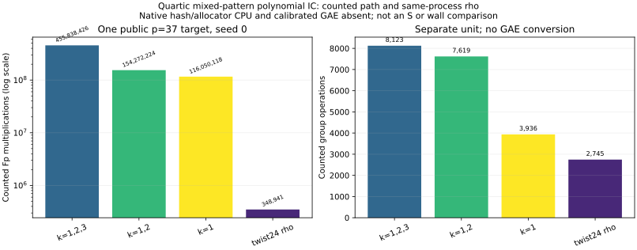

# Mixed-component polynomial index calculus on the quartic twist

22 October 2026. Public synthetic one-target experiment on the canonical
`p=37, b0=2` twist over `Fp[t]/(t⁴-d)`, with prime subgroup order
`r=1,873,633`, generator `G`, and target `Q=[271]G`. The [frozen protocol](QUARTIC_TWIST_LINE_PROTOCOL.md)
registered the four-residual pattern pilot, subsequent one-target solve,
adaptive controls, and bounded S5 degree retries before each implementation
or follow-up. This report replaces the earlier statement that the tagged
line-0/line-2 polynomial relation finder had not been tested. The full
two-dimensional polynomial finder remains unimplemented.

## Answer to the symmetry question

The transported Frobenius `ψ` and cubic automorphism `ι` preserve two usable
abscissa lines, `L0=Fp` and `L2=t²Fp`, on this twist. Their combined signed
action has order 24; every nonzero physical abscissa has an orbit of 12.
The 48-point union base consists of 36 `L0` and 12 `L2` abscissae, but only
**four independent factor-log columns** (three from `L0`, one from `L2`).
This has two distinct effects:

1. **Relation yield:** Adding the 12 physical `L2` points gives decompositions
   with mixed line tags. The action alone does not change the number of
   decompositions for a fixed physical base and fixed residual. A globally
   transformed relation is a covariant row, not an independent new equation
   for the original residual.
2. **Rank and polynomial degree:** Restricting to three `L0` factors and one
   `L2` factor lets us peel a signed `L2` point and solve a degree-four
   summation polynomial in **three** symmetric variables. The four signed
   `k=1` relations found in eight frozen residuals have anchored rank four,
   enough to solve the three unknown factor logs and the target log. Without
   the 12-fold abscissa orbit folding, four rows cannot determine the 48
   anchored flat unknowns; cubic-only folding leaves 16 anchored unknowns.
   The public generator factor log is fixed to one in all three counts.

This is a concrete way twist symmetry helps *polynomial relation finding*:
it creates a stable mixed-component decomposition with a cheaper peeled
polynomial, and makes a small number of those relations sufficient for rank.
The one-target field-work count remains above matched twist-folded rho on
this tested curve. It is a verified mechanism and a polynomial IC solve, not
an IC-versus-rho speedup or a general asymptotic improvement.

## Algebra and completeness obligations

Write `S3(x,y,z)` for the degree-three summation polynomial of the actual
`a=0` twist. With `e1=x+y`, `e2=xy`, and a fixed residual abscissa `z`,

`S3 = z²(e1²-4e2) - z(2e1e2+4b) + e2²-4be1`.

The native producer evaluates the four `Fp` coordinates of this equation
after Weil restriction to `Fp⁴`. Its `k=2` arm peels two distinct signed
`L2` points and scans all `p²` pairs `(e1,e2)∈Fp²` for the remaining two
`L0` abscissae. It then splits the quadratic, enforces base membership and
distinctness, enumerates physical signs and verifies each four-point sum.
The explicit scan is complete at `p=37`; the earlier generic Macaulay solve
was not. The identity has checked certificate
[`IDC1h353e9e2256385dd8`](quartic_twist_s3_symmetric_identity.json).

For `k=1` and `k=3`, the producer peels one signed point and uses
`S4(x1,x2,x3,z)=Res_u(S3(x1,x2,u), S3(x3,z,u))`. If
`A=a2 u²+a1 u+a0` and `B=b2 u²+b1 u+b0`, their Sylvester resultant is

`(a2 b0-a0 b2)² - (a2 b1-a1 b2)(a1 b0-a0 b1)`.

The code evaluates this exact resultant, interpolates it in the three
elementary symmetric functions of `x1,x2,x3` at 35 full-rank samples, and
checks 16 independent fresh samples before each solve. The resultant
identity has checked certificate
[`IDC1hb4b71bf7bd6cba4e`](quartic_twist_s4_resultant_identity.json).
These certificates verify 32 sealed and 32 independent field evaluations
each; they are finite evaluations, not a formal proof of the entire
finite-field or elliptic-curve model. The explicit quadratic resultant
formula above supplies the algebraic derivation. Each candidate still
passes a group-law check. Completeness on the frozen residuals is checked
separately against a **scalar-keyed** auditor that enumerates all 1,873,633
subgroup logs and builds a 4,512-posting signed-pair reference independently
of the polynomial producer's point-keyed oracle.

For pattern `k` with `k` `L2` factors, a uniform-residual occupancy heuristic
is `16 C(36,4-k) C(12,k)/r` signed distinct relations per residual. This
counts the physical signs; it is an expectation under a uniformity model,
not a measured law or a rank guarantee. The observed first four residuals
are fixed by the earlier exact-oracle trace:

| `k` | Expected per residual | First-four signed relations | Polynomial path | Four-residual audit |
| ---: | ---: | ---: | --- | --- |
| 0 | 0.503 | 2 | single-line S5 | **partial**: 1 relation missed at residual 2 |
| 1 | 0.732 | 2 | 24 signed peels, S4 in 3 symmetric variables per residual | complete |
| 2 | 0.355 | 1 | 264 signed pair peels, explicit S3 symmetric scan per residual | complete after the recorded solver repair |
| 3 | 0.068 | 0 | 72 signed peels, S4 on `L2` per residual | complete on zero reference sets |
| 4 | 0.004 | 0 | single-line S5 | **partial**: one system failed, despite zero reference relations |

The [five-arm pilot audit](quartic_twist_tagged_s5_audit_p37_v1.json) and its
[final-source A/A audit](quartic_twist_tagged_s5_audit_p37_final_v1.json) confirm
all five signed reference relations and mark `k=0,4` incomplete. The
first `k=2` run is retained as a [failed generic-solver record](quartic_twist_tagged_s5_k2_p37_v1.json):
1,056 systems failed to recover a known solution. The explicit `Fp²` scan
in [version 2](quartic_twist_tagged_s5_k2_p37_v2.json) recovered the
complete signed set on all four residuals. `k=1` used about 14.2 million
internal `Fp` multiplications per query and `k=2` about 7.45 million;
`k=3` used about 42.8 million. Direct `S5` cost roughly 1.14–1.17 trillion
`Fp` multiplications on each successful completion at this small prime.
These are stage costs for different pattern subsets, not same-computation
speed ratios. They have no same-input msolve or Magma baseline.

The subsequent [degree-30](quartic_twist_tagged_s5_k0_q2_d30_p37_v1.json)
and [degree-31](quartic_twist_tagged_s5_k0_q2_d31_p37_v1.json) retries of
the `k=0`, residual-2 S5 failure still returned “border unreachable at
this degree” and missed the independently verified relation. The matching
[`k=4` degree-30](quartic_twist_tagged_s5_k4_q2_d30_p37_v1.json) and
[degree-31](quartic_twist_tagged_s5_k4_q2_d31_p37_v1.json) runs also failed
to close the border. Each remained under the frozen 8 GiB/1,200 s cap. The
repeated 4,090-dimensional quotient is evidence about this native solver,
not a proof that S5 or a different Gröbner algorithm cannot solve the
system. The degree-29 and failed `k=2` records remain untouched.

## Complete mixed-pattern one-target path on the frozen instance

The producer reconstructs the curve, 48 physical points, 24-action
eigenvalues and four orbit columns; interpolates `S4`; processes only the
listed polynomial patterns; retains every rank-raising row; solves the
anchored linear system; and verifies all 48 physical factor logs and the
target. Its relation path never calls the exact group-pair oracle and never
reads the target's known scalar. The fixture constructs `Q=[271]G` before
the online interval; that input-construction work is reported separately.
All three arms reuse the *same frozen seed-zero residual stream* and run
the strongest available 24-fold rho on `Q` in the same process.

| Enabled patterns | Residuals to anchored rank 4 | Selected distinct signed rows | Counted cold IC `Fp M` | Counted cold IC group ops | Matched rho `Fp M` / group ops | Independent audit |
| --- | ---: | ---: | ---: | ---: | ---: | --- |
| `k=1,2,3` | 7 | 4 | 455,838,426 | 8,123 | 348,941 / 2,745 | [pass](quartic_twist_mixed_polynomial_ic_audit_p37_v3.json) |
| `k=1,2` | 7 | 4 | 154,272,224 | 7,619 | 348,941 / 2,745 | [pass](quartic_twist_mixed_polynomial_ic_k12_audit_p37_v1.json) |
| `k=1` | 8 | 4 | **116,050,118** | **3,936** | 348,941 / 2,745 | [pass](quartic_twist_mixed_polynomial_ic_k1_audit_p37_v1.json) |

The `k=1` run attempted **192 S4 systems** across eight residuals, obtained
four field solutions and four complete distinct signed relations, and
recovered 271 at anchored rank four. Its solved non-anchor factor logs are
`1,314,930`, `793,221`, and `632,518`. The independent auditor recomputed
all processed signed sets with subgroup-log enumeration, reconstructed the
orbit coefficient map and matrix with separate elimination, and verified
the factor logs, target and rho replay. The [primary record](quartic_twist_mixed_polynomial_ic_k1_p37_v1.json)
and [A/A record](quartic_twist_mixed_polynomial_ic_k1_p37_aa_v1.json) have
an [empty complete non-timing diff](quartic_twist_mixed_polynomial_ic_k1_p37_aa_v1.diff);
the two independent audit outputs agree exactly. The `k=1,2` A/A diff is
also [empty](quartic_twist_mixed_polynomial_ic_k12_p37_aa_v1.diff), and
the full-path final-source [v2/v3 diff](quartic_twist_mixed_polynomial_ic_p37_v2_v3.diff)
is empty after accounting for the explicit enabled-pattern flag.

For the **same target and counted field unit**, pruning `k=2,3` changes
455,838,426 to 116,050,118 `Fp M`, a 3.928-fold decrease, even though it
needs one additional residual. The `k=3` arm contributed no relation before
rank completion, and `k=2` was not needed for this one target. This is an
adaptive finding from the pilot and initial full run, not evidence of the
same choice's performance on other curves, seeds or targets. The earlier
tagged-dense exact *group-oracle* path costs 89,828,606 counted `Fp M` on
a different 624-point base and residual policy; it is not a matched
polynomial baseline for this row.

The `k=1` IC/rho ratios are **332.6** in the separately counted `Fp M`
unit and **1.434** in counted group operations. These cannot be combined
into an admitted cost `S`: the polynomial solver's hash/tree operations,
allocator CPU and requested peak bytes, and rho's partition hash/table CPU
are absent. The L0 wall observations are on a shared host; no ABAB isolation
or 0/0.1/1 GAE band is available. A same-input msolve/Magma comparison has
not been run. Consequently there is **no priced whole-method speed result**
and no new row in leaderboard tables A–C or `benchmarks/README.md` under
the repository validation gate. The generated leaderboard carries only a
separate evidence-linked component panel.

## Scope, scaling, and next discriminators

This result verifies one p=37 target on one 48-point mixed base. It does
not imply an asymptotic gain. If both stable line sizes scale as `Θ(p)` and
`r=Θ(p⁴)`, the `k=1` occupancy above is `Θ(1)` per residual, while the
folded column count is `Θ(p)`. If rows remain generically independent and
the explicit `O(p)` signed-peel S4 systems remain bounded-cost per system
in `Fp` operations, this *specific* strategy needs `Θ(p²)=Θ(r^1/2)`
field operations overall. The constant-cost assumption for S4 is not
established; larger-field Gröbner complexity can change it. This is a
heuristic for the current algorithm, not a lower bound on all polynomial
finders. A 2D invariant base offers more physical points but has a much
larger system or pair search; a tagged 2D polynomial formulation is still
missing. Curve twists can also give rho the same automorphism discount, as
the matched control explicitly reflects.

| Requested check | Status and exact gap |
| --- | --- |
| Symmetry for polynomial relation finding | **Verified on this instance:** stable `L0/L2`, 24 action, lower-variable peeled S4, complete `k=1,2,3` signed sets on the audited prefix. |
| Mixed-base unique traces, rank and one target | **Verified on this instance:** `k=1` gives four distinct rows, anchored rank four, all logs and target independently replayed. |
| Full union S5 completeness | **Partial:** `k=0` misses one relation; `k=4` has a failed system. Degrees 29–31 do not repair the native border failure. |
| Complete native cost and rho crossover | **Partial:** field/group counts and in-process rho exist; hash/allocator CPU, peak bytes, calibrated GAE and isolated intervals are missing. |
| External solver and scaling controls | **Not attempted here:** export the same four-coordinate S4/S5 systems to msolve (Magma if available), and run a frozen p=73/p=97 one-target panel. |

The [problem record](../../problems/quartic-twist-polynomial-ic-pricing.md)
states checkable exit criteria for the native accounting, S5 failure and
larger-size controls. The exact-oracle [main twist report](QUARTIC_TWIST24_REPORT.md)
and its graphs retain their original scope. The canonical leaderboard
component graph is updated; the priced IC/rho graphs are unchanged because
this run lacks the validation receipt required for a priced row.

## Reproducibility and visual records

Native source: [pattern solver](../../examples/quartic_twist_tagged_s5.rs),
[one-target producer](../../examples/quartic_twist_mixed_polynomial_ic.rs),
[independent scalar-keyed auditor](../../examples/quartic_twist_mixed_polynomial_ic_audit.rs),
and [identity-certificate checker](../../examples/quartic_twist_polynomial_certificate.rs).
The [run-report index](MIXED_POLYNOMIAL_RUNS.md) links each first run,
A/A control, retained failure, bounded degree retry, graph and PDF. The
[results PDF](MIXED_POLYNOMIAL_REPORT.pdf) embeds the counted-cost figure.
