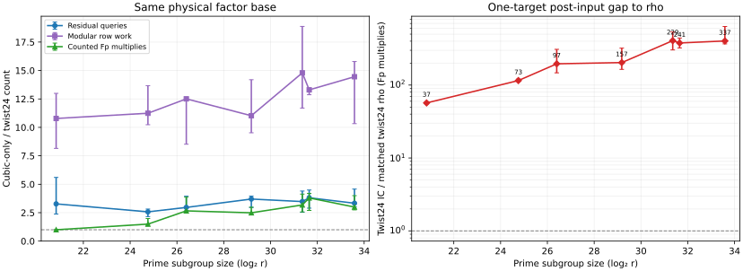
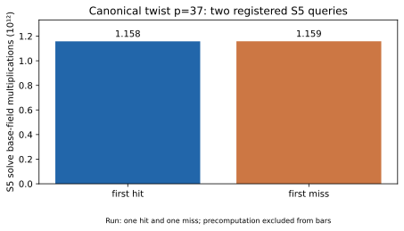
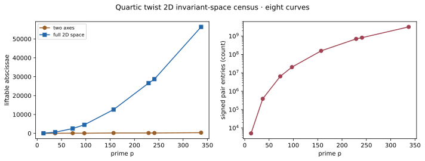
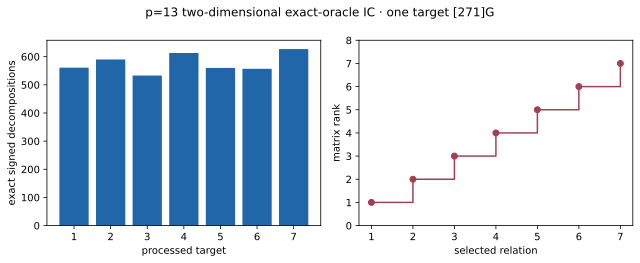
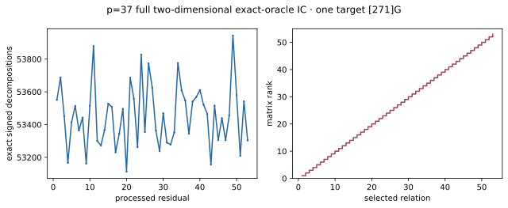
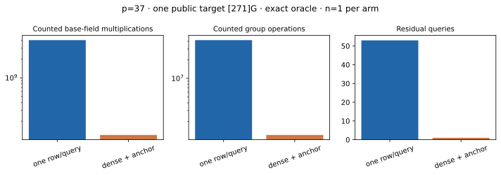
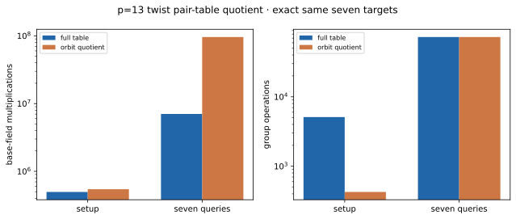
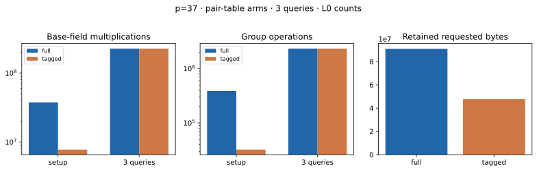
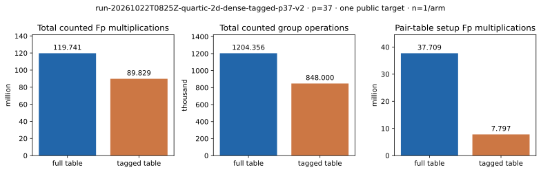

# Twist symmetry in quartic extension index calculus

22 October 2026 · exact small-field study · all reported logarithms are public known answers

## Question, scope, and prior work

The question was whether a twist can supply a symmetry that makes elliptic-curve index-calculus relations more useful, and whether a mixed extension-field factor base can raise relation yield enough to offset its added cost. This report studies a canonical quadratic twist over `Fp⁴`: a fixed one-line base, the union of its two usable one-dimensional lines, the full invariant two-dimensional abscissa space, twist-orbit pair indexes, and dense extraction of independent rows from one residual. The DLP target is on the twist itself. The earlier [mixed-component study](MIXED_REPORT.md) concerned rational targets on the original curve and found an odd-order projection obstruction; it does not apply to the direct twist-subgroup targets here.

Frobenius-invariant factor bases and their relation/matrix savings are established in [Galbraith–Granger–Merz–Petit, *On Index Calculus Algorithms for Subfield Curves*](https://pure-oai.bham.ac.uk/ws/portalfiles/portal/104974339/On_Index_Calculus_Algorithms_for_Subfield_Curves.pdf), especially §3.2 and its discussion of polynomial-system costs. [GLS](https://eprint.iacr.org/2008/194.pdf) supplies transported Frobenius endomorphisms on twists, and [Chi-Domínguez–Rodríguez-Henríquez–Smith](https://arxiv.org/abs/2106.09967) applies a GLS-derived endomorphism to index calculus after Weil descent in characteristic two. The repository's [E18 study](../notes/index-calculus/RESEARCH_GLV_INVARIANT_FACTOR_BASES.md) already measured the cubic `j=0` automorphism on a quartic line. The results here make an explicitly checked order-24 *combined* action on the canonical quartic twist, a paired fully replayed line-union yield comparison, full 2D exact-oracle rank solves, and a counted dense-row improvement concrete. The public known-log anchor in the dense experiment is a generic index-calculus step; this report does not claim that twist symmetry alone causes its gain or claim priority for Frobenius orbit folding.

The [frozen protocol](QUARTIC_TWIST_LINE_PROTOCOL.md), [structural probe](gls_quartic_twist_probe_v1.ndjson), [line sweep](gls_quartic_line_sweep_v1.ndjson), [v2 same-base raw records](quartic_twist24_full_v2.ndjson), [mixed-line raw records](quartic_twist_mixed_v1.ndjson), [native replay](quartic_twist_mixed_native_audit_v1.json), and [validation receipt](VALIDATION_RECEIPT.md) are separate artifacts. The native producer is [quartic_folds.rs](../../src/cryptanalysis/quartic_folds.rs); the full-run drivers are [quartic_twist24.rs](../../examples/quartic_twist24.rs) and [quartic_twist_mixed_lines.rs](../../examples/quartic_twist_mixed_lines.rs).

Write-once run reports: [v2 first run](reports/run-20261022T0542Z-quartic-v2/README.md), [v2 A/A](reports/run-20261022T0543Z-quartic-v2-aa/README.md), [mixed first run](reports/run-20261022T0551Z-quartic-mixed/README.md), [mixed A/A](reports/run-20261022T0552Z-quartic-mixed-aa/README.md), [three S5 pilots](reports/run-20261022T0616Z-quartic-s5-p37/README.md), [2D census](reports/run-20261022T0621Z-quartic-2d-census/README.md), [p=13](reports/run-20261022T0626Z-quartic-2d-p13/README.md) and [p=37](reports/run-20261022T0717Z-quartic-2d-p37/README.md) 2D IC pilots, [pair-table quotient](reports/run-20261022T0644Z-quartic-pair-quotient/README.md), [tagged full-stream replay](reports/run-20261022T0720Z-quartic-tagged-direct_full-p37/README.md), [dense p=13](reports/run-20261022T0729Z-quartic-2d-dense-p13/README.md)/[p=37](reports/run-20261022T0729Z-quartic-2d-dense-p37/README.md) solves, and the [combined tagged-dense p=37 run](reports/run-20261022T0758Z-quartic-2d-dense-tagged-p37/README.md) with its [A/A report](reports/run-20261022T0758Z-quartic-2d-dense-tagged-p37-aa/README.md). The [open-problem record](OPEN_PROBLEMS.md) gives checkable exit criteria for the missing full polynomial pipeline, calibrated complete cost, larger bases and Lean field proof.

The combined producer also has a [final-source rerun](reports/run-20261022T0825Z-quartic-2d-dense-tagged-p37-v2/README.md) and [A/A rerun](reports/run-20261022T0825Z-quartic-2d-dense-tagged-p37-v2-aa/README.md); their complete non-timing records match the first committed run.

| Requested check | Result and evidence |
| --- | --- |
| Twist-derived symmetry on the actual DLP subgroup | Order-eight transported Frobenius plus order-three cubic automorphism, with order-24 signed point orbits. Checked on all base points and prime-order certificates in the [probe audit](gls_quartic_twist_verify_v1.json). |
| Unique traces and matrix rank on a mixed extension base | All 42 single/union runs solve and independently replay their rows; full 2D p=13/p=37 exact-oracle pilots reach rank 7/53 and recover 271 with independent signed-pair and subgroup-log audits. Dense anchored extraction reaches rank 6/52 from the first residual on each curve. |
| Relation yield and full cost | Same target streams and 69,045 processed line-panel queries; p=37 first 53 shared queries give 24/43/53 hits on line 0/two-line/full-2D bases. Dense exact-oracle p=37 cuts counted one-target `Fp M` from 4,048,104,018 to 119,740,945; combining it with the tagged pair index in one producer cuts the same counted path to 89,828,606. The combined producer also records hash lookups and requested allocation, but polynomial solving, a calibrated GAE total and isolated whole-process timing remain unpriced. |
| Symmetry inside the relation finder | A 12-action pair orbit reduces p=37 full-2D setup from 388,752 to 32,396 group additions with complete relation-set equality on all 53 frozen residuals. Its direct-posting table retains 47.7 MB against 91.0 MB allocator-requested payload, but the full 53-query counted `Fp M` reduction is only 1.00746×. |
| Actual polynomial index-calculus oracle | The 42-run relation panel uses an exact signed four-factor meet-in-the-middle oracle. A separately frozen [six-query S5 pilot](quartic_twist_s5_p37.json) executes the repository's native single-line S5 solver on the same canonical twist; all six outputs match the group oracle. The mixed-line polynomial system and full S5 relation collection are untested. The earlier repository [E2b line oracle](../../src/cryptanalysis/line_oracle.rs) implemented a Weil-descent `S3` resultant for a different GLS panel. |

## Construction and proof of the 24 action

Let `p ≡ 1 (mod 12)`, let `d` be the least quadratic nonsquare in `Fp`, and put `F=Fp[t]/(t⁴−d)`. Since `d` is a nonsquare and `4 | p−1`, this binomial is irreducible. Fix `E0/Fp: y²=x³+b0`, and study its canonical quadratic twist `E/F: y²=x³+b0 t³`. The element `t` is nonsquare in `F`. Set `h=t^((1−p)/2)`, `z=t^(p−1)∈Fp` (order four), and choose `ω∈Fp` of order three. The maps are

`ψ(x,y)=(h²x^p,h³y^p)`, and `ι(x,y)=(ωx,y)`.

Substitution into the curve equation proves that both maps preserve `E`, and they commute because `ω∈Fp`. The norm identity `h^(1+p+p²+p³)=t^(-(p⁴−1)/2)=−1` gives `ψ⁴(x,y)=(x,−y)`. Therefore `ψ` has order eight on a nonzero odd-order point; `ι` has order three. On the tested prime-order group, the checked scalar eigenvalues satisfy `λψ⁴=−1` and `λι³=1` modulo `r`. Their orders are eight and three; hence the combined signed action has order 24. For each nonzero liftable abscissa in a stable line, the abscissa orbit has 12 members and the signed point orbit 24. A physical base of `B` abscissae therefore has `B/12` log columns, versus `B/3` under the cubic automorphism alone. The fold changes the row coefficient to `Σ s_i λψ^{j_i} λι^{k_i}` modulo `r`; the native audit checks this scalar identity for every base point and reconstructs every emitted row.

The four `p`-Frobenius eigenlines of the abscissa field are `t^j Fp`, `j=0,1,2,3`. On line `j`, the abscissa action is multiplication by `z^(j−1)`. Lines 0 and 2 are stable with abscissa orbit size four under `ψ`. For line 1, `ψ` fixes `x`, which would force `ψ(P)=±P`; for line 3, `ψ²` fixes `x`, which would force `ψ²(P)=±P`. Both contradict `ψ⁴(P)=−P` on a nonzero point of an odd-prime-order group. Thus lines 1 and 3 have no usable points under these hypotheses. The exhaustive character sweep found exactly that for all eight registered curves.

The point-order certificate is particularly direct: `r` is prime, a nonzero recorded point satisfies `[r]P=O`, and `r>4p²`, the width of the Hasse interval for `Fp⁴`. The only multiple of `r` in that interval is `r`, so `#E(Fp⁴)=r`. The `p=13,b0=4` control also has a direct abscissa census and has **no points on any of the four lines**. It is a real empty-base exception, retained in the raw record.

| `p,b0` | `r` | line 0 abscissae | line 2 abscissae | line 1/3 | line 0 columns → union columns |
| --- | ---: | ---: | ---: | ---: | ---: |
| 13,4 | 28,753 | 0 | 0 | 0/0 | none |
| 37,2 | 1,873,633 | 36 | 12 | 0/0 | 3 → 4 |
| 73,5 | 28,408,033 | 48 | 48 | 0/0 | 4 → 8 |
| 97,5 | 88,538,353 | 36 | 36 | 0/0 | 3 → 6 |
| 157,25 | 607,561,153 | 108 | 84 | 0/0 | 9 → 16 |
| 229,6 | 2,750,120,881 | 96 | 96 | 0/0 | 8 → 16 |
| 241,49 | 3,373,515,841 | 96 | 96 | 0/0 | 8 → 16 |
| 337,100 | 12,897,718,513 | 180 | 180 | 0/0 | 15 → 30 |

## What symmetry can and cannot do to relation yield

At a **fixed physical base**, orbit folding does not change whether a queried residual has a four-factor decomposition. It reduces the number of independent log columns and therefore the number of relations needed to determine the target. If a witness for `R=aG+bQ` is transformed by `ψ` or `ι`, the target becomes the corresponding scalar multiple of `R`; after folding its row and right-hand side are scaled by the same eigenvalue. This is row covariance, not a new independent row for the same target. In particular, globally transforming all factors does not permit transforming a single summation-polynomial variable while holding the other factors and target fixed; the earlier [S3 scaling control](gls_semaev_scaling_v1.json) contains explicit counterexamples.

The line union `L0∪L2` is a different lever. It adds genuine physical factor points while retaining the same 24 action on each of the two disjoint line components. The four-factor search space grows roughly with `binomial(B,4)` before collisions and dependencies; the pair table and per-query work grow roughly with `B²`. The test below measures the actual balance rather than treating the combinatorial estimate as a result.

## Fixed physical base: 21 matched single-target instances

The frozen panel runs seeds `0,1,2` on seven positive curves, one public target `[271]G` per run. The *same* signed points, 64-wide residual stream, exact four-factor oracle, selected decomposition and stopping rule feed flat, cubic-only and combined twist24 matrices. All **63 IC solves** recovered `271`; all **1,008 rho walks** across negation, cubic and full24 folds recovered `271`. The [native audit](quartic_twist24_native_audit_v2.json) independently reconstructs factor points, coefficients, 1,821 selected group relations, encoded rows, row spans, and scalar answers. A second full run has identical non-timing records: [A/A diff](quartic_twist24_v2_aa.diff) is empty.

The table reports medians over three separate one-target runs. `M` counts recorded base-field multiplications on the indicated IC path, including the relevant model/eigen setup, base, map, table, stream and scalar verification; modular row operations are a **separate** unit. `rho24` is the strongest same-target fold and includes its eigen setup. Ratios are medians of paired run ratios, not ratios of pooled target batches. These counts are L0 diagnostics, not calibrated complete `S` values.

| `p` | flat / cubic / twist columns | cubic / twist queries | cubic / twist row operations | cubic / twist counted `M` | twist `M` / rho24 `M` |
| ---: | :---: | ---: | ---: | ---: | ---: |
| 37 | 36 / 12 / 3 | 3.27 | 10.78 | 0.998 | 55.5 |
| 73 | 48 / 16 / 4 | 2.57 | 11.24 | 1.49 | 112.9 |
| 97 | 36 / 12 / 3 | 2.96 | 12.51 | 2.66 | 192.9 |
| 157 | 108 / 36 / 9 | 3.70 | 11.03 | 2.49 | 201.9 |
| 229 | 96 / 32 / 8 | 3.48 | 14.79 | 3.18 | 404.6 |
| 241 | 96 / 32 / 8 | 3.81 | 13.30 | 3.80 | 376.8 |
| 337 | 180 / 60 / 15 | 3.33 | 14.45 | 2.99 | 402.1 |

The combined fold has exactly four times fewer columns than cubic-only on the same physical base. It needs fewer residual queries and row operations on every curve. Its counted `M` total is essentially tied at `p=37` because both arms stop in the same 64-query batch and the larger orbit map costs more. At larger curves its counted `M` path is lower, but even this *partial-cost* comparison remains far above matched rho. No asymptotic or deployed-curve security conclusion follows.

## Two-line union: 42 matched runs and every query replayed

The [registered mixed-line protocol](QUARTIC_TWIST_LINE_PROTOCOL.md) reruns both `L0` and `L0∪L2` for the same seven curves and seeds. The target `(a,b)` generator is independent of the decomposition/solver RNG, so the processed streams are exact prefixes on each paired run. The line-0 points retain identical signs. The [native audit](quartic_twist_mixed_native_audit_v1.json) confirms both facts; uses a second, fully signed two-pair hash oracle to recompute **all 69,045 query hit counts**; re-adds all **5,298 selected relations**; checks the **7,275 total decompositions** recorded by the producer; reconstructs all 126 flat/cubic/twist matrix solves and scalar answers; and checks that every line-0 hit in a shared prefix remains a union hit. The [full A/A diff](quartic_twist_mixed_v1_aa.diff) is empty across 42 non-timing records. The [native summary](quartic_twist_mixed_summary_v1.json) retains all 21 paired one-target rows.

`Yield` below is the median union/single ratio of successful residuals on the *same shared query prefix*. `Queries` is the median single/union number of residuals to the twist24 solve. `LA` is single/union modular row-operation count. `M` is single/union recorded field multiplications for the twist24 path, including model/input/eigen setup, base, twist map, pair table, stream through solve and its scalar verification. Other-arm verification, hash/table operations and allocation are not in `M`; thus `M` is an arithmetic projection, **not** a whole-method speedup. Error ranges for `M` are the minimum and maximum of three paired ratios.

| `p` | bases | 24-fold columns | shared hit yield | query ratio | `LA` ratio | `M` ratio (range) |
| ---: | :---: | :---: | ---: | ---: | ---: | :---: |
| 37 | 36 → 48 | 3 → 4 | 2.04 | 1.67 | 0.61 | 0.57 (0.57–0.57) |
| 73 | 48 → 96 | 4 → 8 | 8.82 | 4.82 | 0.30 | 0.26 (0.25–0.50) |
| 97 | 36 → 72 | 3 → 6 | 14.60 | 6.73 | 0.30 | 1.01 (0.76–1.26) |
| 157 | 108 → 192 | 9 → 16 | 5.68 | 3.72 | 0.34 | 0.63 (0.63–0.63) |
| 229 | 96 → 192 | 8 → 16 | 17.55 | 11.07 | 0.33 | 2.48 (1.25–2.98) |
| 241 | 96 → 192 | 8 → 16 | 14.85 | 7.08 | 0.23 | 1.49 (1.12–1.75) |
| 337 | 180 → 360 | 15 → 30 | 11.28 | 5.08 | 0.26 | 1.24 (0.99–1.24) |

The union raises raw hit yield on every tested curve, but it also increases columns and modular row work on every curve. Counted field multiplications favor the union consistently across all three seeds at `p=229,241`, favor the single line at `p=37,73,157`, and overlap one at `p=97,337`. This is a measured relation-yield gain and a conditional arithmetic tradeoff, not a blanket IC speedup. The full24 rho reference does not depend on factor-base choice; [the v2 rho records](quartic_twist24_full_v2.ndjson) are the matching reference for each target. The gap to rho remains large even where the union improves the field-multiplication projection.

## Native S5 pilot on registered single-line residuals

The repository already had a native symmetrized `S5` and Weil-descent solver in [gaudry_quartic.rs](../../src/cryptanalysis/gaudry_quartic.rs). The [pilot driver](../../examples/quartic_twist_s5_pilot.rs) ran it on the first successful and first unsuccessful `L0` query for seed zero at `p=37,73,97`, exactly as frozen before the pilot. Each result was compared with the exact signed group oracle and all solver-returned abscissa quadruples were checked by group addition. All **six** comparisons agree; each successful query has one quadruple and each miss has none. The raw records are [p=37](quartic_twist_s5_p37.json), [p=73](quartic_twist_s5_p73.json), and [p=97](quartic_twist_s5_p97.json). There were no censored or extraneous outcomes. The solver used the same Macaulay matrix shape at all three primes: 41,780 rows, 40,920 columns, 36,824 pivots and degree 29; symmetrization precomputation was 1,226,109,078 `Fp` multiplications per curve.

| `p` | first hit query | first miss query | hit solve `Fp M` | miss solve `Fp M` | hit/miss L0 solve ms |
| ---: | ---: | ---: | ---: | ---: | :---: |
| 37 | 0 | 1 | 1,157,849,935,909 | 1,158,550,910,260 | 52,254 / 58,214 |
| 73 | 25 | 0 | 1,203,345,274,881 | 1,188,991,913,245 | 53,078 / 48,964 |
| 97 | 14 | 0 | 1,211,126,402,567 | 1,197,004,768,304 | 52,246 / 50,045 |

The per-query field multiplication count is measured inside the native solver; the wall times are shared-host **L0** observations and are not a speed comparison. At `p=37`, one successful S5 solve uses about 68,549 times the **entire** 16,890,856-`M` partial arithmetic path of that seed's exact-oracle twist24 IC solve. This ratio compares two different relation-finding implementations in the same counted unit; it does not rank all possible Gröbner solvers. Magma and msolve were not on this host's `PATH` when checked on 22 October 2026, and a tagged-line union polynomial system was not implemented. The pilot establishes correctness and the cost of this particular native S5 path on two queries per curve, not the cost of a full polynomial IC solve.

## Two-dimensional invariant abscissae, including the empty-line control

The space `V=Fp+t²Fp` is stable under the combined action: `ψ` sends `a+b t²` to `h²(a−b t²)`, while `ι` scales both coefficients by `ω`. The [registered census](quartic_twist_2d_census_v1.ndjson) tested **every** nonzero `x∈V` on all eight curves. Its [independent native audit](quartic_twist_2d_native_audit_v1.ndjson) checked the quadratic-subfield norm criterion against the producer's `Fp⁴` character test for all **265,008** candidates, obtained a point on every abscissa orbit, and checked `ψ⁴(P)=−P`, commutation and the full 24-point signed orbit. Every nonempty abscissa orbit has size 12. The `p=13` curve, whose two one-dimensional lines are empty, has **72** liftable interior abscissae in `V` and six folded columns.

| `p` | two axes | interior | full `V` base | folded columns | signed pair entries `B(B−1)` |
| ---: | ---: | ---: | ---: | ---: | ---: |
| 13 | 0 | 72 | 72 | 6 | 5,112 |
| 37 | 48 | 576 | 624 | 52 | 388,752 |
| 73 | 96 | 2,448 | 2,544 | 212 | 6,469,392 |
| 97 | 72 | 4,464 | 4,536 | 378 | 20,570,760 |
| 157 | 192 | 12,384 | 12,576 | 1,048 | 158,143,200 |
| 229 | 192 | 26,424 | 26,616 | 2,218 | 708,384,840 |
| 241 | 192 | 28,512 | 28,704 | 2,392 | 823,890,912 |
| 337 | 360 | 56,016 | 56,376 | 4,698 | 3,178,197,000 |

The pair-entry column is a derived **work-size** count for the existing exact oracle, before hash collisions or allocation; it is not a measured memory footprint or relation yield. The `p=13` [bounded exact-oracle IC pilot](quartic_twist_2d_p13_v1.json) then used that revived base on one target `[271]G`: **7** processed queries yielded **4,041** signed decompositions, seven selected distinct relations, rank **7** over the six factor-log columns plus target, and recovered **271**. It checked every solved factor log by group multiplication. Its [independent replay](quartic_twist_2d_p13_native_audit_v1.json) enumerated all 28,753 group logarithms, recomputed every query's signed hit count with a separate pair hash, reconstructed all rows and ranks, and verified the answer. The [A/A rerun](quartic_twist_2d_p13_aa_v1.json) has an [empty non-timing diff](quartic_twist_2d_p13_aa.diff). The pilot counted 7,062,416 stream `Fp` multiplications, 72,897 stream group operations, 495,864 table `Fp` multiplications and 460 modular row operations; these are separate units. It is a small-field exact-oracle result, not a polynomial or whole-method speed comparison.

The next registered one-target pilot used the **full p=37 two-dimensional base**, with 48 signed axis points from the paired seed-zero union and 576 deterministically lifted interior points. It re-lifted and charged all 48 axes, checked every one of the **52** folded factor columns by group multiplication, and used the same target `[271]G`. Its first three `(a,b)` residuals exactly match the frozen line-0 stream. On the first **53** residuals, line 0 had **24** hits and 40 signed decompositions, the two-line union had **43** hits and 89 decompositions, and the full 2D base had **53** hits and **2,833,126** decompositions. These are measured on the same prefix and nested physical bases; the much larger number of decompositions is accompanied by much larger per-query pair work and 52 factor-log columns.

The [p=37 full-2D raw run](quartic_twist_2d_p37_v1.json) selected one verified relation per residual, reached matrix rank **53** for the 52 factor logs plus target after 53 queries, recovered **271**, and checked every solved factor log by group multiplication. The [independent native replay](quartic_twist_2d_p37_native_audit_v1.json) enumerated all **1,873,633** subgroup logs, recomputed all 53 signed hit counts from complete decomposition sets with a different point-keyed pair hash, checked each selected relation's membership, reconstructed every selected row and rank, and recovered the same answer. The [A/A non-timing diff](quartic_twist_2d_p37_aa.diff) is empty.

| p=37 exact-oracle phase | Counted `Fp M` | Counted group ops |
| --- | ---: | ---: |
| Model and full base, including axis relifts | 2,568,538 | 0 |
| Input, eigenvalues and orbit map | 1,898,403 | 17,726 |
| Full pair table | 37,708,944 | 388,752 |
| 53-query relation stream | 4,003,923,826 | 41,277,322 |
| Answer checks | 2,004,307 | 18,854 |

The separate matrix cost was **369,021** modular row operations. Total recorded `Fp M` across these phases is **4,048,104,018**; total recorded group operations are **41,702,654**. File parsing, hash work and allocation are not in those units. The shared-host L0 wall observation was 20.23 s and is not an isolated speed claim. This is a full-rank **exact group-oracle** IC pilot, not a polynomial relation-finding run or a cold, calibrated comparison to rho. The [run report](reports/run-20261022T0717Z-quartic-2d-p37/README.md) and [A/A report](reports/run-20261022T0717Z-quartic-2d-p37-aa/README.md) include the commands, source digests, graph and PDFs.

## Dense relations from one residual: rank and public anchor

The earlier p=13 and p=37 pilots **discarded all but one decomposition per successful residual**, even when the exact oracle returned hundreds or tens of thousands. The [registered dense experiment](QUARTIC_TWIST_LINE_PROTOCOL.md) processed the complete first-residual decomposition set in lexicographic order and retained each row only if it raised rank. It also used the public fact that the first factor-base point is the generator `G`, so its factor log is **1**. That known column was moved to the right side before elimination; the target scalar remained unknown until the solve. The producer checked every accepted signed relation by group addition and every recovered factor log by group multiplication. An [independent auditor](../../examples/quartic_twist_2d_dense_audit.rs) used a **point-keyed four-sign pair hash**, independently enumerated all subgroup logs, verified the first-query decomposition count and selected membership/order, rebuilt each anchored row with a different elimination routine, and recovered 271 on both curves. [p=13 audit](quartic_twist_2d_dense_p13_native_audit_v1.json), [p=37 audit](quartic_twist_2d_dense_p37_native_audit_v1.json), and both A/A non-timing diffs ([13](quartic_twist_2d_dense_p13_aa.diff), [37](quartic_twist_2d_dense_p37_aa.diff)) pass.

Why the anchor matters: write `m` folded factor logs as `L`, target log as `d`, and the row for a decomposition of fixed residual `R=[a]G+[b]Q` as `(c,−b)·(L,d)=a`. Every such `c` also satisfies `c·L=log_G R`. Differences between any two rows therefore have last coordinate zero and lie in the kernel of the nonzero functional `L` (its generator component is 1), which has dimension at most `m−1`. Adding one original row gives **unanchored rank at most `m` among `m+1` unknowns** for a single residual. This ceiling is structural, not a failed random rank trial. Fixing `L_0=1` leaves `m` unknowns, and full rank `m` was attained on both registered first residuals.

| `p` | old residuals / anchored dense residuals | first-residual signed decompositions | unanchored rank / unknowns | accepted dense rows / first candidates examined | old / dense counted total `Fp M` | old / dense counted total group ops |
| ---: | :---: | ---: | :---: | :---: | :---: | :---: |
| 13 | 7 / **1** | 561 | 6 / 7 | 6 / 6 | 8,096,696 / **2,045,670** | 81,076 / **18,609** |
| 37 | 53 / **1** | 53,551 | 52 / 53 | 52 / 115 | 4,048,104,018 / **119,740,945** | 41,702,654 / **1,204,356** |

The p=13 counted field/group ratios are **3.958×/4.357×**; p=37 ratios are **33.807×/34.627×**. Both arms count model, base, input, eigen/map checks, full pair table, relation stream and answer checks on one target, in their own native runs. Modular row operations are separate: the p=37 dense algorithm used 20,969 for anchored row selection and 11,484 for final elimination; an additional **17,251,447** operations audited the unanchored first-query rank and are included in the observed L0 wall time but not needed by the anchored algorithm. The old p=37 pilot used 369,021 modular row operations. The change combines two clearly identified levers—retaining independent decompositions of a single residual and fixing a known generator factor log—so the ratio is **not** attributable to twist symmetry alone. The large 2D base and its 24-fold orbit map supply the tested relation sets and compact factor columns.

For a uniform residual in a cyclic subgroup of order `r`, the expected number of signed four-distinct-factor decompositions is **exactly** `16·binom(B,4)/r`: each of the `16·binom(B,4)` signed index choices has one group sum, and a uniform residual equals that sum with probability `1/r`; linearity of expectation does not require independence or collision freedom. The polynomial expansion of the numerator is checked by [identity certificate `IDC1hf0237ddd316cd9d8`](quartic_twist_relation_count_identity.json); the uniform-residual probability step is the written counting proof here. At p=13 (`B=72`), the expectation is 572.48 against 561 in the frozen first query; at p=37 (`B=624`), it is 53,429.22 against 53,551. The close p=37 count is a single seeded observation, not a concentration theorem. The full p=37 53-query mean was 53,455.21.

**Scaling boundary for this explicit pair oracle.** With full 12-element abscissa orbits, `m=B/12` folded columns; at large `B`, the expected first-residual decomposition count is `(2/3)B⁴/r + O(B³/r)`. Equating that expectation to `m` gives the *occupancy crossover* `B³≈r/8`. It is only a row-count heuristic: duplicate/dependent rows and nonuniform or adaptively chosen residuals can prevent full rank, so this equation does not predict a successful solve. But the explicit signed-pair oracle already stores `B(B−1)=Θ(B²)` pair entries and constructs each with a group addition. At the occupancy crossover that is `Θ(r^(2/3))` setup group additions, versus `Θ(r^(1/2))` group steps for matched constant-size-automorphism rho. A 12-fold pair-orbit quotient changes the constant, not this exponent. For `B` below the crossover the idealized number of residuals needed to *see* `m` decompositions grows as `r/(8B³)`; multiplying by this implementation's `Θ(B²)` pair scan per query gives an idealized work-size projection `Θ(B²·max(1,r/(8B³)))`, minimized near `B≈(r/8)^(1/3)` at order `r^(2/3)`. This is an explicit-table model and expectation-based projection, not a lower bound on polynomial, implicit-table, or other index-calculus relation finders. It explains why the observed dense small-field result does not establish an asymptotic rho crossover.

The dense exact-oracle p=37 path still uses **119.74 million** counted `Fp M` and **1.204 million** group operations. For context, the earlier [same-curve, same-target seed-zero 24-fold rho record](quartic_twist24_full_v2.ndjson) used 348,941 `Fp M` and 2,745 group operations: the dense arithmetic path is about **343×/439×** higher in those separate units. This is a cross-run diagnostic, not a calibrated cold `S` ratio. Hash/allocator work, an isolated native-time comparison, polynomial `S5` relation finding, and a matched in-process 0/0.1/1 GAE band remain unmeasured. [p=13 run report](reports/run-20261022T0729Z-quartic-2d-dense-p13/README.md), [p=37 run report](reports/run-20261022T0729Z-quartic-2d-dense-p37/README.md), and their A/A reports contain source digests, raw phase counters, plots and PDFs.

## Twist symmetry applied directly to the relation-finder table

The signed two-factor table itself has a twist action. On the `p=13` 2D base, it has `B(B−1)=5,112` entries after identifying each pair with its global negation through the abscissa. The [registered quotient oracle](quartic_twist_pair_quotient_p13_v1.json) classified these entries under the 12 induced abscissa actions. Every orbit has size 12, so it stored **426** pair-orbit representatives under **350** canonical sum-abscissa keys. For each of the *same seven* residual targets as the p=13 IC pilot, it reconstructed transformed pairs on demand. Its **entire set** of signed four-factor decompositions was identical to the full table oracle on every query; all 4,041 decompositions and all seven previously selected relations were retained. The [A/A run](quartic_twist_pair_quotient_p13_aa_v1.json) has an [empty non-timing diff](quartic_twist_pair_quotient_p13_aa.diff).

| Pair-table arm | Stored pair records | setup `Fp M` | setup group ops | seven-query `Fp M` | seven-query group ops |
| --- | ---: | ---: | ---: | ---: | ---: |
| Full signed table | 5,112 | 495,864 | 5,112 | 7,029,782 | 72,576 |
| Twist orbit quotient | 426 representatives | 544,746 | 426 | 96,036,422 | 72,576 |

This is a **12-fold reduction in stored pair representatives**, not a measured 12-fold reduction in resident bytes: the quotient also keeps action maps and hash buckets. It reduces table construction group additions by 12-fold, but adds about 9.9% setup field multiplications and **13.66-fold** query field multiplications. The extra query work comes from canonicalizing each needed sum and reconstructing its pair orbit. Thus this direct quotient preserves relation yield exactly and shows a concrete storage/arithmetic tradeoff; it does not speed the tested relation lookup. The [run report](reports/run-20261022T0644Z-quartic-pair-quotient/README.md) gives the exact command, source hash, L0 observations and missing allocation/hash counters.

## Action-tagged pair index: the canonicalization cost removed

Three registered implementations were run on the **same** p=13 2D base and seven residuals, and on the p=37 2D base of 624 points and the first three frozen seed-zero residuals. The ordered index keeps one pair tuple per 12-action orbit and a posting `(orbit,action,y-sign)` for every actual pair-sum abscissa. The hash variant changes only the abscissa lookup. The direct-posting variant expands each tag into a compact signed pair at setup. Every variant returned the **identical complete signed four-factor decomposition set** as the repository's full pair table on every residual. A separate group addition checked every reconstructed posting: 5,112 at p=13 and 388,752 at p=37. All six A/A non-timing diffs are empty. These are exact-oracle relation-finder tests on the same public target `[271]G` per curve.

| `p` | queries | full signed pairs / orbit reps | full / tagged setup `Fp M` | full / tagged setup group ops | full / tagged query `Fp M` | full / tagged retained requested bytes, ordered / hash / direct |
| ---: | ---: | :---: | :---: | :---: | :---: | :---: |
| 13 | 7 | 5,112 / 426 | 495,864 / 154,922 | 5,112 / 426 | 7,029,782 / 7,029,782 | 1,273,360 / 329,340 / 665,228 / 681,932 |
| 37 | 3 | 388,752 / 32,396 | 37,708,944 / 7,796,605 | 388,752 / 32,396 | 226,616,754 / 226,616,754 | 91,007,248 / 24,700,872 / 46,196,696 / 47,721,464 |

All variants reduce charged setup group additions by **12-fold** and setup field multiplications by **3.20-fold at p=13** and **4.84-fold at p=37**. They keep query field and group operation counts exactly equal to the full oracle. The ordered index has the lowest retained requested-byte count, but binary-search overhead raises its shared-host query time. The hash and direct variants spend more bytes to reduce that overhead. Across setup plus the registered queries, the direct variant uses **1.047-fold fewer counted `Fp M` at p=13** and **1.128-fold fewer at p=37**, and retains **1.87-fold** and **1.91-fold** fewer requested allocator bytes respectively. Its p=37 shared-host L0 setup/query times were 141/1,210 ms against 192/1,178 ms for the full table; p=13 was 1.80/26.78 ms against 2.30/26.62 ms. These wall observations are **not** an isolated speedup, and requested bytes are allocator payload, not RSS. The work that orders, hashes and reconstructs postings has no base-field multiplication cost but does consume CPU. Setup-only arithmetic and memory improve; a complete one-target IC speedup has not been established.

The pair-orbit reduction does **not** increase relation yield: the physical factor base and target stream are identical, and the exact decomposition sets prove equality pointwise on all ten registered residuals. It changes the cost of representing and finding those relations. The separate mixed-line and 2D experiments increase yield by adding physical factor points. This distinction is the central answer to the symmetry question. [Ordered p=13](reports/run-20261022T0703Z-quartic-tagged-ordered-p13/README.md), [ordered p=37](reports/run-20261022T0704Z-quartic-tagged-ordered-p37/README.md), [hash p=13](reports/run-20261022T0705Z-quartic-tagged-hash-p13/README.md), [hash p=37](reports/run-20261022T0705Z-quartic-tagged-hash-p37/README.md), [direct p=13](reports/run-20261022T0707Z-quartic-tagged-direct-p13/README.md), and [direct p=37](reports/run-20261022T0707Z-quartic-tagged-direct-p37/README.md) provide source digests, commands, raw links, counters, graphs and PDFs. Their matching A/A reports are adjacent.

The follow-on [53-residual full-stream replay](quartic_twist_pair_tagged_direct_full_p37_v1.json) used the **exact** p=37 one-row-per-query pilot trace above. All **2,833,126** complete signed decompositions agreed between full and direct-posting tables, and all 388,752 postings passed an independent group-addition audit. Its [A/A non-timing diff](quartic_twist_pair_tagged_direct_full_p37_aa.diff) is empty. Full/tagged query work was identically **4,003,562,862 `Fp M`** and **41,273,856 group operations**; setup plus query used **4,041,271,806** versus **4,011,359,467 `Fp M`**, a **1.00746×** counted reduction. The 4.84× table-setup arithmetic reduction is diluted by 53 quadratic-size queries. Shared-host L0 setup-plus-query times were 21.03 s full and 21.53 s tagged, with no isolated wall claim. Retained allocator-requested payload stayed 91.0 MB full versus 47.7 MB tagged. This full-trace component replay makes the cost boundary concrete: reducing residual count through dense row extraction matters far more than reducing table setup on this instance. [Run report](reports/run-20261022T0720Z-quartic-tagged-direct_full-p37/README.md), [A/A report](reports/run-20261022T0723Z-quartic-tagged-direct_full-p37-aa/README.md).

### Combined tagged index and dense extraction in one producer

The [separately registered combined p=37 run](quartic_twist_2d_dense_tagged_p37_v2.json) built the same 624-point base and 52-column twist map, constructed the direct-posting tagged table, queried the first seed-zero residual, retained every rank-raising anchored row, solved the matrix and verified every log and the target **inside one counted path**. It returned the same complete **53,551** signed decompositions as a separately charged full-table reference; the first 115 candidates yielded anchored rank **52/52** and recovered **271**. Every one of 388,752 postings passed a separate group-addition audit. The [independent point-keyed auditor](quartic_twist_2d_dense_tagged_p37_native_audit_v2.json) enumerated all 1,873,633 subgroup logs, replayed all first-query decompositions and 52 selected rows with a different elimination method, and recovered 271. The final-source [A/A non-timing diff](quartic_twist_2d_dense_tagged_p37_aa_v2.diff) and [original/final-source parity diff](quartic_twist_2d_dense_tagged_p37_v1_v2.diff) are empty. The first run and its source remain frozen in commit `345d2feeb`.

| One-target counted path | Full-table dense | Tagged-table dense | Full/tagged |
| --- | ---: | ---: | ---: |
| `Fp` multiplications, model through answer checks | 119,740,945 | **89,828,606** | **1.333×** |
| Group operations, model through answer checks | 1,204,356 | **848,000** | **1.420×** |
| Pair-table setup `Fp` multiplications | 37,708,944 | **7,796,605** | **4.837×** |
| Pair-table setup group operations | 388,752 | **32,396** | **12.000×** |

The total deltas, **29,912,339 `Fp M`** and **356,356 group operations**, equal the table-setup deltas exactly; model, base, map, query stream and checks match. This isolates the counted gain from the twist-action table representation on the same dense workload. The tagged table retained **47,721,464 allocator-requested bytes**; its path's peak above the pre-table live allocation was **78,834,528 requested bytes**. The one-residual query recorded **777,503 hash lookups** and **324,839 candidate postings**. Anchored selection and final solve used **20,969** and **11,484** modular row operations; the extra **17,251,447** unanchored-rank diagnostic operations are outside the proposed anchored path but included in its shared-host L0 wall observation (639.113 ms in the final-source run). The counted 1.333×/1.420× comparison uses the earlier full-table dense arm on the identical base, target, residual, relations and factor logs. The combined producer does *not* splice phase counters across runs; the full-table oracle and posting audits are separately excluded reference arms. Relative to the older one-row-per-query full-table pilot, the combined counted ratios are **45.065× `Fp M`** and **49.178× group operations**; that larger difference also includes generic dense row extraction and the public log anchor and is **not** a twist-only gain. [Final-source run report and PDF](reports/run-20261022T0825Z-quartic-2d-dense-tagged-p37-v2/README.md), [A/A report and PDF](reports/run-20261022T0825Z-quartic-2d-dense-tagged-p37-v2-aa/README.md).

The combined arm is still an explicit exact **group-oracle** method. Its 89.83-million-`Fp M` and 848,000-group-operation counts are about **257×** and **309×** the earlier same-target seed-zero 24-fold rho counts in their separate units, before a calibrated GAE conversion. Hash CPU, allocator overhead, polynomial `S5` relation finding, isolated timing and a matched in-process rho band remain outside this measurement. Thus the combined arm establishes a counted one-target exact-oracle improvement over the full-table dense baseline, not a complete polynomial IC or rho crossover.

## Cost, validity, and remaining discriminating work

The main IC suite records field multiplications, setup and rho group additions, modular row operations, query counts, decompositions, ranks, and wall milliseconds. It does **not** emit the group-addition count for each IC stream phase. Its L0 host runs were not isolated through `tools/isolated_bench.py`; hash probes, table allocations, stream group additions, and a consistent 0/0.1/1 GAE pricing band are missing in that suite. The separate combined tagged/dense producer now records the entire one-target exact-oracle field/group path, hash lookup and candidate counts, requested table allocation, matrix work and answer verification. It still lacks hash/allocator CPU pricing, an isolated wall comparison, polynomial relation finding and a matched in-process rho GAE band. The 64-query batch floor can dominate a small instance. The main code runs three matrix arms in one process; its `M` path projection excludes work done solely for other arms. A sealed, isolated one-arm experiment with all native operations priced is required before a cold polynomial one-target `S` comparison or priced leaderboard promotion. The [repo validation gate](../../docs/VALIDATION_GATE.md) therefore excludes these results from the IC-versus-rho tables and `benchmarks/README.md`; the counted components are displayed separately outside those tables.

The exact group oracle answers the **finite combinatorial relation question**. The six-query S5 pilot prices one existing native polynomial path on the single line, but leaves a full polynomial relation stream and the tagged two-line or two-dimensional systems unmeasured. The next test should formulate those systems, compare identical residuals, and benchmark Gröbner basis cost against msolve (and Magma when available). The line-0/line-2 union is exhaustive only among the four one-dimensional Frobenius eigenspaces; the two-dimensional census and `p=13` pilot show why that qualifier matters. Different curve models, torsion translations, isogeny transport, and larger subgroup sizes remain distinct hypotheses. A full claim must also account for the symmetry gain available to matched rho, which the v2 panel explicitly measures.

| Requested question | Evidence status | Exact boundary |
| --- | --- | --- |
| Does the twist create relation-finding symmetry on a fixed base? | Verified on ten residuals with complete signed-set equality for full and three tagged tables; 24-action algebra and point checks cover the registered curves. | Same-base hit yield is unchanged; setup, storage and matrix costs can change. |
| Can mixed components or the full invariant 2D space raise relation yield? | Verified for the two-line paired streams; exhaustive 2D abscissa census; p=13 and p=37 2D exact-oracle target solves with independent rank and scalar replay. | Full 2D target relation streams beyond p=37 and alternative invariant subspaces are not measured. |
| Does the twist improve a complete index-calculus method? | Partial: counted group-oracle component/setup gains, two-line cost tradeoffs, a 33.807× p=37 exact-oracle one-target `Fp M` reduction from dense anchored extraction, and a further 1.333× from the tagged table inside one producer are measured. | The dense gain combines generic public-log anchoring with the 2D base. Polynomial relation collection, isolated native timing/hash CPU and a 0/0.1/1 GAE rho comparison remain open. |
| Is a broad or deployed-curve speedup established? | Not established. | These public small-field canonical twists do not supply the larger-size scaling, external solver comparison or validated whole-method row needed for that claim. |

The [quartic Lean module](QuarticTwistSymmetry.lean) passed the repository proof gate under `leanprover/lean4:v4.34.1`: eight declarations audited, zero trusted axioms ([receipt](proof_gate_quartic_20261022/audit.log)). Its proof map is deliberately narrower than the coordinate proof:

| Report claim | Lean declaration | Exact formal scope |
| --- | --- | --- |
| Fourth iterate equals negation implies eighth iterate equals identity | `eighth_from_fourth` | Any type with an involutive negation and a map satisfying the fourth-iterate identity at every point. |
| Frobenius and cubic eigenvalues multiply on a common cyclic point | `composed_eigenvalue` | An abstract integer scalar action with the two eigenvalue and scalar-equivariance hypotheses. |
| Global action rescales a folded relation row | `row_covariance` | An exact integer coefficient identity; reduction modulo `r` is a homomorphic consequence. |

The finite-field construction `Fp[t]/(t⁴−d)`, twist isomorphism, norm identity, line-fiber obstruction, and exact 12/24 orbit sizes are **not formalized in Lean**. The written proof and exhaustive native checks are the evidence for those concrete statements. The existing [GLS Lean module](GLSSymmetry.lean) covers the earlier quadratic-twist fold and likewise does not fill this quartic bridge.
