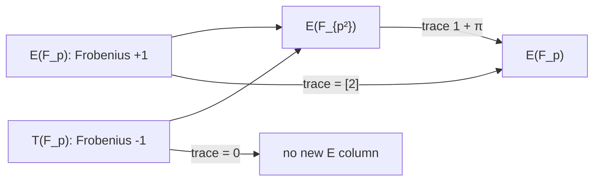

# Quadratic twists and index-calculus relation yield

**Date:** 2026-10-20 (America/Los_Angeles)

**Status:** exact toy-field experiments and an algebraic obstruction; no end-to-end speed claim

**Follow-up (2026-10-21):** [Mixed-component extension-field experiment](MIXED_REPORT.md)
adds exhaustive width-three relation censuses, matrix ranks, recovered
one-target logarithms, complete standalone costs, and same-target controls.
The rest of this note records the original 2026-10-20 experiment.

**Conductor task:** T-69

**Base revision:** `b4f056101a` (`origin/main` when this experiment began)

## Question and scope

Can points on the quadratic twist of a curve help an index-calculus relation
search for a discrete logarithm on the original curve? We test the most direct
proposal: add twist abscissas to an `x in F_p` factor base and solve Semaev's
third summation polynomial. We also test a special case in which a rational
isogeny lets us move the target DLP to the twist.

The exhaustive controls use `E: y²=x³+2x+3` over `F_p`, for `p` in
`{101,211,233,307}`, and `T: d*y²=x³+2x+3`, where `d` is the least quadratic
nonsquare. Each factor base has the first 24 sorted non-2-torsion abscissas
of its color. Every non-2-torsion target abscissa is tested. Candidate pairs
are unordered and include repeated abscissas. These are counts of width-two
polynomial hits, not timings or full rank-producing relation counts.

## Why a direct union of factor bases fails

Let `u²=d` in `F_{p²}` and embed `T(F_p)` in `E(F_{p²})` by
`(x,y) ↦ (x,u*y)`. Write `π` for `p`-power Frobenius. For `P` from `E(F_p)`,
`π(P)=P`; for an embedded twist point `S`, `π(S)=-S`. Therefore, if a target
`R in E(F_p)` has an extension-field relation

```text
R = sum(E-side factors) + sum(twist-side factors),
```

applying `π` and subtracting gives `2*sum(twist-side factors)=O`. Thus the
entire twist contribution is either zero or rational 2-torsion. On an
odd-order projection it is zero. A twist factor cannot serve as an additional
independent factor-base column for the original target.

For a non-2-torsion target and two factors, one or two twist factors cannot
produce a new relation: the only possible polynomial hits are `E+E`.
For three or more factors, twist factors may cancel or sum to shared
2-torsion. Such a hit reduces to a shorter `E` relation plus a known torsion
translation. This statement concerns factors whose abscissas lie in `F_p`;
it does not rule out an algebraic speedup from specially chosen general
points of `E(F_{p²})` with nonzero projections to both components.



The exact order identities in these controls are
`#E(F_p)+#T(F_p)=2(p+1)` and
`#E(F_{p²})=#E(F_p)*#T(F_p)`. The extension orders below were independently
enumerated over all `p²` abscissas using the norm character. Every
`x in F_p` lifts to `E(F_{p²})`, since each element of `F_p` is a square in
`F_{p²}`. This apparent doubling of the raw `x in F_p` base is exactly the
split between the `+1` and `-1` components; it does not double useful
relations for an `E(F_p)` target.

## Exact relation-yield results

The first table gives aggregate hits over *all* non-2-torsion target
abscissas. Every polynomial hit was independently checked by the curve group
law. The converse direction was checked on 2,256 signed group-law sums per
color and field. A base with 24 abscissas has 300 unordered candidate pairs
per target; the union has 1,176. The latter is 3.92 times as many candidates.

| `p` | `#E(F_p)` | `#T(F_p)` | enumerated `#E(F_{p²})` | `E` target abscissas | `E+E` hits | extra hits after adding twist `x` | twist-target `T+T` hits |
| ---: | ---: | ---: | ---: | ---: | ---: | ---: | ---: |
| 101 | 96 | 108 | 10,368 | 47 | 569 | **0** | 570 |
| 211 | 204 | 220 | 44,880 | 101 | 574 | **0** | 569 |
| 233 | 234 | 234 | 54,756 | 116 | 572 | **0** | 573 |
| 307 | 310 | 306 | 94,860 | 154 | 574 | **0** | 573 |

The twist-target controls are important: the twist abscissas do generate
relations, but for a DLP on the twist component. For each original target,
adding twist abscissas creates 876 extra candidate pairs yet produces no new
width-two hits. This is an exact toy result, consistent with
the Frobenius argument; it is not a measured runtime ratio.

Each curve above has the known 2-torsion point `(-1,0)`. For all four fields,
there were 24 twist abscissa pairs that could cancel to zero. Some other
twist pairs summed to `(-1,0)`:

| `p` | twist pairs summing to `(-1,0)` | distinct `E` factor-base abscissas shifted by `(-1,0)` | shifted abscissas outside the original base |
| ---: | ---: | ---: | ---: |
| 101 | 6 | 24 | 11 |
| 211 | 7 | 24 | 20 |
| 233 | 3 | 24 | 16 |
| 307 | 3 | 24 | 20 |

These are genuine three-factor extension-field equalities, but every one
reduces to `R=F+(-1,0)`. Since the torsion point and its translation are
already computable on `E`, the twist pair is padding, not an independent
relation source. This is also why counting raw roots of a higher summation
polynomial without lifting and reducing them can overstate useful yield.

## A special case where twist relations are usable

For `p ≡ 2 (mod 3)`, `E₀: y²=x³+1` has trace zero. Its rational
degree-3 isogeny is

```text
(x,y) -> (X,Y) = ((x³+4)/x², y*(x³-8)/x³),
E₀ -> C: Y²=X³-27.
```

Let `T₀: d*y²=x³+1`. For these primes, `-27/d³` is a sixth power in
`F_p`; choosing `u` with `u⁶=-27/d³`, the rational scaling
`(X,Y) -> (X/(d*u²), Y/(d²*u³))` maps `C` to `T₀`. This composition
is an explicit map from the original curve to a nontrivial quadratic twist.
Its kernel is `{O,(0,1),(0,-1)}`. On a prime-order subgroup of order
different from 3, it is injective, so a DLP can be transported to the twist.

We enumerated both groups, checked the map on every ordered pair of rational
points, and checked a known scalar `7` after transport:

| `p` | `d` | `u` | both group orders | image size | prime target order | homomorphism checks | scalar transport |
| ---: | ---: | ---: | ---: | ---: | ---: | ---: | --- |
| 101 | 2 | 7 | 102 | 34 | 17 | 10,404 | passed |
| 233 | 3 | 89 | 234 | 78 | 13 | 54,756 | passed |

For equal-size factor bases consisting of the first `b` eligible
abscissas on each curve, the width-two hit counts on transported
prime-order target abscissas were:

| `p` | `b` | original hits / covered targets | twist hits / covered targets |
| ---: | ---: | ---: | ---: |
| 101 | 8 | 14 / 7 | 13 / 7 |
| 101 | 16 | 47 / 8 | 41 / 8 |
| 101 | 24 | 92 / 8 | 95 / 8 |
| 233 | 8 | 5 / 3 | 4 / 3 |
| 233 | 16 | 12 / 6 | 15 / 5 |
| 233 | 24 | 27 / 6 | 29 / 6 |

There are valid twist-side relations after the isogeny. Counts fluctuate
with base choice; the twist has slightly more hits in the two `b=24` rows
and fewer in several others. At `p=233,b=16`, more hits cover fewer
targets. The data establish transport and local count differences, not an
index-calculus speedup. These supersingular toy curves also have separate
pairing-based considerations and are not stand-ins for ordinary prime-field
cryptographic curves.

## When to investigate a twist

1. **An explicit base-field isogeny or isomorphism transports the target
   subgroup.** Then an index-calculus pipeline may run on a twist model with
   a better factor-base geometry, sparser equations, or cheaper arithmetic.
   The degree-3 control above proves this mechanism exists. A speed claim
   still needs matched relation solving, matrix rank, online DLP recovery,
   map costs, and a same-target reference.
2. **The DLP is already in the anti-invariant component.** Its natural
   rational model is the twist, so twist relations are directly relevant.
   For a general DLP in `E(F_{p²})` with `E/F_p`, Frobenius separates
   the odd-order problem into the original and twist components. This is a
   group decomposition, not extra relations for an `E(F_p)` target.
3. **A twist construction supplies a useful endomorphism or representation.**
   Orbit reduction or symmetrized polynomial systems can lower solver or
   matrix costs. This is a plausible stage-level lever; our runs did not
   test it. Published index-calculus work establishes related symmetry and
   torsion gains, and a GLS-twist-induced endomorphism gives a factor-`n`
   improvement in a Weil-descent Jacobian setting. That result is not a
   direct factor-`n` theorem for arbitrary ECDLPs.

The degree-two trace-zero component is itself an elliptic curve (the
quadratic twist), so it is still dimension one. The higher-dimensional
trace-zero index-calculus analyses for extension degrees three and five
do not follow from this degree-two split. A concrete extension-field
candidate is a GLS curve: twisting a base-field curve over `F_{p²}`
gives a transported `p`-Frobenius endomorphism. On a suitable large
prime-order subgroup its square acts as `[-1]`, so a stable factor base
may be quotiented by its orbits. The cited GLS paper establishes this
sort of gain for an associated Weil-descent Jacobian. We subsequently
measured an exact toy elliptic-curve relation pipeline on three GLS twists
in [the GLS symmetry study](GLS_SYMMETRY_REPORT.md). It verifies orbit
column folding and one-target solves, while leaving polynomial-system
solving and a calibrated full-cost speed claim open.

For the `d*y²=f(x)` model used here, the twist isomorphism preserves `x`;
its Semaev polynomial in these coordinates is the *same polynomial*.
Merely changing the quadratic character therefore cannot lower its degree
or create new `E(F_p)` roots. Any solver advantage needs a genuinely different
coordinate representation, symmetry, factor-base shape, or transported
target group, and must be priced end to end.

For an ordinary `E/F_p` with nonzero trace `t`, the quadratic twist has
trace `-t`; the two curves have different point counts and are not
`F_p`-isogenous. There is then no analogous rational isogeny for target
transport. A smooth twist order would help solve a twist DLP, but by itself
does not solve the original DLP.

## Trace-map correction and completed follow-up

For arbitrary points `F_i in E(F_{p²})`, tracing a valid relation **does**
give the original group relation `2R=sum(F_i+πF_i)`. This does not require a
GHS cover. The twist component is exactly the kernel of that trace on odd
order. The older [Phase 18.2 note](../ecdlp_autolab/phase18_quasi_subfield.sage)
left trace descent uncertain and suggested a cover obstruction. The exact
correction is: descent is algebraically valid; the size, rank, and cost of
its *traced factor base* must be measured. The completed
[mixed-component follow-up](MIXED_REPORT.md) freezes such a base, counts
unique traces and independent matrix rank, and compares exhaustive
one-target costs with native index calculus and rho controls. Its exact
width-three toy results do not establish a cryptographic-size or general
polynomial-solver speed claim.

## Reproduction and limits

```sh
cd /home/ec2-user/crypto-twist-ic
python3 research/twist_index_calculus_20261020/twist_relation_yield.py > research/twist_index_calculus_20261020/results.json
python3 research/twist_index_calculus_20261020/trace_zero_isogeny_control.py > research/twist_index_calculus_20261020/isogeny_control.json
python3 -m py_compile research/twist_index_calculus_20261020/*.py
```

The checked-in [raw width-two counts](results.json) and
[isogeny control](isogeny_control.json) contain exact inputs and all
validation counters. Scripts are deterministic and use Python's integer
arithmetic; no Sage or solver is involved. This work covers four small odd
prime fields, `f₃`, a fixed sorted factor-base rule, and two explicit
isogeny controls. It does not measure Gröbner solving, relation independence,
linear algebra, target-log recovery time, or cryptographic-size behavior.

| Artifact | SHA-256 |
| --- | --- |
| `twist_relation_yield.py` | `6d8265c1f34535d45a504ac923e64a8c2388410707d5196be0ea36fec6a4f3fe` |
| `results.json` | `67fe2c7d3391cc482f3daaeaea8b355d077476c3bc63bedd034aefa134670308` |
| `trace_zero_isogeny_control.py` | `2c5f8608ddf7a96cff11ca4eedba9559a18d42716267cee64966b50563e35d7a` |
| `isogeny_control.json` | `5939928e0a0674143a3bf64f303e8346cfbab4e0403ffe618791f2a9f3027cc2` |

## Sources

- [Semaev, *Summation Polynomials and the Discrete Logarithm Problem on
  Elliptic Curves*](https://eprint.iacr.org/2004/031.pdf): the relation
  polynomial framework.
- [Gaudry, *Index calculus for abelian varieties of small dimension and the
  elliptic curve discrete logarithm problem*](https://doi.org/10.1016/j.jsc.2008.08.005):
  extension-field index calculus and Weil restriction.
- [Gorla and Massierer, *Index Calculus in the Trace Zero Variety*](https://eprint.iacr.org/2014/318.pdf):
  trace-zero index calculus in the relevant extension-field setting.
- [Faugère, Gaudry, Huot and Renault, *Using Symmetries in the Index Calculus
  for Elliptic Curves Discrete Logarithm*](https://doi.org/10.1007/s00145-013-9158-5):
  solver gains from curve-model symmetry.
- [Faugère, Huot, Joux, Renault and Vitse, *Symmetrized Summation
  Polynomials*](https://doi.org/10.1007/978-3-642-55220-5_3):
  explicit 2-torsion-based polynomial improvements.
- [*Extending the GLS Endomorphism*](https://eprint.iacr.org/2021/676.pdf):
  twist-induced endomorphism and index-calculus orbit reduction in a
  Weil-descent Jacobian setting.
