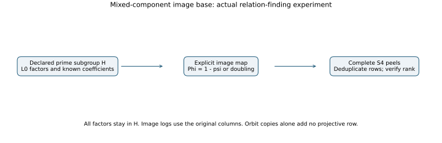

# Actual execution boundary and inference limits

The measured object is the frozen v1 native program, source archive SHA-256
`61948c5aaae1e1451dee1760e619ffc4d585c11808c90a8cff60dce2bd5786c1`.
Its source is not replaced when the report or resume machinery changes.

## Inputs and the cold clock

The clock in `native/src/cold.rs::execute` starts after loading and checking
the frozen tape, and before `build` and the exact symbolic S4 derivation.
It stops after back substitution and group verification of the recovered
target and every usable factor. Evidence serialization follows the clock.
All failed peels and complete queries up to rank or the original cap are
inside it. Input parsing, process startup and known-answer fixture creation
are outside it. The public curve/subgroup/eigenvalue parameters are given;
point counting and discovery of those domain parameters are not timed.

Each comparison holds the supplied twisted curve and subgroup fixed and
changes the factor-base image. It isolates the proposed phi-image mechanism
against doubling on that model. It does not compare replacing a curve by a
different twist, or assign the model's order-three automorphism exclusively
to twisting. The explicit equation and field in MATHEMATICS.md define the
experiment; “quartic” here describes the extension-field construction.

The legacy tape contains known answers and reference diagnostics. The
candidate code reads the public G, Q and only entries 0 and 1 of each query
record; it does not read `known_scalar`, reference logs, hits or ranks to
construct relations or decide when to stop. This is a source-audited
known-answer experiment, not a process-isolated secret-input experiment.

The runner also reads `base_coordinates` for public physical IDs, counts
and sign orientation, and checks each point against the independently
computed lift. It enumerates every required abscissa and performs its
Tonelli--Shanks lift inside the clock; it never substitutes an encoded y
coordinate for that lift. Orbit columns, coefficients, required images,
action checks, exceptional handling and zero-triple tables are rebuilt.
Active arms construct only their required L0 factors and images.

**Clarification of the frozen supplement:** the phrase “no precomputed
lift … is available” in `SUPPLEMENT_COLD_COST.md` is too strong as a data
isolation description: the public coordinate encoding is present for
comparison and sign alignment. The computed lifts are charged in full.
Report the actual supplied encoding and exclusions above; do not describe
this program as accepting only G,Q with all other fixture information
physically absent. This clarification does not edit the frozen protocol,
raw source, timings, output sets or acceptance thresholds.

## Complete elapsed intervals versus incomplete operation prices

Each cold record contains setup and five exclusive online phases. The
verifier requires their exact sums to match online and cold nanoseconds.
All computation of this instrumented implementation, including allocation,
normalization, hash/tree work, roots and evidence bookkeeping, is charged
to those elapsed intervals. Allocation telemetry adds overhead and is
included on every arm. Resident memory and live Rust allocation peaks are
different measures and are reported separately.

The field/group meter and F4 row-reduction counter have narrower scopes.
They are not a complete GAE operation price. In particular, not every F4
normalization/root/hash operation emits a separate native-operation count.
The required 0/0.1/1 GAE band, matched strong-rho measurement and validation
gate therefore remain unfulfilled. No leaderboard ranking, rho advantage
or complete operation-cost speedup follows from the elapsed-time ratios.

The external control measures complete reduced Gröbner bases on the same
378 exported inputs. It excludes polynomial restriction, roots, group work,
matrix work and the rest of the IC pipeline. Its internal timers exclude
process startup. It does not price an msolve-based end-to-end DLP solver.
Positions use query zero and the frozen first/middle/last peels; the
sample is not a benchmark of the whole solver's difficult tail. No pipeline
cost is projected from its component ratios.
Magma, FGb, Singular and OpenF4 comparisons are not reproduced in this
round; no claim to the fastest external implementation is made.

## Timing admission after interruption

The cold resource envelope is c7i.2xlarge, one reserved whole SMT core, one
Rayon thread, an 8 GiB process address-space limit and 1,200 seconds per
arm. Every measured record must have exit 0, uncontended isolation, no
other user thread left on the reserved core, the declared CPU topology and
the recorded address-space/watchdog command. A resource refusal is retained.

A resumed timed unit contains all ten arms and the additional original
A/A execution from one originating job. Only complete admitted units are
reused. An incomplete or contended round is restarted in full; its earlier
records remain. Selection is chronological, never by elapsed time. Final
ratios pair reference and candidate within each originating round. Raw
medians across several hosts of the same class are descriptive.

The inactive-column phi-L0 arm is censored on all 21 inputs. Its elapsed
cost is consumed work at the stream cap, not cost to a verified solution.
It cannot appear as a successful cheap arm in a ratio.

## Population and claims

The panel comprises seven fields and three seeded records per field, all
with public scalar 271. Historical stopping of the frozen streams can bias
empirical relation rates. Timing repeats use the same target and trajectory.
They are not independent draws of secret scalars, independent curve
families, or a basis for an asymptotic claim. Every per-target row and every
failure is retained. Aggregate tuple and operation counts are diagnostics,
not a multi-target amortization of DLP setup or recovery.
