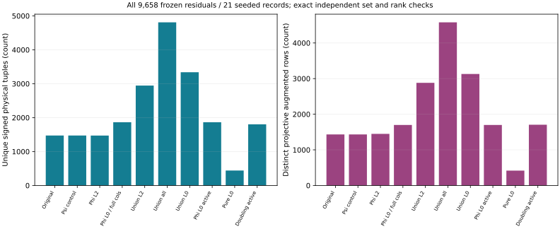
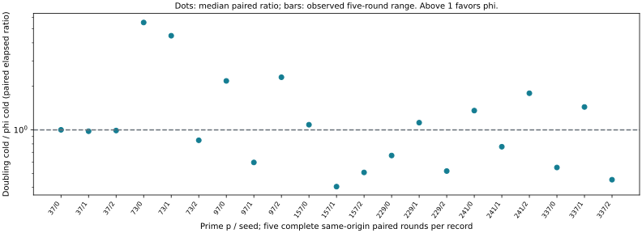
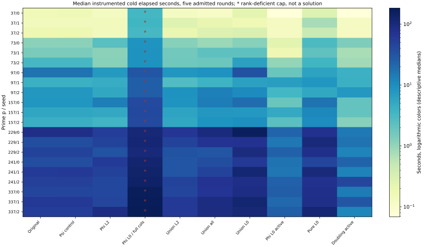
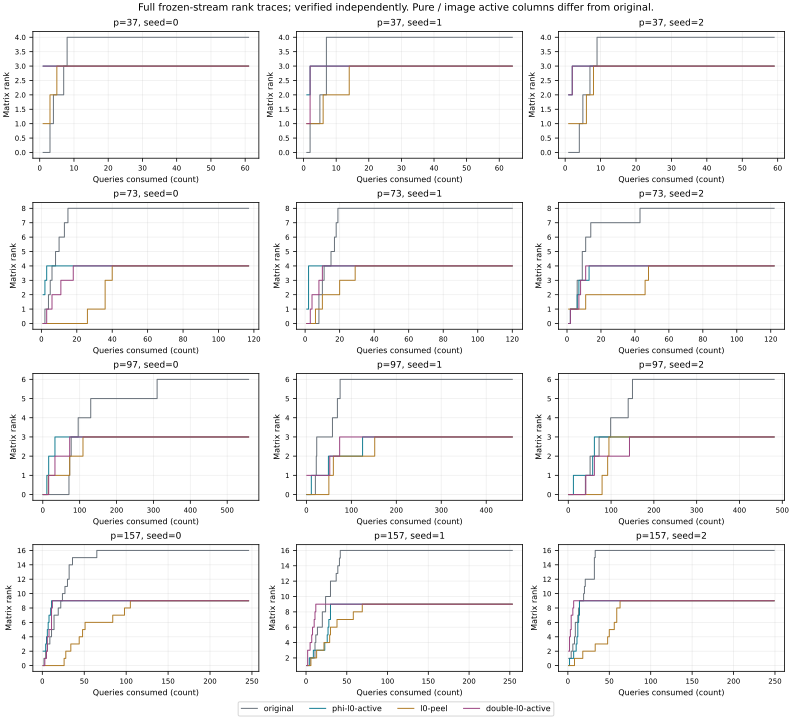
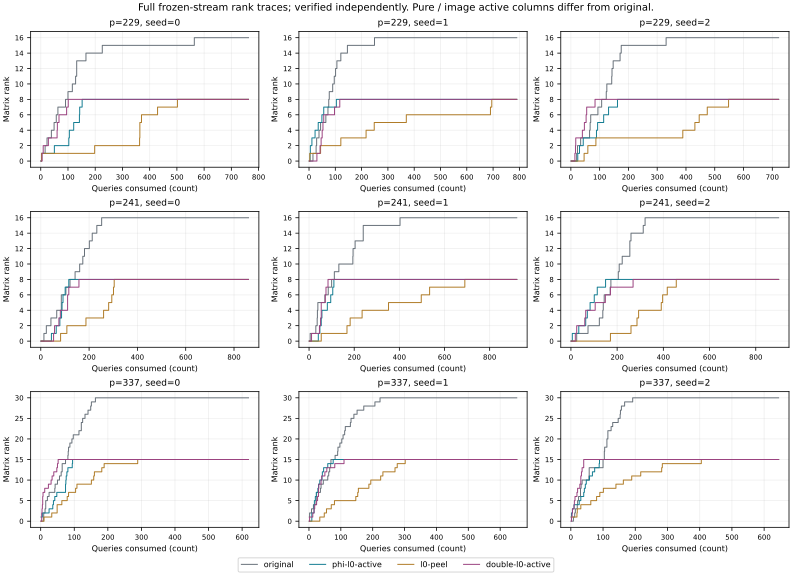
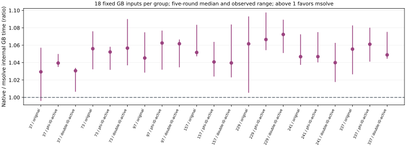

# Twist image bases: completed relation, rank and cold-cost controls

2026-10-23. Seven quartic extension fields, three seeded records each, ten arms. The requested resumed 189-case run and 21 doubling controls are complete, with 210 independent exact-set/rank/recovery audits. Every polynomial run has zero undetermined systems. All 105 complete timed units (ten arms plus original A/A) and all 630 non-timing replays have been reconciled after Spot interruption. Resource admission is per record and whole round, not inferred from job success.

## What is attributable to the twist?

On the identical 9,658 frozen residuals, phi=(1-psi) supplies **61 extra signed physical tuples**, a measured diagnostic change of **3.3814%**, relative to the same-size doubling image. Its distinct projective augmented row delta is **-7** (-0.4106%). Both active bases reach full rank in 21/21 cases and recover the target and every usable factor logarithm. Distinct projective rows need not be linearly independent.

Through each arm's first full-rank query, phi consumes **5.8688% more finite polynomial systems** in aggregate than doubling. These aggregates describe separate targets; they are not an amortized DLP price. Per-target complete elapsed ratios below go in both directions. This experiment establishes no consistent twist-specific complete-cost advantage. A geometry change, extra decompositions and a lower stopping cost are separate properties.

The mixed-component image base is explicitly constructed and verified. Its L0+L3 image is disjoint from the old L0/L2 base, and its logs use existing columns. Generic doubling also creates a disjoint known-log image of the same size. The exact phi coordinate equation is degree three; the current peeled S4 solver does not retain that equation in its solve. See [the mathematical argument](MATHEMATICS.md) and certificate `IDC1h7e0104841476f369`.

## Requested requirements and evidence

| Requirement | Status and evidence |
| --- | --- |
| Finish resumed 189 cases and deterministic A/A | Verified complete: 189 first and 189 A/A exits 0, byte-identical outputs |
| Finish the doubling control | Verified complete: 21 reference and 21 polynomial cases, first/A/A |
| Unique physical and folded relation yield | Verified complete: exact same 9,658 residuals; independent signed-set equality |
| Matrix rank and recovery | Verified complete: 210 independent audits, 189 successful full-rank cases and 21 deliberately inactive-column censored controls |
| Complete cost of this instrumented implementation | Verified complete under [actual fixture boundary](BOUNDARY.md): 105 admitted whole timed rounds and 630 non-timing replays |
| Twist-specific attribution | Measured comparison against psi, pure L0 and generic doubling; no uniform positive result |
| Complete GAE price, matched strong rho, independent scalar sampling, growing-size security conclusion | Unresolved; not supplied by these controls |
| External complete GB comparison | 378 fixed systems, eight passes, 3024 checked basis pairs; component comparison only |

## Unique yield on the full frozen stream

| Arm | Unique signed tuples | Distinct projective rows | Finite signed peels | Full rank / 21 |
| --- | --- | --- | --- | --- |
| original | 1473 | 1432 | 1913256 | 21 |
| psi-control | 1473 | 1432 | 1913256 | 21 |
| phi-l2 | 1472 | 1449 | 1913256 | 21 |
| phi-l0 | 1865 | 1698 | 1957992 | 0 |
| union-l2 | 2945 | 2881 | 3826512 | 21 |
| union-all | 4810 | 4579 | 5784504 | 21 |
| union-l0 | 3338 | 3130 | 3871248 | 21 |
| phi-l0-active | 1865 | 1698 | 1957992 | 21 |
| l0-peel | 441 | 417 | 1957992 | 21 |
| double-l0-active | 1804 | 1705 | 1957992 | 21 |

The psi control reproduces exactly the original signed sets: automorphism copies do not add folded rank. The full-column phi-L0 arm retains unused L2 unknowns and is rank deficient in every case. The active-column arm checks that discarded coefficients are zero; it solves every case. Unions gain raw relations by doing more systems and carrying more columns; they must be priced by their complete stopping costs.

## Cost per public target: twist image versus doubling

One target per row, five paired whole rounds, alternating arm order. Ratio = doubling cold / phi cold within each same-origin round. The table gives the median and observed range of those five ratios, not a ratio of independently selected fastest runs. Above 1 favors phi. These are complete instrumented elapsed intervals for the supplied coordinate-encoding fixture; parsing, startup and known-answer construction are excluded. See the [boundary clarification](BOUNDARY.md).

| p / seed | Phi cold median (s) | Doubling cold median (s) | Paired ratio median | Five-round range | Original A/A range |
| --- | --- | --- | --- | --- | --- |
| 37 / 0 | 0.068650 | 0.069758 | 1.001154 | 0.989790–1.028708 | 1.000381–1.015917 |
| 37 / 1 | 0.125541 | 0.123523 | 0.978979 | 0.977502–0.987318 | 0.983755–1.015499 |
| 37 / 2 | 0.125255 | 0.124436 | 0.990042 | 0.982966–0.996666 | 0.993915–1.009741 |
| 73 / 0 | 0.241243 | 1.334657 | 5.524357 | 5.497047–5.596725 | 0.999426–1.006326 |
| 73 / 1 | 0.167776 | 0.752636 | 4.476432 | 4.437333–4.504181 | 0.996332–1.004380 |
| 73 / 2 | 0.974077 | 0.828428 | 0.847570 | 0.842071–0.853045 | 0.998212–1.003659 |
| 97 / 0 | 1.820251 | 3.973863 | 2.180789 | 2.175206–2.191123 | 0.997844–1.001333 |
| 97 / 1 | 6.745508 | 4.019464 | 0.595827 | 0.593999–0.604832 | 0.999529–1.021967 |
| 97 / 2 | 3.336158 | 7.712071 | 2.311662 | 2.276324–2.338670 | 0.994230–1.002044 |
| 157 / 0 | 1.853565 | 2.014505 | 1.085886 | 1.076037–1.091555 | 0.995017–0.998806 |
| 157 / 1 | 4.949680 | 2.006529 | 0.405438 | 0.404821–0.406946 | 0.995883–1.012040 |
| 157 / 2 | 2.343618 | 1.190425 | 0.508169 | 0.506477–0.508620 | 0.994873–1.005784 |
| 229 / 0 | 22.061632 | 14.677746 | 0.665205 | 0.660190–0.670090 | 0.989843–1.010847 |
| 229 / 1 | 15.088636 | 17.048593 | 1.122205 | 1.109753–1.133316 | 0.968125–1.002312 |
| 229 / 2 | 23.465120 | 12.124593 | 0.519497 | 0.509440–0.525666 | 0.997579–1.004294 |
| 241 / 0 | 16.733039 | 22.759671 | 1.359694 | 1.346917–1.363669 | 0.981440–1.013276 |
| 241 / 1 | 15.959578 | 12.211535 | 0.765154 | 0.760456–0.768259 | 0.992172–1.003424 |
| 241 / 2 | 23.920537 | 42.715544 | 1.792158 | 1.752688–1.798900 | 0.984299–1.012300 |
| 337 / 0 | 25.907803 | 14.240316 | 0.549708 | 0.546135–0.550980 | 0.996583–1.007085 |
| 337 / 1 | 20.724869 | 29.929771 | 1.440101 | 1.431508–1.445216 | 0.996345–1.008408 |
| 337 / 2 | 25.332803 | 11.485804 | 0.452564 | 0.449587–0.454562 | 0.977374–1.004549 |

The same declared 8 GiB address-space cap, 1,200 s watchdog, one Rayon thread and reserved whole SMT core apply to every measured arm on c7i.2xlarge / Intel Xeon Platinum 8488C hosts. Every admitted interval has exit 0, uncontended isolation and no user thread left on its reserved core. Complete successful intervals include construction/lifts, images and coefficients, symbolic setup, all failed peels, F4, roots/group checks, matrix work, recovery and independent point verification. Setup and five exclusive online phases are stored separately and their exact sums checked. Memory fields include process peak RSS in KiB and separately measured Rust allocation telemetry. No process RSS is inferred from allocation counts.

All ten arms and every per-target cost remain in [cold-costs.csv](results/cold-costs.csv), [paired-cold-costs.csv](results/paired-cold-costs.csv) and [summary.json](results/summary.json). An asterisk denotes consumed censored work, never a successful cheap solution. Complete rounds are selected chronologically under the [frozen resume rule](SUPPLEMENT_COLD_RESUME.md). Original failed, interrupted and contended records remain in the archive. A copied checkpoint is not a new timing sample.

## Rank trajectories

The rank axis uses the actual matrix dimension for each arm. Original uses L0 and L2 columns; pure and active-image controls use the justified L0 columns. Query counts alone cannot compare their work, because peel counts and solve costs differ. [full-stream.csv](results/full-stream.csv) records exact columns, first full-rank indices and finite systems. The full-rank query field is zero based; these figures show the count of queries consumed.

## External complete-GB control

Official msolve 0.11.0 commit `cc044551f8e202d00691990fd3fd0b1226a88ea2`, one thread, seed 0, grevlex, flags `-t 1 -v 2 -g 2 -r 1`, is compared on exactly 378 frozen positions (21 records × three arms × three fixed peel positions × two signs). Five positions have nonunit ideals; 373 do not. Inputs were selected before solving. Warmup, first, A/A and five timed passes yield 3,024 matching native/msolve reduced bases, each independently checked by input and S-pair reduction. The timer patch only increases printed precision. Build, options, library/executable hashes and raw outputs are preserved.

The comparison uses internal complete-basis timers on the same isolated c7i.xlarge host, excluding startup/parsing/printing. Each group contains the same 18 fixed systems in each round. Native/msolve above 1 means native is slower. This does not price an msolve-based complete DLP solver. Magma, FGb, Singular and OpenF4 were not reproduced; fastest-external status is unknown. The observed msolve gap remains a [backlog item](../../../backlog/XP-20261023-quartic-twist-image-base/README.md).

| p / arm | Native internal ms | msolve internal ms | Native/msolve median | Five-round range | Native A/A | msolve A/A |
| --- | --- | --- | --- | --- | --- | --- |
| 37 / original | 15.003302 | 14.596226 | 1.029396 | 0.996377–1.056698 | 1.010498 | 0.979161 |
| 37 / phi-l0-active | 15.245855 | 14.526784 | 1.039499 | 1.035443–1.049500 | 0.989531 | 1.004391 |
| 37 / double-l0-active | 14.997233 | 14.598490 | 1.030647 | 1.006926–1.033431 | 0.999100 | 0.988070 |
| 73 / original | 15.217642 | 14.487801 | 1.055972 | 1.032729–1.075527 | 1.005649 | 0.989025 |
| 73 / phi-l0-active | 15.170199 | 14.497698 | 1.052228 | 1.032141–1.057748 | 0.991448 | 1.007731 |
| 73 / double-l0-active | 15.287369 | 14.605640 | 1.056638 | 1.037290–1.089624 | 1.008156 | 0.989346 |
| 97 / original | 15.047991 | 14.413478 | 1.045285 | 1.028933–1.074409 | 0.984633 | 0.980374 |
| 97 / phi-l0-active | 15.365781 | 14.550267 | 1.062530 | 1.032282–1.076409 | 0.989421 | 0.969586 |
| 97 / double-l0-active | 15.223387 | 14.347432 | 1.061697 | 1.035022–1.066132 | 0.975632 | 0.971008 |
| 157 / original | 15.397865 | 14.527320 | 1.051682 | 1.047673–1.083013 | 0.989845 | 1.016876 |
| 157 / phi-l0-active | 15.235802 | 14.419197 | 1.040759 | 1.024412–1.063383 | 0.977498 | 0.989569 |
| 157 / double-l0-active | 15.342985 | 14.627573 | 1.039590 | 1.023495–1.083348 | 0.995048 | 1.040114 |
| 229 / original | 15.376205 | 14.471710 | 1.061580 | 1.005761–1.092633 | 0.976644 | 0.999781 |
| 229 / phi-l0-active | 15.322049 | 14.447986 | 1.066544 | 1.054762–1.097192 | 0.999181 | 0.985233 |
| 229 / double-l0-active | 15.387014 | 14.399529 | 1.072364 | 1.051473–1.088881 | 0.992812 | 1.001293 |
| 241 / original | 15.218322 | 14.542282 | 1.046807 | 1.037788–1.072078 | 1.008208 | 1.037221 |
| 241 / phi-l0-active | 15.256400 | 14.405847 | 1.046861 | 1.040671–1.074604 | 1.007443 | 1.000143 |
| 241 / double-l0-active | 15.283102 | 14.696180 | 1.039937 | 1.018126–1.062228 | 0.998248 | 1.000590 |
| 337 / original | 15.292063 | 14.568626 | 1.055506 | 1.026989–1.082315 | 0.968781 | 0.999726 |
| 337 / phi-l0-active | 15.273493 | 14.505745 | 1.061121 | 1.041556–1.079674 | 0.957374 | 1.004517 |
| 337 / double-l0-active | 15.276665 | 14.505743 | 1.048874 | 1.044945–1.074879 | 0.985464 | 0.993356 |

## Interpretation and outstanding questions

For a uniform residual, a fixed peel is a translation and leaves the residual distribution unchanged. Equal-size disjoint phi and doubling images therefore have the same exact first moment of signed physical tuples; their correlations and rank trajectories may differ. The historical stream is not uniform, so the measured tuple difference is conditional on this tape. Every seeded record also uses the same public scalar 271. Three seeds are trajectory variations, not independent secret samples, and timing repeats are repeated measurements of the same problem. No confidence interval for a population of curves or unknown scalars is inferred.

The actual distinguishable mathematical feature is phi's low-degree image equation. A joint S5/elimination solver could retain it and share work across image peels. That solver is not implemented or measured here. Orbit representatives alone exchange a peel loop for a transformed-residual loop; they do not remove those systems. No asymptotic obstruction to all joint algorithms is claimed.

The frozen cold supplement's assertion that no precomputed lift is available needs a precise correction: encoded public points are present for sign alignment and checks, while every required lift is recomputed and charged. The candidate does not read the tape's known scalar or reference hits/ranks, but this is source-audited rather than a process-isolated blinded input. The [boundary document](BOUNDARY.md) preserves that distinction and names every excluded cost.

The field/group and F4 row-reduction counters are partial. Complete instrumented elapsed time is available; a complete GAE price, the 0/0.1/1 price band and a protocol-matched strongest rho reference are missing. No `VALIDATION.json` is fabricated and no new headline enters the leaderboard or `benchmarks/README.md`. Benchmark PDFs and figures are copied as unlisted diagnostics. The precise remaining problem is [quartic-twist-polynomial-ic-pricing](../../../problems/quartic-twist-polynomial-ic-pricing.md).

## Reproduction, controls and publication

[ARTIFACTS.md](ARTIFACTS.md) gives the content-addressed raw archive, frozen source hashes, extraction and exact native analysis commands. [All launched-job reports](reports/INDEX.md) preserve build failures, timeouts, interruptions and invalid resource receipts. [MATHEMATICS.md](MATHEMATICS.md) separates proved coordinate algebra, checked group actions, elementary counting arguments and untested joint-solver hypotheses. [VALIDATION_STATUS.md](VALIDATION_STATUS.md) records the actual software gates, including failed and interrupted attempts. The archive also retains the rejected coefficient/record mutations, corrupted input hash control, original baseline parity and whole-round resume control.

Canonical graph review: `docs/ic/leaderboard.json`, `docs/ic-leaderboard.html`, `docs/ic/progress-timeline.json`, `docs/index-calculus-scoreboard.html` and the curve registry were checked for the new image study. No new curve transport or validated operation-price/rho result exists, so their existing values remain current. The new measured coverage is represented in the study-local figures and benchmark copies only. This research deliverable is part of [PR #2368](https://github.com/aburan28/crypto/pull/2368); software review status is distinct from mathematical validation.
