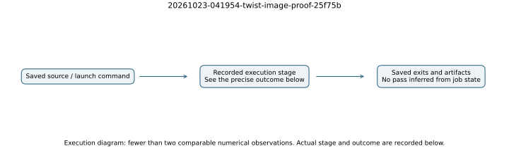

# proof: recorded execution

Job `20261023-041954-twist-image-proof-25f75b`. Outcome: **done**, recorded exit `0`.
Host class: `c7i.large`, lifecycle `spot`.
Started `2026-10-23T04:20:32Z`; last status update `2026-10-23T04:21:14Z`.

One conditional coordinate theorem compiled and axiom-audited; false equality rejected.

## Command, controls and evidence

Exact command SHA-256: `b9d33935724c66054a3f1f1d8de7d9fa2ceacef0517400e1386b9a5b9c22f346`. The command, native raw output, exit receipts, setup/build logs and host metadata are in `runs/jobs/20261023-041954-twist-image-proof-25f75b/` after extracting the content-addressed archive. Job snapshots record the source revision; frozen cold source is bundled separately. The registry specifies all arms, fields and seeds through these commands; the panel protocol and its supplements define the controls and caps.

This job has 0 originating resource-admitted timed records. Copied checkpoints are not additional samples. A cold graph displays every originating admitted cold record, identified by the native JSON. A diagnostic count graph displays the recorded summary's signed relations and rank/columns, with each population labeled in the JSON; it establishes no wall-time advantage. Replayed summaries are deterministic checks rather than independent targets. Medians and paired ranges used for the final comparison are independently recomputed across complete whole rounds in `results/summary.json`; a per-record resource pass alone does not admit an incomplete round. The full-column phi-L0 arm is censored consumed cost, not a verified solution.

Recorded exit-count map: `{"1": 1}`.
Recorded summary-status map: `{}`.
Recorded independent audit-status map: `{}`.

Raw observations: `results/job-observations/20261023-041954-twist-image-proof-25f75b.json`. Partial JSON records, failed exits and refused isolation are retained in the raw archive. Missing isolation is missing, never an admitted time. No performance conclusion follows from a job's done/0 state alone. Build and test gate durations are not algorithm timings.

See [protocol](../../PROTOCOL.md), [cost boundary](../../BOUNDARY.md), [final report](../../README.md) and [raw reproduction](../../ARTIFACTS.md). The msolve job alone measures internal GB timers on 378 fixed systems; it does not run a complete external DLP solver. Other jobs with fewer than two comparable admitted timings use an execution diagram rather than an invented numerical plot.
