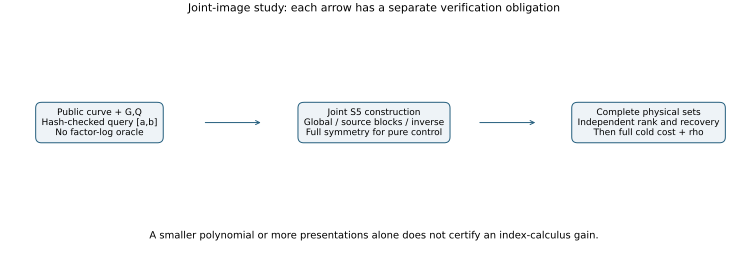
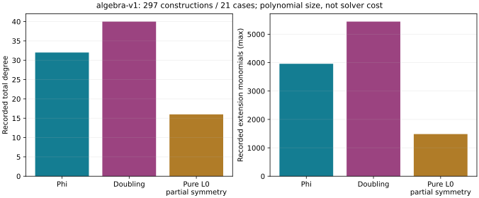

# Twist-derived images: joint S5 and attribution controls

This is the continuation of the completed
[189-case image-base study and 21 doubling controls](../endomorphism_image_base/README.md).
The broad question remains whether twist-derived structure lowers the
complete cost of index calculus. Completing a construction or one query
does not complete that research goal.

## What the completed controls say

The original finite study is complete and is not being repeated. On the
same 9,658 conditioned historical residuals, phi produces 1,865 unique
signed physical tuples and 1,698 distinct projective augmented rows;
doubling produces 1,804 and 1,705. Both attain full rank on all 21 cases.
Distinct rows are not independent rank. Through first full rank, the phi
arm processes 275,784 finite signed polynomial systems against doubling's
260,496. All 105 complete cold rounds passed their admission checks.
Per-case median paired doubling/phi elapsed ratios range from 0.405438 to
5.524357: both gains and losses occur. There is no consistent complete-cost
advantage attributable to the phi image in that panel.

The experiments fix one twisted model per case and vary known-log images.
They do not compare selecting different twists of a source curve. All
targets are public synthetic fixtures with scalar 271; the three seeds are
not independent secret-scalar samples. See the original
[clock boundary](../endomorphism_image_base/BOUNDARY.md) and
[native summary](../endomorphism_image_base/results/summary.json).

## Completed joint construction experiment

Instead of separately solving each translated S4 system, retain the image
source U inside the joint resultant

    Res_X(H(e1,e2,e3,X;B), S3(X,Z,x(R);B)).

H is the already verified 49-term S4 expression. Over
K=Fp[t]/(t^4-d), B=b0*t^3, the finite-residual construction clears D^8
after substituting Z=N(U)/D(U). Four field components give four equations.
Finite-domain constraints enforce actual allowed distinct factors; the
geometric encoding uses a discriminant saturation and filters non-base
solutions afterwards. R=O has a separately implemented construction, but
the 297-input suite does not exercise that branch.

All **297 construction tasks, 694 system files and 63 case-arm sets** pass
the independent native validator. Each arm has 84 predeclared fixed-query
positions, plus separately labelled positive and regression controls.
These conditioned controls are not a timing population.

| Arm | Tasks | System files | Extension terms | Total degree | U degree |
|---|---:|---:|---:|---:|---:|
| Phi | 97 | 194 | 3,960 | 32 | 24 |
| Doubling | 100 | 200 | 5,444–5,445 | 40 | 32 |
| Pure L0, partial symmetry | 100 | 300 | 1,484–1,485 | 16 | 8 |

The validator binds the exact workload, public input hashes, coefficient
dimensions, term statistics, msolve exports, and zero exit receipts.
It checks record consistency and numerical incidence; it is not an
independent exact derivation of the generic S5 elimination ideal.
Construction source is commit
`054b22b41d8e8c0d4296c9119b06e88df5d95fab`. A separate whole-stream
incidence audit checks 4,110 unique signed physical relations in 5,433
presentations, including actual group sums and numerical S5 vanishing.
Every finite construction also has 16 independent Gaussian determinant
probes. Incidence of known relations does not establish completeness of a
polynomial root finder.

Authoritative numbers and hashes are in
[algebra-v1-validation.json](results/algebra-v1-validation.json);
the [construction run report](reports/run-20261024T0003Z/REPORT.md)
states its boundary. Lower polynomial degree is a representation result,
not a measured solver or IC gain.

## Why additional controls are necessary

Three source-block inputs per arm retain all allowed U values in disjoint
sets U^12=T. Reduction modulo that equation lowers U degree to at most 11.
It does not identify all source phases for a fixed residual or award a
twelvefold cost reduction. The source-root partition and map coordinates
are checked on all 21 cases; a proof that this partition is the entire
folded group action is a separate missing bridge.

The mixed implicit encodings retain a real inverse variable, rather than
clearing the denominator. Phi uses U^2*W=1; doubling uses
(U^12-B^4)*W=1. Their final polynomials are reduced by the corresponding
inverse relation. The pure control instead uses all four elementary
symmetric coordinates. Its exact coefficient check removes the auxiliary
U and lowers total degree from 16 to 8 on the regression input. Neither
generic symmetrization nor an inverse coordinate is a new twist mechanism.

The repaired exporter passes 69 native tests and produces all six
finite/geometric regression inputs. The earlier failed export remains
preserved. See [the repair report](reports/run-20261024T0142Z/REPORT.md).
The first six native attempts are terminal: both fully symmetric pure
encodings pass their physical-set audits; all four mixed implicit attempts
fail allocation under 8 GiB. These are bounded outcomes, not missing true
relations or an impossibility proof. Official msolve comparisons must still
verify complete signed physical sets and independent rank before a
full-cost collector is priced.

The external pure finite-domain and T=1,10,26 source-block outputs now
pass the separate physical-set/RREF audit on p37/seed0/query2. Each
recovers the same single signed physical relation and rank 1/3 as its
properly scoped group oracle. Input reductions and S-pairs vanish;
reverse ideal containment is explicitly unverified. Other external
outputs remain under their existing managed owners. This is a fixture
correctness result, not an admitted solver or DLP cost comparison.
The three blocks present the same physical tuple; their union does not
create three distinct relations.

The resumed source-block regression is now complete on the predeclared
p37/seed0/query2 fixture. All three unions have complete native roots and
pass the separate signed-set/RREF audit: pure L0 has one physical relation
and rank 1/3, phi has two and rank 2/3, doubling has one and rank 1/3.
The fully symmetric pure finite and geometric variants each recover the
same single physical relation and rank 1/3, with independent audits passing.
These are one-query correctness and representation results; the phi rank
advantage on that selected positive fixture is not a population or cost
claim. See the [source-block report](reports/run-20261024T0141Z-source-blocks/REPORT.md).

## Counting constraint and the zero-residual question

For L ordinary abscissae and a disjoint image of the same size, both mixed
arms have exactly 16*binomial(L,3)*L signed physical tuples. Every tuple
has exactly one sum in H. Summing relation counts over all residuals is
therefore independent of which image map was used. Their uniform-residual
means are equal. This does not equate support, variance, projective rows,
rank, conditional trajectories or solving cost.

Pure L0 has 16*binomial(L,4) physical tuples. Its partial three-plus-source
encoding has four presentations of each tuple. The mixed/pure domain-size
ratio 4L/(L-3) is available to generic doubling as well. It cannot be
credited specifically to a twist. The old conditioned traces do not
estimate an independent uniform-residual mean.

Zero is fixed by the action and might concentrate relations useful for
factor-log precomputation. It can also concentrate identities whose entire
folded row vanishes. The next exact diagnostic covers all 21 zero fibers
and the entire residual population for p=37, seeds 0,1,2. It records signed
physical sets, zero rows, distinct rows and independent RREF. Every zero
query has target coefficient zero; no target recovery is claimed from
zero-only rows. This is a separate oracle diagnostic, not a polynomial
candidate or an IC price. Its protocol is
[SUPPLEMENT_UNIFORM_AND_ZERO.md](SUPPLEMENT_UNIFORM_AND_ZERO.md).

## Verification and completion criteria

| Requirement | Status and evidence |
|---|---|
| Resumed 189 cases and doubling control | Verified complete in the parent study |
| Joint construction over all fixed inputs | Verified complete: 297 tasks, 694 files |
| Whole-stream relation incidence | Verified complete: 4,110 physical relations |
| Native global joint S5 regression | Six terminal results: five allocation failures and one incomplete cooperative result; original limits retained |
| Source-block regression | Complete on p37/seed0/query2: all three unions and independent signed-set/rank audits pass; ranks 1/3 pure, 2/3 phi, 1/3 doubling |
| Implicit and fully symmetric regression | Complete: pure finite/geometric audited, each rank 1/3; all four mixed processes fail allocation |
| Full input population for new variants | Independent native validation passes all 297 positions: 294 new and 3 reused, no missing/invalid/bounded-failure records; [run report](reports/run-20261024T0320Z-variant-population/REPORT.md) |
| External S5 bases and roots | Processes and independent verification remain separate obligations |
| Uniform mass and zero-rank diagnostic | Implemented; explicit 21+3 run inventory retained |
| Polynomial identities | Three exact integer/IDC checks and four coordinate Lean theorems pass; factored quartic gate v6 passes seven theorems plus two local AC declarations; all earlier failures retained |
| Finite-count Lean proof | Repaired module passes the gate and 12-declaration axiom audit |
| Zero-triangle coefficient identity | Lean theorem passes; group/row/count bridges remain the separate native check |
| External audit software gate | Version 2 passes 75 tests; block-scope error caught before use; corrected version 3 passes all 76 tests including the actual physical fixture scope test |
| Pure-zero algebraic certificate | Exact native 2048*D=sum Ai*Ci, two Lean theorems and independent IDC1h09d838b7dca9895f pass; full curve/basis formal bridges remain open |
| Stronger finite-component obstruction | Exact 64*S³ certificate, combined 10-theorem Lean gate and independent IDC1h65c11f01d0b1e67a pass; full curve/group bridge remains separate |
| Finite Fp residual prefilter | Full-tape counterfactual audit released after proof/replay; native build gate queued; no filter deployed |
| New cold DLP, GAE and strongest matched rho | Not measured; no new performance ranking |
| Selecting among different twists | Not tested by these fixed-model image comparisons |

The [proof map](proof/PROOF_MAP.md) lists hypotheses and missing bridges.
The [migration reconciliation](MIGRATION_RECONCILIATION_20261024.md)
distinguishes terminal work from interrupted work. Managed continuation
units and per-phase receipts preserve one thread, 8 GiB and at most
1,200 s; all heavy work retains the repository's busy reservation.
Resource failures do not establish a mathematical obstruction.

Before claiming an IC improvement, a viable representation must collect
through rank or the frozen cap, verify recovered target and factor logs,
and pass a newly frozen complete-cost comparison. Charge lifts, setup,
polynomial construction, every failed solve, roots, group checks, matrix
work, recovery and verification. Retain A/A, paired rounds, the strongest
existing IC baseline, matched rho, external comparisons and 0/0.1/1 GAE.
No new leaderboard or benchmark-index row is promoted here.

## Stronger ordinary-component rejection rule

The independent first-discriminant replay passes as
IDC1h09d838b7dca9895f, including exact integer reconstruction, 32 extra
points and two rejected mutations. The stronger search and combined Lean
gate additionally prove that the four H4 components force the monic
quartic to have at most two distinct roots in odd characteristic.
The [square-obstruction report](reports/run-20261024T0445Z-square/REPORT.md)
gives the exact identity and all assumptions. The combined gate audits
10 theorems with standard foundations only. The stronger independent
replay passes as IDC1h65c11f01d0b1e67a, with zero exact integer remainder,
32 extra points and both constant and multiplier mutations rejected.

The proposed consequence rejects finite peeled S4 residuals whose
abscissa lies in Fp when the three remaining ordinary factors are
distinct. Infinity is retained because CM triangles can sum to O.
The frozen audit must preserve every saved physical presentation,
unique tuple, projective row, rank, first full-rank query and recovery
on the full historical tape for phi, doubling and pure controls.
The concrete degree-four B basis is checked separately. No historical
collector or relation oracle is repeated. Rejection counts alone will
not be called an end-to-end gain or a gain attributable to the twist.

## Prior work

Permutation, low-order-torsion and quasihomogeneous invariants are prior
methods: [Using Symmetries in the Index Calculus for Elliptic Curves
Discrete Logarithm](https://eprint.iacr.org/2012/199) and
[Symmetrized Summation Polynomials](https://doi.org/10.1007/978-3-642-55220-5_3).
The invariant coordinates used for descent need their stated field of
definition. [Joux–Vitse](https://eprint.iacr.org/2010/157) supplies relevant
partially symmetrized extension-field methods. Polynomial degree alone
does not establish regularity, complexity, novelty or a speed advantage.
