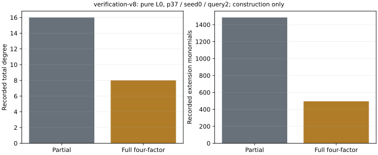

# Corrected exporter verification v8

Run `verification-v8`, started 2026-10-24 01:42:42 UTC. This executes the
previously queued repair once after confirming that v7 never created a
run directory or surviving process. The constructor validation is reused
by its saved hash; the 297-task suite is not repeated.

All 69 native tests pass, including an actual full-symmetry export and
checks that every finite and geometric exponent has the declared arity.
All three arms then export their finite and geometric inputs successfully:
six corrected p37/seed0/query2 inputs. The frozen runner and source hashes
are retained in `runs/verification-v8/metadata/`.

For pure L0, exact coefficient independence removes U, and the relation
total degree is 8 with 495 extension terms, from unreduced degree 16 and
1,485 terms. These are recorded constructor statistics, not solver timings.
The implicit mixed coordinates are checked against every registered source
point. Later root-solving processes use the copied runner and the same
independent physical-set oracle.

Compilation is separate. Scientific phases use one thread, the busy
reservation, 8 GiB and 1,200 s limits. This run constructs and checks inputs;
it does not solve roots, collect through rank or measure a cold DLP cost.
