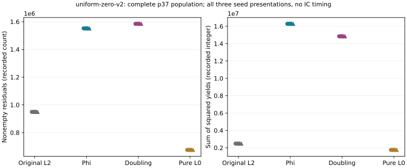

# Full p37 residual census and all 21 four-factor zero fibers

`uniform-zero-v2` completes all 21 zero-fiber cases and all three frozen
p37 population cases, with no missing case. This is the registered
scalar/group-oracle diagnostic, not a polynomial collector or IC price.

## Uniform population

For every p37 seed the subgroup has 1,873,633 residuals and L0 has
36 abscissae. All signed candidate tuples are assigned to their actual
residual. Every measured mass equals its combinatorial domain size.

| Arm | Signed-tuple mass | Nonempty residuals | Sum of squared yields |
|---|---:|---:|---:|
| Original L2 | 1,370,880 | 949,248 | 2,476,032 |
| Phi | 4,112,640 | 1,551,768 | 16,283,616 |
| Doubling | 4,112,640 | 1,584,745 | 14,842,680 |
| Pure L0 | 942,480 | 675,000 | 1,749,648 |

The native records retain exact rational means and variances, the full
histograms and their frequencies. Phi and doubling have identical first
moments. Phi's second moment is larger and its support smaller here.
Neither difference establishes independent rank yield or solving cost.
The three seeds are presentations of the same curve, not three independent
curve samples. The earlier conditioned residual tape is a different scope.

## Four-factor zero fibers

Original, phi and pure have no signed physical zero relation in any of
the 21 cases. Doubling has genuine physical relations on every case.
For p=37,73,97,157,229,241 its factor-log rank is zero. At p337, each
seed has **384** physical relations, **360** zero augmented rows and
factor-log rank **1/14**. Thus the doubled-triangle identities cannot be
assumed to explain every observed relation. Their separately registered
point/row reconstruction checks the predicted 2L subset and reports the
additional relations, without repeating this oracle.

Every zero-only row has target coefficient zero. No target recovery or
complete factor-log recovery is claimed. These bounded findings do not
exclude higher arities or other components.

## Execution and evidence

Driver `run-uniform-zero.sh`, source label
`f2ab4b4636c07f87929b5852ab9ae8967ba1d5fe` plus actual source/runner hashes.
Original one-thread, 8 GiB and 1,200-second per-case limits and the shared
busy reservation are retained. The earlier prebuild failure stays separate.
No admitted wall-time comparison or benchmark promotion follows.

`results/uniform-zero-v2-summary.json` is the unchanged native summary,
SHA-256 `fe6383a480bf594e8393d3e85619f9123501a12c0b5b431148ca2aad12bf23be`.
The raw run retains all 84 arm records, population histograms, public hashes,
commands, failures and exits. Source and target models are the original
fixed-model fixtures; selection among different twists is not tested.
