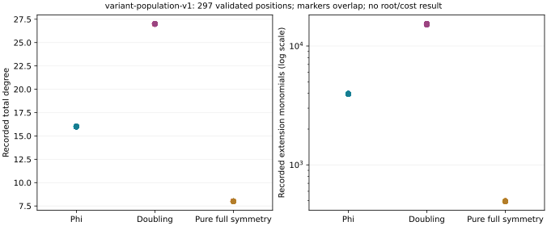

# All 297 variant constructions pass native record validation

The managed `variant-population-v1` sweep started at 03:20:23 UTC on
2026-10-24. It covers every position of the frozen algebra-v1 workload:
seven fields, three seeds, three arms, fixed query positions and labelled
positive/regression controls. All 297 requested positions are terminal:
294 new exports and three reused exports from the already completed
verification-v8 regression. No solver or relation oracle is repeated.

The independent `variant-validation-v1` runner finishes at 06:29:08 UTC
and reports **pass**, with no bounded failures, invalid records or missing
positions. Its full native output is
[variant-population-v1-validation.json](../../results/variant-population-v1-validation.json).
The copied receipt is checked byte-for-byte against the terminal native
output; its actual SHA-256 is recorded with the publication evidence.
Both files hash to `8f20e187ebcb85f753c9fe67a2313471bf1e7fb8303ffbb45afc0c3b86b19da3`.

## What the validator checks

The exporter is the frozen verification-v8 runner from
`dc19cc173a457dd4595459765a2fb37a9b02e383`. The separate validator is built
from `fb1733b0ed002e5b8314e41597d6ee03904f0e25`; its original gate passes
76 tests before the runner is copied and sealed. It checks the workload,
public-input hashes, variable arities, coefficient ranges, equation
statistics and hashes, and exact msolve serialization. It checks both
finite and geometric exports at every successful position.

The v8 input files omit recorded equation-digest/statistics fields that
the original algebra-v1 format carries. The validator computes them,
checks the finite statistics against the producer summary, records that
those optional input seals are absent, and checks any recorded seal when
present. It does not invent missing producer seals. Producer map/symmetry
check counts are retained, rather than re-executed in this postprocessor.

## Representation sizes and fair controls

The all-position plot shows recorded degrees and extension-monomial
counts. Markers can overlap; they are not independent random-curve
samples. The p37/seed0/query2 regression has these native recorded values:

| Representation | Total degree | Extension monomials |
|---|---:|---:|
| Phi with inverse coordinate, reduced | 16 | 3,960 |
| Doubling with inverse coordinate, reduced | 27 | 15,180 |
| Pure L0 with full four-factor symmetry | 8 | 495 |

For the same fixture, unreduced phi has 7,425 monomials at degree 16;
unreduced doubling has 48,510 at degree 96; partial pure symmetry has
1,485 at degree 16. The recorded reductions change the encoding. They do
not measure solving work, regularity, physical relation yield or rank.
These numbers describe the implemented encodings, rather than an intrinsic
lower bound for every doubling representation.

The pure control is necessary: its permutation symmetry gives a smaller
representation too. Phi's inverse-coordinate relation differs from
doubling's norm-denominator relation, but an input-size difference alone
does not establish a twist-specific algorithmic speedup. The selected
native regression already records allocation failure for both mixed
implicit encodings under the same 8 GiB cap; those failures remain intact.

## Budgets and unresolved measurements

Every new constructor uses one Rust worker, 8 GiB and its original
1,200 s outer watchdog. One busy reservation per field covers the frozen
position loop; each export retains its individual limit and receipt.
Compilation is separate. Validation uses its frozen native runner,
8 GiB, the shared busy reservation and a 1,200 s watchdog. No elapsed
speed comparison is admitted on this shared host.

This is a record/coefficient/export consistency result. It is not an
independent generic S5 ideal derivation, a complete-root certificate,
a full-stream physical-set/rank result, or an end-to-end price. Those
requirements remain open. The raw outputs are outside the earlier
22-directory checkpoint and must enter a later canonical archive version.
No leaderboard or benchmark-index result is promoted.
