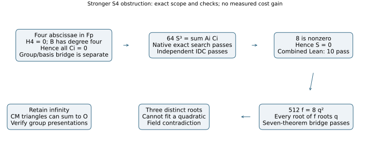

# Stronger component-ideal obstruction for a finite S4 residual

This extends the completed four-distinct-root discriminant check. The
weaker result cannot justify a filter when the fourth, residual abscissa
repeats an ordinary factor. The stronger frozen target is

    S = 64*s4 - (4*s2-s1^2)^2,
    64*S^3 = A0*C0 + A1*C1 + A2*C2 + A3*C3.

The native rational search `pure-zero-square-v1` is terminal and passes:
34 equations, 31 unknowns, denominator 64, zero integer remainder, and
a rejected constant +1 mutation. The exact coefficients are retained in
[certificate.json](../../results/square-zero-obstruction/certificate.json).
The independent Rust/IDC replay `square-zero-verify-v1` passes as
IDC1h65c11f01d0b1e67a: exact integer remainder zero, 32 extra points,
constant and multiplier mutations rejected. The input SHA-256 is
`c6bed3a5b6170e15e5fcd1a0b374000f0c459f3b38fececaef7d87da06bbe5cd`.
Its unchanged receipt is under `results/square-zero-obstruction/independent-v1/`.
The combined Lean check `square-ideal-lean-v1`
now actually passes: 10 audited theorems, zero failing, zero trusted
native declarations. Its actual logs and source hash are retained in
`results/proof-checks/square-ideal-v1/`.

## Readable bridge and current proof status

Put a=s1,b=s2,c=s3,d=s4 and

    f(X)=X^4-a*X^3+b*X^2-c*X+d,
    q(X)=8*X^2-4*a*X+4*b-a^2,
    C3=-512*c+256*a*b-64*a^3.

The seven-theorem `square-bridge-lean-v1` gate actually passes, with
only the three standard Lean foundations and no failing or trusted
native declarations. It verifies the universal ring identity

    512*f(X) - 8*q(X)^2 = C3*X + 8*S,

the factorization of f at elementary symmetric coordinates, and the
following field consequence: if 8 is nonzero and C3=S=0, f cannot have
three distinct roots. At a root of f, the identity forces q(X)^2=0;
q has degree two and nonzero leading coefficient. The formal proof
uses differences of quadratic values and absence of zero divisors,
rather than assuming the desired root bound.

The checked combined source adds the actual 64*S^3 certificate, derives
S=0 from C0=C1=C2=C3=0, and composes that conclusion with the root bridge.
Its new declarations are `SquareIdeal.component_square_certificate`,
`coefficients_force_defect_zero` and `components_exclude_three_distinct_roots`.
The independent coefficient replay also passes its separate execution gate;
the full curve/group theorem is not formalized by this success.

## Released counterfactual audit

Let K contain F, assume B has degree four over F, and consider the
nonsingular model y^2=x^3+B in characteristic other than 2 or 3. Three
distinct finite ordinary factors have abscissae in F. If their signed
sum is finite with abscissa in F, all four abscissae of the resulting
S4 equation lie in F. Coefficient independence makes every Ci vanish.
The checked square result contradicts the three distinct roots,
even if the fourth abscissa repeats one of them.

For S4 necessity with that possible repetition, pair the four signed
points so each pair has different abscissae. Such a pairing exists when
the first three are distinct. Neither pair sums to infinity; their
opposite finite sums supply the common root in the S3 resultant.
The standard group-sum necessity is stated in
[Gorla–Massierer, Definition 2.4 and Theorem 2.5](https://arxiv.org/html/1405.1059),
citing [Semaev](https://eprint.iacr.org/2004/031).
The complete curve/group and field-embedding bridges are not formalized
in Lean by these polynomial theorems.

Infinity requires a different branch: a CM triangle P,psi(P),psi^2(P)
can sum to O with three distinct ordinary abscissae. The proposed rule
therefore retains infinity. The native audit includes an actual group
fixture with that triangle and a fourth distinct peel.

Both stronger checks now pass. The frozen supplement requires a
counterfactual audit over the original 9,658 residuals, all 21 cases and
the phi, doubling and pure controls. It must preserve every physical
presentation, unique tuple, projective row, independent rank, first
full-rank query and recovered solution. It does not repeat the old
collector or its group oracle. It also checks the concrete power basis
1,B,B^2,B^3 in each public model.

## Accounting and limits

Search and independent replay use native Rust; the proof uses Lean
4.34.1. Each scientific phase has one worker, the busy reservation,
8 GiB, and its original 60 s replay/search or 900 s proof watchdog;
compilation is separate. Failed earlier attempts remain preserved.
No elapsed timing is admitted on this shared host.

This is a finite-component obstruction and a proposed stage filter.
It supplies neither new relations nor an independent matrix-rank gain.
Both phi and doubling can use a valid ordinary-component filter; its
benefit cannot be attributed to a twist without a matched complete-cost
comparison. No asymptotic, novelty, leaderboard or full-DLP claim is made.
