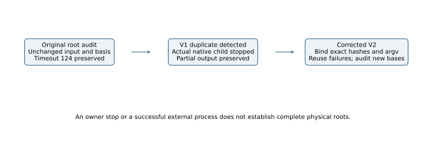

# External follow-up: duplicate terminal audit stopped and reconciliation fixed

The first follow-up owner has an orchestration defect: it reuses completed
audit summaries but fails to recognize a completed timeout without a summary.
The original basis and input did not change. The duplicate was identified
and stopped; every partial artifact and the original timeout are retained.

## Actual sequence

`twist-joint-external-audit-completion-v1.service` starts at 05:39 UTC and
waits for the two original external owners. After the external msolve
inventory finishes, it copies existing successful audit records and starts
another `l0-peel-variant-geometric` root audit. That identical computation
already has native exit **124** after its original **1,200-second** cap in
`external-audit-v3`. The missing summary is a timeout, not an unaudited input.

At inspection, the duplicate is running with a native child; it is not
merely waiting for the lock. The service is stopped before further retries.
The before-stop receipt records **132,461,232,000 ns of whole-service CPU**.
That is unadmitted service accounting, including orchestration, not a
solver timer or a new scientific result. No native completion verdict
exists for the stopped retry. Systemd's successful stop is not an audit pass.

The original timeout, executed scripts, duplicate command and partial
outputs remain under their original run IDs. The reconciliation and exact
before/after service observations are in
`runs/external-audit-completion-v1/metadata/duplicate-reconciliation.json`
and the adjacent stop receipts. No msolve or BSGS process is repeated by
the correction. The unnecessary native-root retry itself is explicitly
recorded here rather than omitted from consumed work.

## Corrected version

Commit `0fd82a7287` adds a separate terminal-failure reuse branch. It
requires the exact original argv, with public-input, system and basis
hashes and the frozen runner/output paths, to match before reusing the
failed receipt. The actual unchanged timeout command matches; a changed
basis-hash argument is rejected. The earlier inline corruption check
changed the reference argument; the corrected control changes the actual
basis-hash position. These infrastructure checks run no native audit.

New owner `twist-joint-external-audit-completion-v2.service` preserves that
timeout as `reused-native-terminal-failure`, with native exit 124 and
external exit zero. Its remaining audits cover only newly available
terminal bases. All 21 expected positions, including missing and failed
outputs, remain in its inventory. A zero external exit supplies no complete
root, physical-yield or rank claim by itself. The existing one-worker,
8 GiB, 1,200-second native cap and busy reservation remain unchanged.
Read its own eventual terminal report for its outcomes; none is inferred
from this correction. No benchmark or leaderboard result is promoted.
