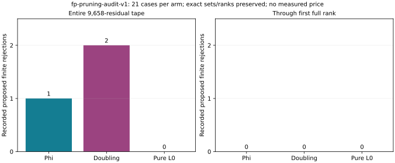

# Finite-field pruning preserves all sets and saves no through-rank systems

All 21 saved-tape cases pass the counterfactual finite-Fp rejection audit.
The 77-test software gate, proof and integer replay are recorded separately.
No polynomial collector or BSGS oracle was repeated by this audit.

## Complete observed counts

Each arm tests 1,957,992 finite signed peels over the same 9,658 residuals.
The full-stream rejection counts are **phi 1, doubling 2, pure 0**.
All rejected presentations were already unsuccessful in the saved oracle.
There are zero false rejections on all 21 cases in each arm.

| Arm | Tuples retained | Projective rows retained | Full-rank cases | Rejections through first full rank |
|---|---:|---:|---:|---:|
| Phi | 1,865 | 1,698 | 21/21 | 0 |
| Doubling | 1,804 | 1,705 | 21/21 | 0 |
| Pure | 441 | 417 | 21/21 | 0 |

Every saved physical presentation, unique physical tuple and projective
row is preserved. Independent RREF gives the original rank, the identical
first full-rank query and verified target/factor points in every case.
All finite systems through rank remain: phi **275,784**, doubling
**260,496**, pure **1,062,000**. These are sums of separate case counters,
not pooled ranks or amortized DLP prices. Infinity is retained by the rule;
the actual-point exception test is in the software report.

## Interpretation and evidence

This predicate supplies **no system-count saving before recovery on this
tape**. Its proof and successful preservation audit do not establish a
useful collector improvement. No filter is deployed and no new elapsed
time or complete price is admitted. A different workload could differ;
this is not an impossibility claim for other pruning or joint algorithms.

Native source and frozen runner are the same as the
[software gate](../run-20261024T0607Z-pruning-software/REPORT.md).
The full native summary is `runs/fp-pruning-audit-v1/summary.json`, SHA-256
`e8122030c1d0255630a3a50425c3fe37f1daf75f5491be368a2621bda49e8903`.
`results/fp-pruning-v1-headline.json` is a direct field projection of that
summary; it performs no new aggregation. Per-case records, input/reference
hashes, actual commands and exits remain in the raw run. One Rust worker,
8 GiB, 1,200 seconds per case and the shared busy reservation apply.
No benchmark-index or leaderboard row is promoted.
