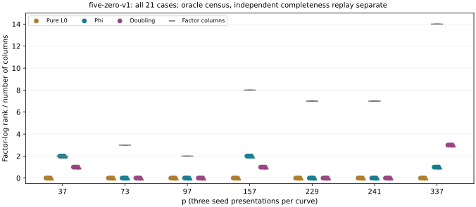

# Five-factor zero census: equal aggregate counts, different rank

The native census completes all **21 cases and three arms**, with zero
missing cases. It reuses old point-verified matrix solutions as an oracle;
it neither repeats BSGS nor supplies a polynomial relation-finding price.
The required independent point-keyed completeness replay is a separate run.

## Counts and factor-log rank

Pure five-ordinary-factor zero sets are empty on every case. Phi and
doubling each yield **504 signed physical tuples and 15 distinct projective
rows**, summed over the 21 separate cases. Neither has an all-zero row in
this five-factor census. Equal row counts do not imply equal rank.

| p | Factor columns | Phi tuples / rank | Doubling tuples / rank |
|---|---:|---:|---:|
| 37 | 2 | 72 / 2 | 24 / 1 |
| 73 | 3 | 0 / 0 | 0 / 0 |
| 97 | 2 | 0 / 0 | 0 / 0 |
| 157 | 8 | 48 / 2 | 24 / 1 |
| 229 | 7 | 0 / 0 | 0 / 0 |
| 241 | 7 | 0 / 0 | 0 / 0 |
| 337 | 14 | 48 / 1 | 120 / 3 |

Every table row applies to each of its three retained seeds; all 21 records
are preserved individually. At p37, phi's zero rows recover all two
unanchored factor logs and verify every source/image point, while doubling
reaches rank one. At p157 phi also has greater rank; at p337 doubling has
greater rank. There is no uniform rank ordering over these curves.
The seeds are not independent curve samples.

The pure and mixed joins check exactly ten and six partitions per physical
tuple respectively, then deduplicate. Every retained five-point group sum
is checked. The target coefficient is zero, and no target recovery is
attempted. Full factor-log verification occurs only for the three p37 phi
records; a rank-deficient result is not a failed point verification.

## Cost and verification limits

The scalar-keyed enumeration records 35,456,448 pure triple queries and
107,972,352 for each mixed arm, plus pair-table sizes per case. These are
oracle-work counters, not polynomial IC costs. All 79 native tests pass
before the runner is copied. Source label is
`11592c85b13d97dcffce3744424fa9db7a9d2665`, with actual source and runner
hashes. One worker, 8 GiB, 1,200 seconds per case and the busy reservation
are retained.

Unchanged native summary: `results/five-zero-v1-summary.json`, SHA-256
`14347fef57ee2bd1ed3ac43bc4b1efc3d0cd6365d4c9ea41d599a660ebf113d2`.
Its per-case hashes bind exact signed sets. The separate
[point replay contract](../../SUPPLEMENT_FIVE_POINT_REPLAY.md) uses public
point keys, a unique canonical partition and another elimination algorithm.
Until that replay passes, completeness remains independently unverified.
Even a pass would still require a polynomial collector, charged setup,
target descent, generic-image controls and complete matched prices before
an end-to-end gain is claimed. No leaderboard or benchmark row is promoted.
