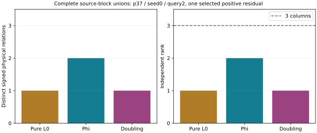

# The historical pure S5 miss is matched to a complete fixture result

`historical-s5-match-v3` compiles and exits zero at the matching step.
This closes the source-and-record binding obligation for one historical
residual. It does not repair or rerun the original tagged solver.

## Exact binding and controls

The checker uses source commit `9b9e3dad0a7b4638624759953760f8160bda865b`,
including the diagnostic syntax correction. Its actual source hashes,
immutable runner hash, exact commands and exits are retained in
`runs/historical-s5-match-v3/metadata/`. It compares every one of the 13
public keys with the frozen export projection. All **61** query pairs
and their order match; only the raw oracle-count column is removed.

The historical pure `k=0` case is **p37, seed 0, query 2**, with public
query coefficients **a=1,798,499; b=300,441**. The earlier degree-30
record is partial and returns no polynomial relation. Its reference tuple
is exactly the completed pure source-block solution's tuple:
`[(5,-1),(21,-1),(23,1),(24,1)]`.

That solution has complete native roots and passes the separate
signed-set/RREF audit, with one physical relation and rank **1/3**.
The chart shows the already recorded three-arm fixture, not three new
solves. The pure tuple's source presentations occur in all three blocks;
their union contains one relation.

All four corruption controls reject: changed public coordinate, changed
query coefficient, omitted tuple and truncated public trace. The full
result and input/audit hashes are copied to
`results/historical-s5-match-v3/summary.json` (SHA-256
`680a317ae18937b21a45922dbabc1086b612054e2e59fc2a355389c8d07e4fbe`).
Its diagnostic JSON is retained separately.

## Scope and resources

This checker reads saved records; it runs no collector or BSGS oracle.
The shared busy reservation covers build and match. Matching has one
worker, an 8 GiB address-space cap and a 60-second watchdog after separate
compilation. No elapsed time or complete-cost gain is admitted.

The two quartic field constructors choose the same first nonsquare;
compatibility is a separate source audit, not retroactive execution
attestation. The historical report carries no complete runtime input
hash. This pass therefore establishes no retroactive runtime seal,
whole-61-query collector completion, generic ideal equality, IC gain or
complete price. Both failed checker attempts remain preserved.
