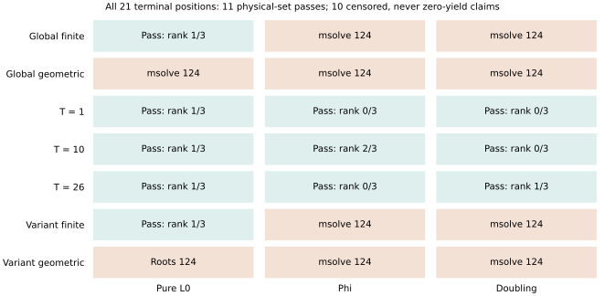

# All 21 external S5 positions reconciled with exact physical-set audits

The original 21 msolve processes and both native audit owners are terminal.
The corrected follow-up reuses every matching successful or failed receipt
and checks only newly available bases. The earlier duplicate retry and
its consumed work remain in the separate correction report.

## Actual terminal inventory

Every input is the fixed p37/seed0/query2 fixture. `P r/3` below means
complete physical-set equality with the independent group oracle and
independent matrix rank r/3. `MS124` is an msolve timeout with no certified
basis/root outcome. `Root124` is a native root-audit timeout after msolve
returned a basis; it supplies no physical-yield result.

| Encoding | Pure | Phi | Doubling |
|---|---|---|---|
| Global finite | P 1/3 | MS124 | MS124 |
| Global geometric | MS124 | MS124 | MS124 |
| Source block T=1 | P 1/3 | P 0/3 | P 0/3 |
| Source block T=10 | P 1/3 | P 2/3 | P 0/3 |
| Source block T=26 | P 1/3 | P 0/3 | P 1/3 |
| New finite variant | P 1/3 | MS124 | MS124 |
| New geometric variant | Root124 | MS124 | MS124 |

There are 11 physical-set passes, nine external timeouts and one retained
native root timeout. All expected positions are present in the workflow
inventory. The pure block passes recover the same single physical tuple;
their union does not create three relations. The mixed block unions agree
with the earlier complete source-block regressions.

Each passing audit verifies input reductions and S-pairs, exhausts the
basis's Fp variety, checks allowed factors/signs and group sums, and
compares the complete physical set and rank with the separately scoped
group oracle. **Reverse ideal containment remains unverified**. These
finite physical-set results do not establish generic equality of ideals.

## Scope and receipts

Official msolve 0.11.0, its source/image/executable hashes, one-thread
options, exact system/basis hashes and exits are retained in
`runs/external-regression-v2/`. External phases retain 8 GiB,
1,180-second cooperative and 1,200-second outer limits; native audits
retain 8 GiB/1,200 seconds and the shared busy reservation. These are not
admitted paired solver timings or a complete DLP pipeline comparison.
No missing or timed-out result is counted as zero physical yield.

`results/external-audit-completion-v2-inventory.json` is the unchanged
workflow inventory, SHA-256
`8c195a6e0c9c8963ddca258e7853941ba37edb2da405b29bb687645668c5a9f3`.
Native summaries and every original failure remain in the raw archive.
No fastest-external, IC speedup or leaderboard promotion is claimed.
