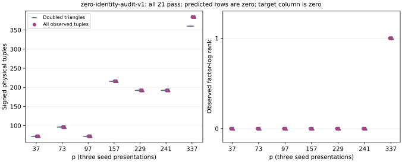

# Doubled-triangle control passes all 21 saved zero sets

The separate public-point reconstruction passes every original case and
has no missing case. It reads saved zero sets and repeats no BSGS oracle.

For every ordinary source P, the checker reconstructs
`[2]P - P + psi(P) + psi²(P) = O` and its global negative from actual
points and sign encodings. The distinct allowed factors and doubling-image
injectivity make 2L different physical tuples. Every predicted tuple occurs
in the saved complete zero set, and every predicted augmented row is zero.
The separately checked Lean coefficient identity is not substituted for
these actual group, set-membership and row checks.

| p | Predicted signed tuples | Observed tuples | Additional tuples | Observed factor rank |
|---|---:|---:|---:|---:|
| 37 | 72 | 72 | 0 | 0/2 |
| 73 | 96 | 96 | 0 | 0/3 |
| 97 | 72 | 72 | 0 | 0/2 |
| 157 | 216 | 216 | 0 | 0/8 |
| 229 | 192 | 192 | 0 | 0/7 |
| 241 | 192 | 192 | 0 | 0/7 |
| 337 | 360 | 384 | 24 | 1/14 |

Each table row is observed separately on all three seeds. The control
explains the whole physical zero set on six curves. At p337 it explains
the 360 zero rows, while the 24 additional tuples contribute the separately
observed rank one. Thus neither all physical zero relations nor all
doubling zero relations can be dismissed as tautologies.

The checker reuses the immutable 79-test runner from `five-zero-v1`,
SHA-256 `5d38c7f75fb1ce23cf41e13daaf0e6900478fb8b5dded208980b2086d4b250fd`.
The predeclared protocol is `SUPPLEMENT_ZERO_DOUBLING_IDENTITY.md`;
`run-zero-identity-audit.sh` waits for all 21 saved outputs before checking.
Commands, input/runner hashes and exit zero remain in the raw run.

Unchanged native summary: `results/zero-identity-audit-v1-summary.json`,
SHA-256 `4cffa2b82a00b3a97eae945cf4a77d31b723c7fcbe0b25115afa2244586d5077`.
One worker, 8 GiB, 1,200 seconds and the busy reservation are retained.
This is a structural subset control, not a new collector, target recovery
or complete-price comparison. Every zero-only target coefficient is zero.
