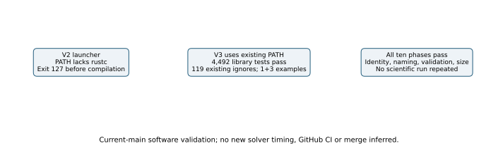

# Current-main integration gate passes all ten phases

The ordinary clean merge of fetched main at 092d1ff47e changes seven runtime
files. The earlier 4,488-test gate is retained; the new gate checks the new
root inputs and is not inferred from that earlier result.

## Observed results

| Phase | Actual outcome |
|---|---|
| Release library compilation and tests | 4,492 passed, zero failed, 119 existing ignores |
| Touched examples | One integer-certificate test and three structure tests pass |
| Curve identity self-test and naming | Both exit zero |
| Validation-gate tests and base comparison | Both exit zero |
| Official large-file check | Exit zero |

All ten declared phases, including separate compilation, have exit zero.
The library log reports 978.66 seconds under the unchanged 1,200-second
watchdog. This is an unadmitted test duration, not a solver comparison.
Tests are serial under 8 GiB after separate compilation without the
address-space cap. Heavy work uses the existing shared busy reservation.

## Retained launch failure and exact scope

The first launcher, `post-latest-main-v2`, exits 127 before compilation
because managed systemd PATH cannot find rustc. Its executed script,
partial startup metadata and journal are retained. Corrected v3 explicitly
selects the existing `/home/ec2-user/.cargo/bin` toolchain; no resource,
test or evidence gate is weakened. No scientific workload runs in v2.

The v3 source label is
`1055dcbcdb4998e78e22c900ab737ddc9913de70`, with actual root source
hashes, empty touched-source diff, commands, host, Rust version, outputs and
exits in `results/publication/post-latest-main-v3/metadata/`.
The native point-replay suite's earlier 81-test pass has its own source and
frozen runner; it is not a newly repeated test under this root label.

The gate starts at 10:25:18 UTC and finishes at 11:11:56 UTC. Later metadata
and report commits do not change these root runtime inputs. The 43-directory
scientific checkpoint remains fixed. This software pass does not establish
new mathematical completeness, a scientific speedup, published-head GitHub
CI or PR merge. Applicable review and CI still concern the published head.
