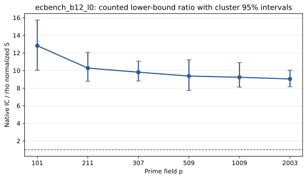

# ecbench_b12_l0 run report

Session ECBS1hb42cab033348 used spec ECS1h6016b77af125 (SHA-256 6016b77af1259573d64bf3446781d817d94fa496991b214475259f7114b21d0e) and binary SHA-256 56a532e119bb6e58df188afc25d6bc8495fd345a643a8c541f136481f1090324. The host was Intel(R) Xeon(R) 6975P-C. Isolation earned L0 (--cpus none --allow-busy); wall time is descriptive. All curve registry flags were false.

The session requested 324 runs: 324 verified. Three public targets per curve, one warmup and five measured rounds compared rho-neg, ic-native, and an A/A rho arm. The saved comparison has 90 measured IC/rho pairs; its counted S ratio is 10.427. Both arms have unpriced native counters, so that ratio is a lower-bound diagnostic. All six curves have comparable verified IC/rho pairs.

Figure: per-curve counted S ratios and cluster 95% intervals from the saved ecbench comparison. L0 wall time is not admitted; no twist method ran in this session.

Sources: [sealed session](../../sessions/ecbench_b12_l0/), [comparison](../../sessions/ecbench_b12_l0/comparisons/rho-neg__ic-native.json), [audit](../../ecbench_b12.audit.json).
