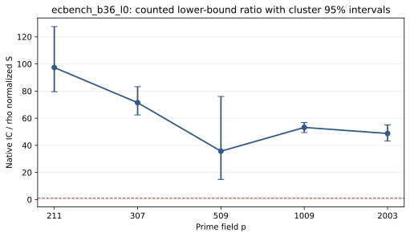

# ecbench_b36_l0 run report

Session ECBS1h3b6532e1f17c used spec ECS1h7d2c03d8f40f (SHA-256 7d2c03d8f40fc0c2476e25ecdebc83c9e014c04547ff0ce68437bf34b2e910fa) and binary SHA-256 56a532e119bb6e58df188afc25d6bc8495fd345a643a8c541f136481f1090324. The host was Intel(R) Xeon(R) 6975P-C. Isolation earned L0 (--cpus none --allow-busy); wall time is descriptive. All curve registry flags were false.

The session requested 324 runs: 18 exhausted, 306 verified. Three public targets per curve, one warmup and five measured rounds compared rho-neg, ic-native, and an A/A rho arm. The saved comparison has 75 measured IC/rho pairs; its counted S ratio is 60.472. Both arms have unpriced native counters, so that ratio is a lower-bound diagnostic. p=101 is absent from the comparable IC/rho graph because all 18 strict IC executions exhausted.

Figure: per-curve counted S ratios and cluster 95% intervals from the saved ecbench comparison. L0 wall time is not admitted; no twist method ran in this session.

Sources: [sealed session](../../sessions/ecbench_b36_l0/), [comparison](../../sessions/ecbench_b36_l0/comparisons/rho-neg__ic-native.json), [audit](../../ecbench_b36.audit.json).
