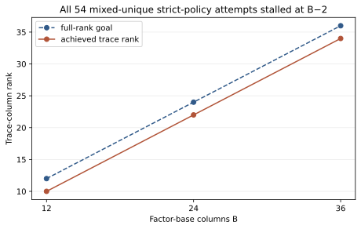

# Full-rank failure control

The final-source --full-rank-control run reproduced 54 of 54 mixed-unique failures: six curves × three base sizes × three targets. Achieved trace ranks were 10/12, 22/24, and 34/36. All 162 native-B, native-trace, and mixed-rect attempts solved. The historical first failure file is retained, but its exact intermediate source revision was not frozen.

Figure: recorded strict-policy mixed-unique rank and full-rank goal. Every B point represents 18 failed target attempts. This is a rank result, not a wall comparison.

Sources: [replayable raw](../../mixed_full_rank_control.ndjson), [historical raw](../../mixed_full_rank_attempt.ndjson), [protocol](../../MIXED_PROTOCOL.md).
