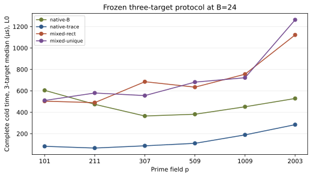

# Frozen three-target protocol run

The frozen three-target protocol emitted 72 exhaustive relation censuses, 216 correct IC solves, and 54 matched rho solves. All target scalars were independently checked. Mixed-unique used the explicitly amended target-row span rule; the original full-rank failures are preserved separately.

Figure: recorded median complete cold time across three predeclared public targets per curve at B=24. L0 wall time is descriptive. The full raw file includes all three B values.

Sources: [raw](../../mixed_component_results.ndjson), [protocol](../../MIXED_PROTOCOL.md), [auditor](../../validate_mixed_results.py).
