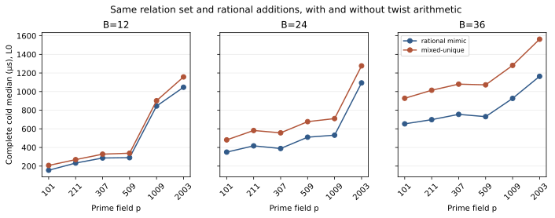

# Matched rational-only mimic run

The matched rational-only control tested every nonzero public target at six curves and three base sizes: 12,312 target pairs. The paired audit confirmed equal projected relation sets, setup trials, descent paths, recovered scalars, and rational group-law addition counts. The mimic performed zero twist additions; the mixed arm performed positive twist additions on every pair.

Figure: recorded complete cold medians across every target per curve and B; L0 time is descriptive and includes direct-extension witness checks. Raw SHA-256: 77ddee7cb277f0c9288d2d6ea17a0ccf869510a1317bc34665c6952217700b9c.

Sources: [raw](../../native_mimic_control.ndjson.gz), [audit](../../native_mimic_audit.json), [auditor](../../audit_native_mimic.py).
