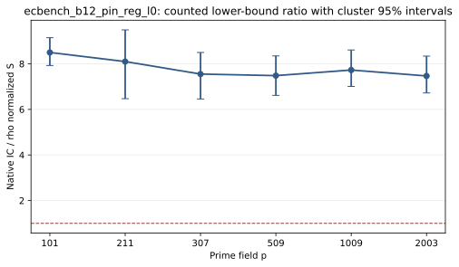

# ecbench_b12_pin_reg_l0 run report

Session ECBS1h8f59e93309b7 used spec ECS1ha1eede873cd7 (SHA-256 a1eede873cd719c4d39473739efde84c36de7eb741839fdff740b68945d81389) and binary SHA-256 b0c9d8093e01d748ec8b850548ae63347a0e69e9131badae7444a0b4211dc635. The host was Intel(R) Xeon(R) 6975P-C. Isolation earned L0 (--cpus none --allow-busy); wall time is descriptive. All curve registry flags were true.

The session requested 324 runs: 324 verified. Three public targets per curve, one warmup and five measured rounds compared rho-neg, ic-native, and an A/A rho arm. The saved comparison has 90 measured IC/rho pairs; its counted S ratio is 7.892. Both arms have unpriced native counters, so that ratio is a lower-bound diagnostic. All six curves have comparable verified IC/rho pairs.

Figure: per-curve counted S ratios and cluster 95% intervals from the saved ecbench comparison. L0 wall time is not admitted; no twist method ran in this session.

Sources: [sealed session](../../sessions/ecbench_b12_pin_reg_l0/), [comparison](../../sessions/ecbench_b12_pin_reg_l0/comparisons/rho-neg__ic-native.json), [audit](../../ecbench_b12_pin_reg.audit.json).
