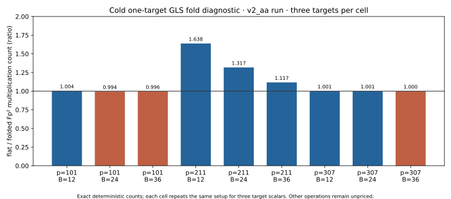

# GLS symmetry v2_aa run record

UTC start directory: `20261021T1536Z`. Description: repeated v2 A/A control. Host:
`ip-172-31-26-135.us-east-2.compute.internal`, Intel Xeon 6975P-C, 32
logical CPUs. Isolation: L0 shared host. The run exited successfully; the
[stderr](../../gls_symmetry_run_v2_aa.stderr) file is empty. The exact
[protocol](../../GLS_SYMMETRY_PROTOCOL.md) and its explicit v2 amendment
define the three curves, bases, relation oracle, targets and stopping rules.

The command was native `rustc -D warnings -O` compilation of
[`gls_symmetry_ic.rs`](../../gls_symmetry_ic.rs)
followed by a single complete producer execution with stdout redirected to
[`gls_symmetry_results_v2_aa.ndjson`](../../gls_symmetry_results_v2_aa.ndjson)
and stderr to the linked file. Source SHA-256: `3483134315e51797b956df8eb29410252e65e86418285855e94d7b463bc92626`. Raw output
SHA-256: `d64ab66dc2a38adf4a13beded258acb76308e31db2343d3cc47b32a2b44c5a87`. Producer snapshot commit: `17405f4ef` (v1 source
and v2 source were frozen there). No run was substituted or discarded.

Requested/completed: 3 curve records, 9 full signed-triple censuses, 9
corrupted-orbit controls, 54 cold one-target IC solves and 27 same-target
negation-rho solves: **102/102 records**, 0 failures or timeouts. The
[independent audit](../../gls_symmetry_audit_v2_aa.json) passed all group,
curve-order, orbit, rank and scalar checks. The
[native summary](../../gls_symmetry_summary_v2_aa.csv) has all 27 cell-arm
rows, medians and min/max L0 times. Three target scalars repeat the same
setup trajectory in each cell; setup trial counts are one deterministic
trajectory, not three independent samples.

Example measured cell `p=211,r=44221,B=12`: flat/fold collection queries
`829/254`; cold recorded `Fp²`
multiplications `110453/67414`; rho
`25635`. L0 median time (three targets):
`6052836/3880655/814606` ns for flat/fold/rho.
The displayed ratio of flat/fold multiplication counts is
`1.638428`; it is derived by dividing the two recorded
counts. Min/max times, all other cells and separate operation categories
are in the CSV and NDJSON. No uncertainty interval was recorded beyond the
three-target min/max; setup count variation is absent by construction.

The graph is rendered by [`render_gls_visuals.py`](../../render_gls_visuals.py)
from the native CSV without recomputing results. [PNG](gls_fold_cost_v2_aa.png)
is the matching 150 dpi render. [Editable PDF source](README.typ) and
[PDF](README.pdf) include this graph. Field additions, inner base-field
arithmetic, hashing and allocations are not exhaustively priced; times are
L0 descriptive. This run report records observations only.
