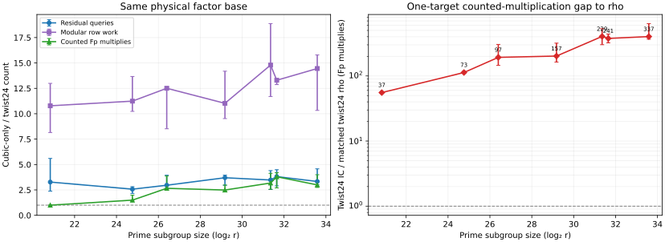

# Quartic twist24 v2 A/A repeat

UTC start 2026-10-22 05:43:44.734; completion 05:44:32.212. Same shared Intel Xeon 6975P-C host, 32 logical CPUs, `rustc 1.99.1`, `RAYON_NUM_THREADS=16`, L0. Same source commit `4d6cb3168e` and frozen [protocol](../../QUARTIC_TWIST_LINE_PROTOCOL.md) as the [first run](../run-20261022T0542Z-quartic-v2/README.md).

```sh
RAYON_NUM_THREADS=16 TMPDIR=/home/ec2-user/.cache/gls-report-tmp timeout 1800s target/release/examples/quartic_twist24 > research/twist_index_calculus_20261020/quartic_twist24_full_v2_aa.ndjson 2> research/twist_index_calculus_20261020/quartic_twist24_full_v2_aa.log
```

All 21 instances, 63 IC answers and 1,008 rho answers succeeded. Raw [NDJSON](../../quartic_twist24_full_v2_aa.ndjson) SHA-256 `56d655c7e13285bf62f497720a2498cb360f673c37c199dcd79d880751302d2b`; [stderr](../../quartic_twist24_full_v2_aa.log). The [A/A diff](../../quartic_twist24_v2_aa.diff) is empty after deleting only `wall_ms`; every other recorded field matches the first run exactly. The independent [native audit](../../quartic_twist24_native_audit_v2_aa.json) passed and matches the first audit byte for byte. The graph copies the non-timing count plot because its raw count data are identical.



No wall-time inference follows from an L0 repeat. The [results report](../../QUARTIC_TWIST24_REPORT.md) and [PDF](README.pdf) state the scope.
