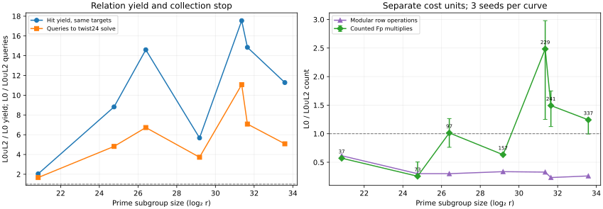

# Quartic twist two-line A/A repeat

UTC start 2026-10-22 05:52:55.464; completion 05:54:07.424. Same shared Intel Xeon 6975P-C host, 32 logical CPUs, `rustc 1.99.1`, `RAYON_NUM_THREADS=16`, L0, producer and [frozen protocol](../../QUARTIC_TWIST_LINE_PROTOCOL.md) as the [first mixed run](../run-20261022T0551Z-quartic-mixed/README.md).

```sh
RAYON_NUM_THREADS=16 TMPDIR=/home/ec2-user/.cache/gls-report-tmp timeout 1800s target/release/examples/quartic_twist_mixed_lines > research/twist_index_calculus_20261020/quartic_twist_mixed_v1_aa.ndjson 2> research/twist_index_calculus_20261020/quartic_twist_mixed_v1_aa.log
```

All 42 runs and 126 IC answers succeeded. Raw [NDJSON](../../quartic_twist_mixed_v1_aa.ndjson) SHA-256 `6338077c4dd2218c33c135a834622bd5cf74c6f95e93418ea1d61ae6f445ca1a`; [stderr](../../quartic_twist_mixed_v1_aa.log). The [A/A diff](../../quartic_twist_mixed_v1_aa.diff) is empty after deleting only `wall_ms`, and the [native summary](../../quartic_twist_mixed_summary_v1_aa.json) matches the first summary byte for byte. The independent [native audit](../../quartic_twist_mixed_native_audit_v1_aa.json) replays every query and relation again. The graph copies the non-timing values because the runs agree exactly.



This repeat measures determinism of the counted result. L0 wall time remains descriptive. See the [results report](../../QUARTIC_TWIST24_REPORT.md) and [PDF](README.pdf).
