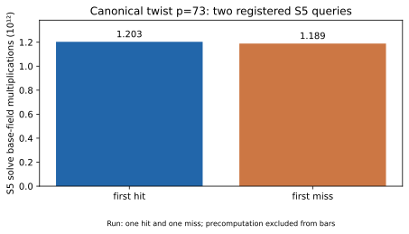

# Native S5 pilot, p=73

Run ID `run-20261022T0618Z-quartic-s5-p73`; 22 October 2026; Intel Xeon 6975P-C, 32 logical CPUs; shared-host L0. One public known-answer target `[271]G`. Registered [protocol](../../QUARTIC_TWIST_LINE_PROTOCOL.md), [raw record](../../quartic_twist_s5_p73.json), [stderr log](../../quartic_twist_s5_p73.log), and [graph](s5_cost.svg). Source SHA-256: `049e0bbcd34791c920176c32b65181d509d992edd47d05f1cf13e10ff1d5ca31`.

Command: `RAYON_NUM_THREADS=16 TMPDIR=/home/ec2-user/.cache/gls-report-tmp timeout 1800s target/release/examples/quartic_twist_s5_pilot --p 73 research/twist_index_calculus_20261020/quartic_twist_mixed_v1.ndjson`. The process watchdog was 1,800 seconds; both registered queries completed. The exact signed meet-in-the-middle oracle and group addition checked all returned quadruples. This is a two-query oracle pilot, not a full IC solve.

| Query | Index in frozen L0 stream | Exact decompositions | Native S5 solve `Fp M` | L0 solve ms | Oracle agreement |
| --- | ---: | ---: | ---: | ---: | :---: |
| first_success | 25 | 1 | 1,203,345,274,881 | 53,078.1 | yes |
| first_failure | 0 | 0 | 1,188,991,913,245 | 48,963.9 | yes |

Symmetrisation precomputation: 1,226,109,078 `Fp M`, 343.7 L0 ms. Each solve used a degree-29 Macaulay matrix with 41,780 rows and 40,920 columns. L0 timing is a shared-host observation and is not an isolated performance comparison. The S5 system is the single `x∈Fp` line; a tagged two-line or two-dimensional polynomial system was not run. msolve/Magma were unavailable in this environment and were not compared.

Graph source: [plot_quartic_followups.py](plot_quartic_followups.py). [PDF report](README.pdf). No failed, extraneous or censored outcome occurred.
