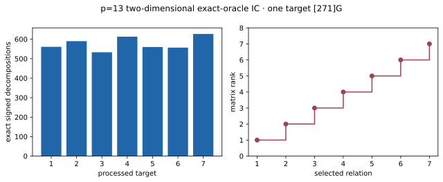

# p=13 two-dimensional exact-oracle IC pilot (A/A)

Run ID `run-20261022T0626Z-quartic-2d-p13-aa`; 22 October 2026; Intel Xeon 6975P-C, 32 logical CPUs; shared-host L0. One public target `[271]G`, seed zero, exact signed four-factor oracle, 72 physical base points and six 24-fold log columns. [Frozen protocol](../../QUARTIC_TWIST_LINE_PROTOCOL.md), [raw record](../../quartic_twist_2d_p13_aa_v1.json), [independent replay](../../quartic_twist_2d_p13_native_audit_v1.json), [graph](p13_relations.svg). Source SHA-256: `5799b63213978434879b607341f819180fb2620cd5d6b586927c9c0ac1e0dc0b`.

Command: `TMPDIR=/home/ec2-user/.cache/gls-report-tmp timeout 180s target/release/examples/quartic_twist_2d_p13`. The 10,000-target cap was not reached. Seven targets produced 4,041 signed decompositions and seven selected group-verified relations; rank seven recovered and independently verified the target log 271. The separate auditor enumerated all 28,753 group logs, recomputed all seven signed query hit counts and rows, and verified rank and answer. Full A/A non-timing diff: [empty](../../quartic_twist_2d_p13_aa.diff).

| Phase | Counted `Fp` multiplications | Counted group operations |
| --- | ---: | ---: |
| model | 650 | 0 |
| base | 216,201 | 0 |
| input | 3,560 | 35 |
| eigenvalues | 6,478 | 62 |
| orbit map | 149,262 | 1,422 |
| pair table | 495,864 | 5,112 |
| relation stream | 7,062,416 | 72,897 |
| answer check | 162,265 | 1,548 |

Matrix arithmetic: 460 modular row operations, separately priced. Total shared-host L0 process time: 29.95 ms; this is not an isolated speed result. Hash probes, table allocation, a matched rho band and an S5 polynomial system are not measured in this pilot.

| Processed target | Exact decompositions | Matrix rank |
| ---: | ---: | ---: |
| 1 | 561 | 1 |
| 2 | 590 | 2 |
| 3 | 533 | 3 |
| 4 | 613 | 4 |
| 5 | 560 | 5 |
| 6 | 557 | 6 |
| 7 | 627 | 7 |

Graph source: [plot_quartic_followups.py](plot_quartic_followups.py). [PDF report](README.pdf).
