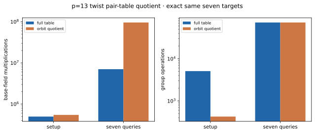

# p=13 twist-quotient pair-table oracle (A/A)

Run ID `run-20261022T0645Z-quartic-pair-quotient-aa`; 22 October 2026; Intel Xeon 6975P-C, 32 logical CPUs; shared-host L0. [Frozen protocol](../../QUARTIC_TWIST_LINE_PROTOCOL.md), [raw record](../../quartic_twist_pair_quotient_p13_aa_v1.json), [previous exact-oracle target trace](../../quartic_twist_2d_p13_v1.json), and [graph](pair_quotient.svg). Source SHA-256: `5a36638a7791581215d53c2a4a812988b42a881075919a0115731eb270881666`.

Command: `TMPDIR=/home/ec2-user/.cache/gls-report-tmp timeout 180s target/release/examples/quartic_twist_pair_quotient_p13 research/twist_index_calculus_20261020/quartic_twist_2d_p13_v1.json`. All seven queries completed. The full and quotient oracles returned **identical complete signed decomposition sets** on every query; each previously selected IC relation occurs in both. The full table had 5,112 entries, while the quotient stored 426 orbit representatives under the 12 abscissa actions and used 350 canonical hash keys. Orbit histogram: `{'12': 426}`. The [A/A non-timing diff](../../quartic_twist_pair_quotient_p13_aa.diff) is empty.

| Phase | Counted `Fp` multiplications | Counted group operations |
| --- | ---: | ---: |
| full setup | 495,864 | 5,112 |
| quotient setup | 544,746 | 426 |
| full seven queries | 7,029,782 | 72,576 |
| quotient seven queries | 96,036,422 | 72,576 |

Setup and query counts exclude common model, base and target construction. Hash probes, allocator bytes and resident memory were not measured. Shared-host L0 times (full setup/query; quotient setup/query) were 2.28/25.96 and 2.20/282.36 ms; these are diagnostics, not an isolated speed comparison. The quotient exchanges fewer stored pair representatives for more field arithmetic in this implementation.

Graph source: [plot_quartic_followups.py](plot_quartic_followups.py). [PDF report](README.pdf).
