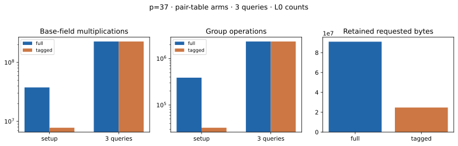

# Action-tagged pair index · ordered · p=37 · A/A

Run ID `run-20261022T0704Z-quartic-tagged-ordered-p37-aa`; 22 October 2026; Intel Xeon 6975P-C, 32 logical CPUs; shared-host L0. [Protocol](../../QUARTIC_TWIST_LINE_PROTOCOL.md), [raw record](../../quartic_twist_pair_tagged_p37_aa_v1.json), [stderr](../../quartic_twist_pair_tagged_p37_aa_v1.log), [empty A/A non-timing diff](../../quartic_twist_pair_tagged_p37_aa.diff), and [graph](tagged_pair_index.svg). Source SHA-256: `3ac3034a1dcc4fa9e03e7efe4436ed41d05493195486560b1d5532b201f6f004`.

Command: `ulimit -v 8388608; timeout 600s target/release/examples/quartic_twist_pair_tagged --p 37 research/twist_index_calculus_20261020/quartic_twist_2d_p13_v1.json research/twist_index_calculus_20261020/quartic_twist_mixed_v1.ndjson`. One public target `[271]G`; 3 frozen residual queries. Completed 3/3; no timeout, failure or censored query. The full and tagged tables produced exactly equal **complete signed four-factor decomposition sets** for every residual; an independent group addition checked all 388,752 reconstructed postings. The table contains 32,396 orbit representatives, 388,752 postings and 318,348 abscissa keys, against 388,752 full signed pair entries. Pair-orbit histogram: `{'12': 32396}`.

| Phase | Counted `Fp` multiplications | Counted group operations |
| --- | ---: | ---: |
| full setup | 37,708,944 | 388,752 |
| tagged setup | 7,796,605 | 32,396 |
| full queries | 226,616,754 | 2,336,256 |
| tagged queries | 226,616,754 | 2,336,256 |

| Table | Retained allocator-requested bytes | Peak allocator-requested bytes |
| --- | ---: | ---: |
| full | 91,007,248 | 91,007,248 |
| tagged | 24,700,872 | 77,279,520 |

Tagged lookup calls: 2,332,511; candidate postings inspected: 969,765. Setup/queries L0 wall ms, full: 186.384/1193.418; tagged: 125.682/1642.397. These shared-host observations are not isolated performance results. Posting audit cost is excluded from the candidate's charged work: 37,708,944 `Fp M` and 388,752 group operations. Model/base/target construction is common and excluded; full cold IC and matched rho were not run in this component comparison. Requested bytes are allocator payload sizes, not RSS.

| Query | a | b | Exact signed decompositions |
| ---: | ---: | ---: | ---: |
| 0 | 388601 | 593892 | 53,551 |
| 1 | 82489 | 1017024 | 53,688 |
| 2 | 1798499 | 300441 | 53,451 |

Graph source: [plot_quartic_followups.py](plot_quartic_followups.py). [PDF report](README.pdf). External same-computation pair-index tool: not available or compared; no fastest-tool claim.
