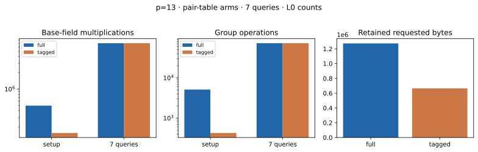

# Action-tagged pair index · hash · p=13

Run ID `run-20261022T0705Z-quartic-tagged-hash-p13`; 22 October 2026; Intel Xeon 6975P-C, 32 logical CPUs; shared-host L0. [Protocol](../../QUARTIC_TWIST_LINE_PROTOCOL.md), [raw record](../../quartic_twist_pair_tagged_hash_p13_v1.json), [stderr](../../quartic_twist_pair_tagged_hash_p13_v1.log), [empty A/A non-timing diff](../../quartic_twist_pair_tagged_hash_p13_aa.diff), and [graph](tagged_pair_index.svg). Source SHA-256: `0f1331541a0112a3b4b215ccc3a01ff9140fb1c1390f532796eb760944557710`.

Command: `ulimit -v 8388608; timeout 600s target/release/examples/quartic_twist_pair_tagged_hash --p 13 research/twist_index_calculus_20261020/quartic_twist_2d_p13_v1.json research/twist_index_calculus_20261020/quartic_twist_mixed_v1.ndjson`. One public target `[271]G`; 7 frozen residual queries. Completed 7/7; no timeout, failure or censored query. The full and tagged tables produced exactly equal **complete signed four-factor decomposition sets** for every residual; an independent group addition checked all 5,112 reconstructed postings. The table contains 426 orbit representatives, 5,112 postings and 4,200 abscissa keys, against 5,112 full signed pair entries. Pair-orbit histogram: `{'12': 426}`.

| Phase | Counted `Fp` multiplications | Counted group operations |
| --- | ---: | ---: |
| full setup | 495,864 | 5,112 |
| tagged setup | 154,922 | 426 |
| full queries | 7,029,782 | 72,576 |
| tagged queries | 7,029,782 | 72,576 |

| Table | Retained allocator-requested bytes | Peak allocator-requested bytes |
| --- | ---: | ---: |
| full | 1,273,360 | 1,388,576 |
| tagged | 665,228 | 1,207,104 |

Tagged lookup calls: 71,564; candidate postings inspected: 26,031. Setup/queries L0 wall ms, full: 2.249/26.430; tagged: 1.703/26.788. These shared-host observations are not isolated performance results. Posting audit cost is excluded from the candidate's charged work: 495,864 `Fp M` and 5,112 group operations. Model/base/target construction is common and excluded; full cold IC and matched rho were not run in this component comparison. Requested bytes are allocator payload sizes, not RSS.

| Query | a | b | Exact signed decompositions |
| ---: | ---: | ---: | ---: |
| 0 | 2394 | 3725 | 561 |
| 1 | 1479 | 7596 | 590 |
| 2 | 20331 | 22566 | 533 |
| 3 | 15632 | 20396 | 613 |
| 4 | 1476 | 25080 | 560 |
| 5 | 18153 | 25215 | 557 |
| 6 | 342 | 9410 | 627 |

Graph source: [plot_quartic_followups.py](plot_quartic_followups.py). [PDF report](README.pdf). External same-computation pair-index tool: not available or compared; no fastest-tool claim.
