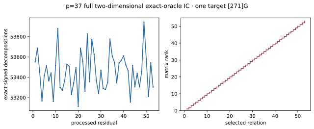

# p=37 full two-dimensional exact-oracle IC pilot · A/A

Run ID `run-20261022T0717Z-quartic-2d-p37-aa`; 22 October 2026; Intel Xeon 6975P-C, 32 logical CPUs, shared-host L0. One public known-answer target `[271]G`, seed zero, prime subgroup order 1,873,633. [Frozen protocol](../../QUARTIC_TWIST_LINE_PROTOCOL.md), [raw record](../../quartic_twist_2d_p37_aa_v1.json), [stderr log](../../quartic_twist_2d_p37_aa_v1.log), [independent native audit](../../quartic_twist_2d_p37_native_audit_v1.json), [empty A/A non-timing diff](../../quartic_twist_2d_p37_aa.diff), and [graph](p37_relations.svg). Producer SHA-256 `603813ad10a0b691297a64dfb8f734333d8bc19005faea2f51adae4360aceae6`; auditor SHA-256 `278a6d6bba8b4065b980202f8203ea8f9278c46e0088e307a8ce1c147aaf039e`.

Command: `ulimit -v 8388608; timeout 600s target/release/examples/quartic_twist_2d_p37 research/twist_index_calculus_20261020/quartic_twist_mixed_v1.ndjson`. Auditor command: `ulimit -v 8388608; timeout 600s target/release/examples/quartic_twist_2d_p37_audit research/twist_index_calculus_20261020/quartic_twist_2d_p37_v1.json`. Completed before the 256-residual and 600-second caps; no failures, timeouts or censored queries. The exact signed group oracle used 624 physical points in `Fp+t²Fp`, folded to 52 factor-log columns. **53** residuals produced **2,833,126** signed four-factor decompositions; 53 selected group-verified relations reached rank **53**, recovering scalar **271** and all 52 factor logs. The first three `(a,b)` values match the frozen single-line stream. The auditor independently enumerated all 1,873,633 subgroup logs, recomputed every residual count with a fully signed point-keyed pair hash, checked each chosen relation and row, reconstructed rank and verified the scalar.

| Phase | Counted `Fp` multiplications | Counted group operations |
| --- | ---: | ---: |
| model | 859 | 0 |
| base including axis relifts | 2,567,679 | 0 |
| input | 4,741 | 46 |
| eigenvalues | 16,618 | 156 |
| orbit map | 1,877,044 | 17,524 |
| full pair table | 37,708,944 | 388,752 |
| 53-query stream | 4,003,923,826 | 41,277,322 |
| answer checks | 2,004,307 | 18,854 |

Modular matrix row operations: 369,021, a separate unit. L0 total wall time: 20251.65 ms, a shared-host diagnostic and not isolated speed evidence. The field and group counts include model, re-lifted axis and interior base, input, eigen/map checks, full pair table, all 53 queries, and answer checks. File parsing, hash probes and table allocation are excluded. This is an exact **group-oracle** pilot; polynomial S5 relation finding, matched rho and 0/0.1/1 GAE conversion are absent. It does not establish a complete cold polynomial IC or rho speedup. No external same-computation tool was compared.

Graph source: [plot_quartic_followups.py](plot_quartic_followups.py). [PDF report](README.pdf).
