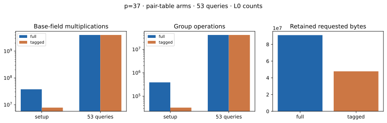

# Action-tagged pair index · direct_full · p=37 · A/A

Run ID `run-20261022T0723Z-quartic-tagged-direct_full-p37-aa`; 22 October 2026; Intel Xeon 6975P-C, 32 logical CPUs; shared-host L0. [Protocol](../../QUARTIC_TWIST_LINE_PROTOCOL.md), [raw record](../../quartic_twist_pair_tagged_direct_full_p37_aa_v1.json), [stderr](../../quartic_twist_pair_tagged_direct_full_p37_aa_v1.log), [empty A/A non-timing diff](../../quartic_twist_pair_tagged_direct_full_p37_aa.diff), and [graph](tagged_pair_index.svg). Source SHA-256: `a9d3e186fd5e1ed3c4c519fe4607c0a8ba6ee32fe5be999d3588057bd18aef96`.

Command: `ulimit -v 8388608; timeout 600s target/release/examples/quartic_twist_pair_tagged_direct_full --p 37 research/twist_index_calculus_20261020/quartic_twist_2d_p13_v1.json research/twist_index_calculus_20261020/quartic_twist_mixed_v1.ndjson research/twist_index_calculus_20261020/quartic_twist_2d_p37_v1.json`. One public target `[271]G`; 53 frozen residual queries. Completed 53/53; no timeout, failure or censored query. The full and tagged tables produced exactly equal **complete signed four-factor decomposition sets** for every residual; an independent group addition checked all 388,752 reconstructed postings. The table contains 32,396 orbit representatives, 388,752 postings and 318,348 abscissa keys, against 388,752 full signed pair entries. Pair-orbit histogram: `{'12': 32396}`.

| Phase | Counted `Fp` multiplications | Counted group operations |
| --- | ---: | ---: |
| full setup | 37,708,944 | 388,752 |
| tagged setup | 7,796,605 | 32,396 |
| full queries | 4,003,562,862 | 41,273,856 |
| tagged queries | 4,003,562,862 | 41,273,856 |

| Table | Retained allocator-requested bytes | Peak allocator-requested bytes |
| --- | ---: | ---: |
| full | 91,007,248 | 91,007,248 |
| tagged | 47,721,464 | 78,834,528 |

Tagged lookup calls: 41,207,697; candidate postings inspected: 17,090,764. Setup/queries L0 wall ms, full: 170.394/20915.279; tagged: 137.942/21479.507. These shared-host observations are not isolated performance results. Posting audit cost is excluded from the candidate's charged work: 37,708,944 `Fp M` and 388,752 group operations. Model/base/target construction is common and excluded; full cold IC and matched rho were not run in this component comparison. Requested bytes are allocator payload sizes, not RSS.

| Query | a | b | Exact signed decompositions |
| ---: | ---: | ---: | ---: |
| 0 | 388601 | 593892 | 53,551 |
| 1 | 82489 | 1017024 | 53,688 |
| 2 | 1798499 | 300441 | 53,451 |
| 3 | 1635135 | 1200459 | 53,167 |
| 4 | 1724732 | 1014634 | 53,414 |
| 5 | 654573 | 1560753 | 53,514 |
| 6 | 1182360 | 1284628 | 53,364 |
| 7 | 74523 | 268643 | 53,443 |
| 8 | 1765708 | 297893 | 53,162 |
| 9 | 1654001 | 1807776 | 53,515 |
| 10 | 1862898 | 49648 | 53,879 |
| 11 | 376921 | 1494413 | 53,301 |
| 12 | 990785 | 1481885 | 53,272 |
| 13 | 673194 | 611927 | 53,367 |
| 14 | 964773 | 1251871 | 53,528 |
| 15 | 19827 | 327429 | 53,508 |
| 16 | 387141 | 1352074 | 53,231 |
| 17 | 819067 | 150507 | 53,344 |
| 18 | 1156449 | 997440 | 53,496 |
| 19 | 642664 | 775179 | 53,113 |
| 20 | 1594576 | 968832 | 53,686 |
| 21 | 1201946 | 1129959 | 53,558 |
| 22 | 114220 | 1626514 | 53,262 |
| 23 | 302191 | 857434 | 53,827 |
| 24 | 883046 | 333626 | 53,355 |
| 25 | 1574768 | 1290877 | 53,774 |
| 26 | 1086171 | 1697677 | 53,626 |
| 27 | 1159124 | 1252457 | 53,364 |
| 28 | 1753926 | 506403 | 53,238 |
| 29 | 1183617 | 183975 | 53,469 |
| 30 | 714555 | 1515990 | 53,290 |
| 31 | 640807 | 174956 | 53,278 |
| 32 | 140464 | 1144333 | 53,352 |
| 33 | 1280601 | 953657 | 53,776 |
| 34 | 1415104 | 82542 | 53,609 |
| 35 | 1057444 | 453850 | 53,547 |
| 36 | 492406 | 1163548 | 53,344 |
| 37 | 1757457 | 954828 | 53,541 |
| 38 | 1527788 | 1831195 | 53,568 |
| 39 | 1106566 | 1414454 | 53,611 |
| 40 | 1824469 | 1783457 | 53,521 |
| 41 | 1573145 | 1073380 | 53,465 |
| 42 | 505926 | 914565 | 53,156 |
| 43 | 1106558 | 1043111 | 53,516 |
| 44 | 1369185 | 635859 | 53,305 |
| 45 | 1430558 | 273572 | 53,439 |
| 46 | 251895 | 997541 | 53,305 |
| 47 | 136617 | 156591 | 53,457 |
| 48 | 788868 | 169675 | 53,944 |
| 49 | 1187097 | 1322750 | 53,580 |
| 50 | 434901 | 1651667 | 53,209 |
| 51 | 868535 | 1088583 | 53,542 |
| 52 | 1253999 | 55033 | 53,304 |

Graph source: [plot_quartic_followups.py](plot_quartic_followups.py). [PDF report](README.pdf). External same-computation pair-index tool: not available or compared; no fastest-tool claim.
