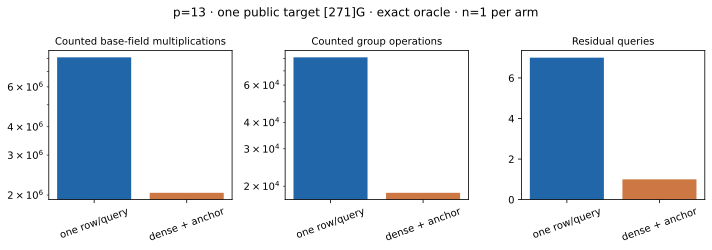

# Dense same-residual 2D exact-oracle IC · p=13

Run ID `run-20261022T0729Z-quartic-2d-dense-p13`; 22 October 2026; Intel Xeon 6975P-C, 32 logical CPUs, shared-host L0. One public known-answer target `[271]G`. [Frozen protocol](../../QUARTIC_TWIST_LINE_PROTOCOL.md), [raw record](../../quartic_twist_2d_dense_p13_v1.json), [stderr log](../../quartic_twist_2d_dense_p13_v1.log), [independent replay](../../quartic_twist_2d_dense_p13_native_audit_v1.json), [empty A/A non-timing diff](../../quartic_twist_2d_dense_p13_aa.diff), [prior one-row-per-query pilot](../../quartic_twist_2d_p13_v1.json) and [graph](dense_cost.svg). Producer SHA-256 `442ae462454bccfb487f898c9d733923be7cbffe60d9cad1af2ae467d0296922`; auditor SHA-256 `e2646ab8daf9bb4f3f3fd1be137c8d4f9a89c748dfed8b896ce0c84a08df5728`.

Command: `ulimit -v 8388608; timeout 600s target/release/examples/quartic_twist_2d_dense_p13`. Completed 1/1 residual before the 64-query and 600-second caps; no failure, timeout or censored query. The exact signed oracle enumerated **561** four-distinct-factor decompositions of the *same* residual. Its unanchored matrix rank was **6** of 7; setting the public generator's factor log to 1 left **6** unknowns. A deterministic scan accepted **6** rank-raising rows within the first **6** decompositions and reached anchored rank **6**, recovering 271. The independent point-keyed signed-pair oracle reproduced the full first-query hit count, checked every selected signed pair and row, enumerated all **28,753** subgroup logs, independently solved the anchored matrix and verified 271. The one-residual unanchored rank ceiling follows because differences between rows annihilate the nonzero factor-log vector; the anchored full rank supplies the matching lower bound.

| Phase | Counted `Fp` multiplications | Counted group operations |
| --- | ---: | ---: |
| model | 650 | 0 |
| base | 216,201 | 0 |
| input | 3,560 | 35 |
| eigenvalues | 6,478 | 62 |
| orbit map | 149,262 | 1,422 |
| full pair table | 495,864 | 5,112 |
| one-query stream | 1,011,390 | 10,430 |
| answer checks | 162,265 | 1,548 |

Total counted `Fp M`: previous 8,096,696; dense anchored 2,045,670; previous/dense **3.958**. Total group operations: previous 81,076; dense anchored 18,609; previous/dense **4.357**. These totals include model, base, input, eigen/map verification, full pair table, relation stream and answer checks in each arm. The reference used one selected row per residual and kept the generator log as an unknown; the candidate changes **both** row retention and the public known-log anchor. Modular row operations are separate: anchored selection 57, final solve 93, and unanchored-rank diagnostic 14,766 (excluded from the anchored algorithmic path but included in this run's wall time). Shared-host L0 total wall time 7.853 ms is not an isolated speed claim. Hash/allocation CPU, polynomial S5, 0/0.1/1 GAE and an integrated matched rho are absent; this is a counted **exact group-oracle** one-target comparison.

Graph source: [plot_quartic_followups.py](plot_quartic_followups.py). [PDF report](README.pdf).
