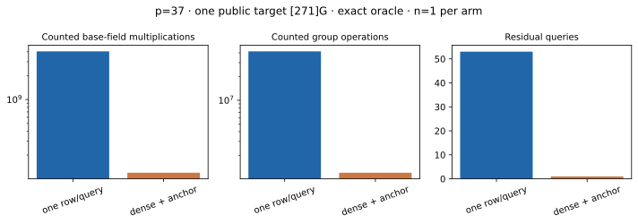

# Dense same-residual 2D exact-oracle IC · p=37 · A/A

Run ID `run-20261022T0730Z-quartic-2d-dense-p37-aa`; 22 October 2026; Intel Xeon 6975P-C, 32 logical CPUs, shared-host L0. One public known-answer target `[271]G`. [Frozen protocol](../../QUARTIC_TWIST_LINE_PROTOCOL.md), [raw record](../../quartic_twist_2d_dense_p37_aa_v1.json), [stderr log](../../quartic_twist_2d_dense_p37_aa_v1.log), [independent replay](../../quartic_twist_2d_dense_p37_native_audit_v1.json), [empty A/A non-timing diff](../../quartic_twist_2d_dense_p37_aa.diff), [prior one-row-per-query pilot](../../quartic_twist_2d_p37_v1.json) and [graph](dense_cost.svg). Producer SHA-256 `47ea95bc50eaffcee5fe05f18289c31be37e720f05955cfb06cea64f143dcea4`; auditor SHA-256 `e2646ab8daf9bb4f3f3fd1be137c8d4f9a89c748dfed8b896ce0c84a08df5728`.

Command: `ulimit -v 8388608; timeout 600s target/release/examples/quartic_twist_2d_dense_p37 research/twist_index_calculus_20261020/quartic_twist_mixed_v1.ndjson`. Completed 1/1 residual before the 64-query and 600-second caps; no failure, timeout or censored query. The exact signed oracle enumerated **53,551** four-distinct-factor decompositions of the *same* residual. Its unanchored matrix rank was **52** of 53; setting the public generator's factor log to 1 left **52** unknowns. A deterministic scan accepted **52** rank-raising rows within the first **115** decompositions and reached anchored rank **52**, recovering 271. The independent point-keyed signed-pair oracle reproduced the full first-query hit count, checked every selected signed pair and row, enumerated all **1,873,633** subgroup logs, independently solved the anchored matrix and verified 271. The one-residual unanchored rank ceiling follows because differences between rows annihilate the nonzero factor-log vector; the anchored full rank supplies the matching lower bound.

| Phase | Counted `Fp` multiplications | Counted group operations |
| --- | ---: | ---: |
| model | 859 | 0 |
| base | 2,567,679 | 0 |
| input | 4,741 | 46 |
| eigenvalues | 16,618 | 156 |
| orbit map | 1,877,044 | 17,524 |
| full pair table | 37,708,944 | 388,752 |
| one-query stream | 75,560,753 | 779,024 |
| answer checks | 2,004,307 | 18,854 |

Total counted `Fp M`: previous 4,048,104,018; dense anchored 119,740,945; previous/dense **33.807**. Total group operations: previous 41,702,654; dense anchored 1,204,356; previous/dense **34.627**. These totals include model, base, input, eigen/map verification, full pair table, relation stream and answer checks in each arm. The reference used one selected row per residual and kept the generator log as an unknown; the candidate changes **both** row retention and the public known-log anchor. Modular row operations are separate: anchored selection 20,969, final solve 11,484, and unanchored-rank diagnostic 17,251,447 (excluded from the anchored algorithmic path but included in this run's wall time). Shared-host L0 total wall time 728.058 ms is not an isolated speed claim. Hash/allocation CPU, polynomial S5, 0/0.1/1 GAE and an integrated matched rho are absent; this is a counted **exact group-oracle** one-target comparison.

Graph source: [plot_quartic_followups.py](plot_quartic_followups.py). [PDF report](README.pdf).
