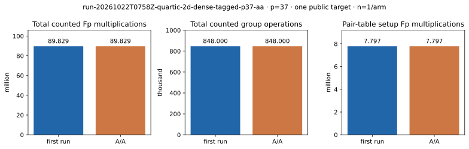

# Combined tagged and dense p=37 exact-oracle A/A

Run ID `run-20261022T0758Z-quartic-2d-dense-tagged-p37-aa`; 22 October 2026; shared Intel Xeon 6975P-C host, L0. This is a second execution of the [registered combined producer](../run-20261022T0758Z-quartic-2d-dense-tagged-p37/README.md) on the same public `[271]G` target, 624-point base, frozen seed-zero residual, 300-second watchdog and 8-GiB virtual-memory cap. [First raw record](../../quartic_twist_2d_dense_tagged_p37_v1.json), [A/A raw record](../../quartic_twist_2d_dense_tagged_p37_aa_v1.json), [empty stderr](../../quartic_twist_2d_dense_tagged_p37_aa_v1.log), and [empty canonical non-timing diff](../../quartic_twist_2d_dense_tagged_p37_aa.diff) are retained. Producer SHA-256 `201d30777812399be02ae414d8fe8d13b63f73c6ace1f5d7024763ce6a31e42a`; imported tagged index SHA-256 `5ad7a68b17a3a969dfa242cb73b3f3a8a368a36c58678bf9dce9d4bfc2615739`.

Command: `prlimit --as=8589934592 -- timeout 300s target/release/examples/quartic_twist_2d_dense_tagged_p37 research/twist_index_calculus_20261020/quartic_twist_mixed_v1.ndjson research/twist_index_calculus_20261020/quartic_twist_2d_dense_p37_v1.json`. Completed 1/1 residual with no error or censoring. The A/A comparison removes only `wall_ms_l0`, `table_ms_l0` and `tagged_path_ms_l0`, then sorts JSON keys; **every other recorded field matches exactly**. Both runs return 53,551 complete signed decompositions, the same 52 selected relations, rank 52, answer 271, 89,828,606 counted `Fp` multiplications, 848,000 group operations, 47,721,464 retained requested table bytes and 78,834,528 requested peak bytes above pre-table allocation. The first and A/A shared-host path wall observations were 632.080 and 653.005 ms; they are not an isolated timing comparison.

Graph source: [plot_dense_tagged.py](plot_dense_tagged.py). [PDF report](README.pdf).
