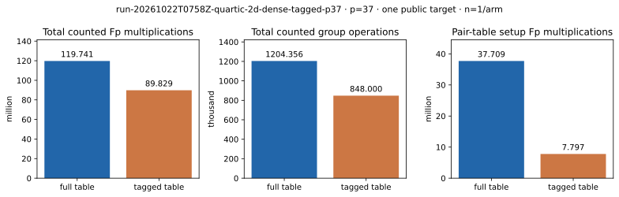

# Combined tagged-index and dense-row exact-oracle IC · p=37

Run ID `run-20261022T0758Z-quartic-2d-dense-tagged-p37`; 22 October 2026; shared Intel Xeon 6975P-C host, L0. One public known-answer target `[271]G` in the order-1,873,633 subgroup of the canonical `p=37`, `b0=2` quartic twist. The [registered protocol](../../QUARTIC_TWIST_LINE_PROTOCOL.md), [producer](../../../../examples/quartic_twist_2d_dense_tagged_p37.rs), [raw record](../../quartic_twist_2d_dense_tagged_p37_v1.json), [empty stderr](../../quartic_twist_2d_dense_tagged_p37_v1.log), [independent point-keyed audit](../../quartic_twist_2d_dense_tagged_p37_native_audit_v1.json), [A/A report](../run-20261022T0758Z-quartic-2d-dense-tagged-p37-aa/README.md), and [earlier full-table dense arm](../../quartic_twist_2d_dense_p37_v1.json) are retained. Producer SHA-256 `201d30777812399be02ae414d8fe8d13b63f73c6ace1f5d7024763ce6a31e42a`; imported tagged-index source SHA-256 `5ad7a68b17a3a969dfa242cb73b3f3a8a368a36c58678bf9dce9d4bfc2615739`; independent auditor SHA-256 `e2646ab8daf9bb4f3f3fd1be137c8d4f9a89c748dfed8b896ce0c84a08df5728`.

Command: `prlimit --as=8589934592 -- timeout 300s target/release/examples/quartic_twist_2d_dense_tagged_p37 research/twist_index_calculus_20261020/quartic_twist_mixed_v1.ndjson research/twist_index_calculus_20261020/quartic_twist_2d_dense_p37_v1.json`. Completed 1/1 residual before the 64-query, 300-second and 8-GiB caps. No timeout, failure or censored query. The producer used the full 624-point signed two-dimensional base with 52 twist-folded columns. The direct-posting tagged table constructed 32,396 pair-orbit representatives and 388,752 postings. It enumerated all **53,551** signed four-distinct-factor decompositions of the first residual. The separately counted full-table reference returned the **identical complete signed set**; every posting was also checked by an excluded independent group addition. The first **115** candidates supplied 52 rank-increasing anchored rows, rank **52/52**, and recovered 271. Every factor log and the target answer were checked by group multiplication. The independent point-keyed four-sign auditor enumerated all **1,873,633** group logs, replayed all 53,551 decompositions, 52 selected rows and rank, and recovered 271.

| Charged phase | Full-table dense `Fp M` | Tagged dense `Fp M` | Full-table dense group ops | Tagged dense group ops |
| --- | ---: | ---: | ---: | ---: |
| Model, base, input, eigenvalues, orbit map | 4,466,941 | 4,466,941 | 17,726 | 17,726 |
| Pair table | 37,708,944 | **7,796,605** | 388,752 | **32,396** |
| First-residual stream | 75,560,753 | 75,560,753 | 779,024 | 779,024 |
| Answer checks | 2,004,307 | 2,004,307 | 18,854 | 18,854 |
| **One-target counted total** | **119,740,945** | **89,828,606** | **1,204,356** | **848,000** |

The full-table dense arm is the earlier registered run on the **same base, target and residual**, with identical selected relations and factor logs. Candidate/reference ratios are **1.333× fewer counted `Fp` multiplications** and **1.420× fewer counted group operations** in these separate units. The exact total deltas, **29,912,339 `Fp M`** and **356,356 group operations**, equal the pair-table setup deltas: every other counted phase matches. The tagged producer itself charges every phase from model construction through answer checks in one run; the full-table equality and posting audits are excluded and separately recorded in its JSON. Its table retained 47,721,464 allocator-requested bytes and the producer's peak above its pre-table live allocation was 78,834,528 requested bytes. It recorded 777,503 hash lookups and 324,839 candidate postings. The anchored selection and solve used 20,969 and 11,484 modular row operations. An additional 17,251,447 modular operations computed the unanchored rank diagnostic; they are excluded from the proposed anchored algorithmic path but included in the observed L0 wall time of 632.080 ms. Wall time is shared-host L0, not an isolated speed claim; hash CPU and requested bytes do not form a calibrated group-addition-equivalent cost.

This is an exact **group-oracle** relation finder. The native `S5` polynomial, Gröbner cost, implicit table, external solver baseline, isolated end-to-end timing and matched 0/0.1/1 GAE rho band remain unmeasured. The tagged table preserves relation yield; the 624-point physical base and dense row selection supply it.

Graph source: [plot_dense_tagged.py](plot_dense_tagged.py). [PDF report](README.pdf).
