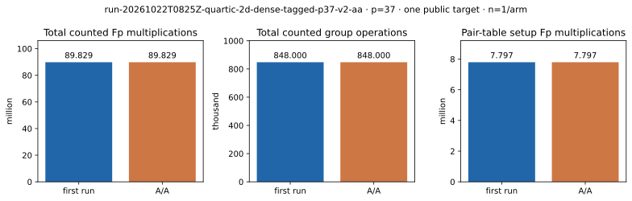

# Final-source tagged/dense p=37 A/A

Run ID `run-20261022T0825Z-quartic-2d-dense-tagged-p37-v2-aa`; 22 October 2026; shared Intel Xeon 6975P-C, L0. This repeats the exact command, public `[271]G` target, 624-point base, frozen first residual, 300-second watchdog and 8-GiB cap of the [final-source first run](../run-20261022T0825Z-quartic-2d-dense-tagged-p37-v2/README.md). [First raw JSON](../../quartic_twist_2d_dense_tagged_p37_v2.json), [A/A raw JSON](../../quartic_twist_2d_dense_tagged_p37_aa_v2.json), [empty stderr](../../quartic_twist_2d_dense_tagged_p37_aa_v2.log) and [empty non-timing diff](../../quartic_twist_2d_dense_tagged_p37_aa_v2.diff) are preserved. Current producer SHA-256 `201d30777812399be02ae414d8fe8d13b63f73c6ace1f5d7024763ce6a31e42a`; tagged-index module `c28ee64777b08cb210050bf9542b7b6d3c667678bcbf53b633964b6241c4cd53`.

Completed 1/1 residual without failure or censoring. Removing only `wall_ms_l0`, `table_ms_l0` and `tagged_path_ms_l0` makes the canonical JSON records **identical**: 53,551 complete signed decompositions, 52 selected rows, rank 52, answer 271, 89,828,606 counted `Fp M`, 848,000 group operations, 47,721,464 retained requested table bytes and 78,834,528 requested peak bytes above pre-table allocation. The two shared-host L0 path observations were 639.113 and 633.789 ms and are not isolated timing evidence. The independent auditor of the first run checks correctness separately from this repeatability control.

Graph source: [plot_dense_tagged.py](plot_dense_tagged.py). [PDF report](README.pdf).
