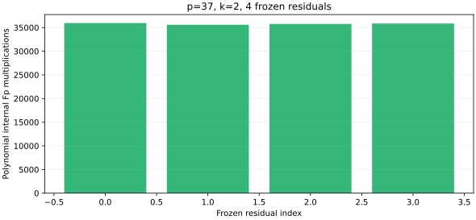

# run-20261022T0851Z-quartic_twist_tagged_s5_k2_p37_v1

Raw record: [quartic_twist_tagged_s5_k2_p37_v1.json](../../quartic_twist_tagged_s5_k2_p37_v1.json) (SHA-256 `6fb9841fc27ca4e5aba2571ef05df8a262a0eeb0fd325d418374bbeb58fbf1bf`).

Source: [quartic_twist_tagged_s5.rs](../../../../examples/quartic_twist_tagged_s5.rs) (current SHA-256 `45251363eab451979d5eaf18246e63546c3ac5fc74455addb528e91e8c1e9ed0`). Measurement source: frozen source commit 98fb8e09f; current source SHA below is a rendering-time snapshot.

## Workload and execution

Frozen protocol: [quartic twist line protocol](../../QUARTIC_TWIST_LINE_PROTOCOL.md).

Host and isolation: Intel Xeon Platinum 6975P-C; shared host; L0 exploratory run.

One public known-answer target [271]G; p=37, b0=2, r=1,873,633, seed=0. For the pilot and diagnostic, the first four registered residuals or index 2 are used; for the full producer the existing 61-residual stream is the cap.

Command (with an 8 GiB address-space cap and 1,200 s watchdog): `target/release/examples/quartic_twist_tagged_s5 --k 2 research/twist_index_calculus_20261020/quartic_twist_mixed_v1.ndjson`.

## Recorded observations

- Producer status: mismatch; exact signed-set agreements 3/4; system failures 1056.
- Signed polynomial relations 0; field solutions 0; systems attempted 1056.
- An agreement on an empty set does not make a failed system complete. The independent scalar-keyed pilot audit classifies each arm.

The graph plots native recorded counts. It does not include native hash, allocator or partition CPU. L0 wall time in the raw record is not isolated. No priced IC/rho or fastest-solver speed claim follows from this run.

[PDF copy](report.pdf).
