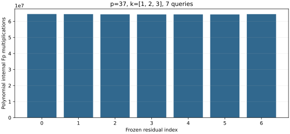

# run-20261022T0910Z-quartic_twist_mixed_polynomial_ic_p37_aa_v1

Raw record: [quartic_twist_mixed_polynomial_ic_p37_aa_v1.json](../../quartic_twist_mixed_polynomial_ic_p37_aa_v1.json) (SHA-256 `9b97f93aa5678e55ba199369e2082564aea2502669d2ac8c23c1024e8b6ba0da`).

Source: [quartic_twist_mixed_polynomial_ic.rs](../../../../examples/quartic_twist_mixed_polynomial_ic.rs) (current SHA-256 `cb1caa67733660b09271eca8b0fbc6a72307f28c59a8eafb1bf79e3432f1d24e`). Measurement source: frozen source commit ade6c1916; current source SHA below is a rendering-time snapshot.

## Workload and execution

Frozen protocol: [quartic twist line protocol](../../QUARTIC_TWIST_LINE_PROTOCOL.md).

Host and isolation: Intel Xeon Platinum 6975P-C; shared host; L0 exploratory run.

One public known-answer target [271]G; p=37, b0=2, r=1,873,633, seed=0. For the pilot and diagnostic, the first four registered residuals or index 2 are used; for the full producer the existing 61-residual stream is the cap.

Command (with an 8 GiB address-space cap and 1,200 s watchdog): `target/release/examples/quartic_twist_mixed_polynomial_ic research/twist_index_calculus_20261020/quartic_twist_mixed_v1.ndjson`.

## Recorded observations

- Status: pass; anchored rank 4/4; recovered scalar 271.
- Processed 7 frozen residuals and retained 4 rank-raising signed relations; all factor logs verified.
- Recorded polynomial stream: 451,109,265 internal Fp multiplications; 5,125 stream group operations. The total appears in the separate independent audit and final-source record, not as a field of this historical producer schema.
- Final-source A/A control: compare all non-timing JSON fields against the other final-source repeat. The initial pilot source is preserved separately.

The graph plots native recorded counts. It does not include native hash, allocator or partition CPU. L0 wall time in the raw record is not isolated. No priced IC/rho or fastest-solver speed claim follows from this run.

[PDF copy](report.pdf).
