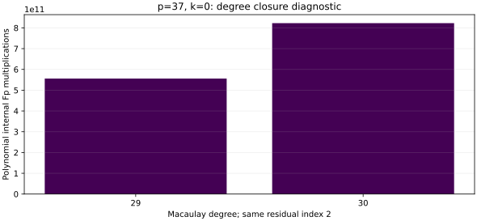

# run-20261022T0920Z-quartic_twist_tagged_s5_k0_q2_d30_p37_v1

Raw record: [quartic_twist_tagged_s5_k0_q2_d30_p37_v1.json](../../quartic_twist_tagged_s5_k0_q2_d30_p37_v1.json) (SHA-256 `b865e9162e859cca9c9bdf156035702f75e99ccb9b287b17533c183535c998f5`).

Source: [quartic_twist_tagged_s5.rs](../../../../examples/quartic_twist_tagged_s5.rs) (current SHA-256 `45251363eab451979d5eaf18246e63546c3ac5fc74455addb528e91e8c1e9ed0`). Measurement source: final source; current SHA below is the rendering-time snapshot.

## Workload and execution

Frozen protocol: [quartic twist line protocol](../../QUARTIC_TWIST_LINE_PROTOCOL.md).

Host and isolation: Intel Xeon Platinum 6975P-C; shared host; L0 exploratory run.

One public known-answer target [271]G; p=37, b0=2, r=1,873,633, seed=0. For the pilot and diagnostic, the first four registered residuals or index 2 are used; for the full producer the existing 61-residual stream is the cap.

Command (with an 8 GiB address-space cap and 1,200 s watchdog): `target/release/examples/quartic_twist_tagged_s5 --k 0 research/twist_index_calculus_20261020/quartic_twist_mixed_v1.ndjson --query-index=2 --s5-degree=30`.

## Recorded observations

- Producer status partial; system outcome: border unreachable at this degree; failure count 1.
- Signed-set agreement False; polynomial relations 0; reference relations 1.
- This bounded degree increase is a failed diagnostic. It does not prove the S5 system has no solution or that a different solver cannot find one.

The graph plots native recorded counts. It does not include native hash, allocator or partition CPU. L0 wall time in the raw record is not isolated. No priced IC/rho or fastest-solver speed claim follows from this run.

[PDF copy](report.pdf).
