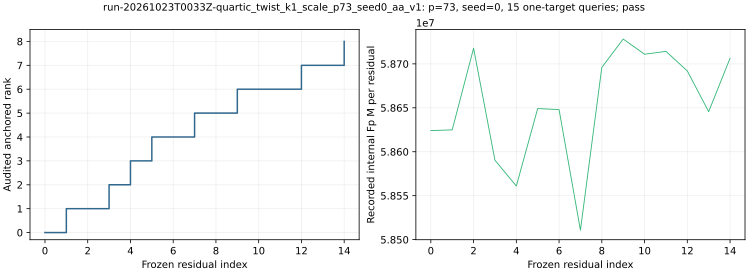

# run-20261023T0033Z-quartic_twist_k1_scale_p73_seed0_aa_v1

[Raw record](../../quartic_twist_k1_scale_p73_seed0_aa_v1.json) SHA-256 `f186bd068ab2da3c3dcea5d308eacdca1b0a99b2ca49769fa976eda83ce2627f`; [independent audit](../../quartic_twist_k1_scale_p73_seed0_audit_aa_v1.json) SHA-256 `a470c2bc86f9cc9fad48024363aec812e7545912b53deff60ff085ec47f647e8`.

Measurement source: commit `a815598a57`; [producer](../../../../examples/quartic_twist_k1_scale.rs) SHA-256 `ed5a6f4daa9242ea94c3813daa1e2a066b01c43d5370e0db8aadc162e778ff5e`; [auditor](../../../../examples/quartic_twist_k1_scale_audit.rs) SHA-256 `4ba2a5734f35a52c575b1763973a6d0ee3d398ae17edc7b907c339a9586bd405`.

## Execution

Shared Intel Xeon Platinum 6975P-C host; L0 exploratory run. One public synthetic target `[271]G`.

Command: `target/release/examples/quartic_twist_k1_scale research/twist_index_calculus_20261020/quartic_twist_mixed_v1.ndjson 73 0` with 8 GiB address-space cap and 1,200 s watchdog.

## Recorded observations

- Native status `pass`; independent audit `pass`; 15 of 117 frozen residuals; anchored rank 8/8; recovered 271.
- Independent exact k=1 signed sets: 8 reference, 8 polynomial, 0 missing; 0 algebraic system failures.
- Counted IC: 888,203,272 Fp multiplications and 9,988 group operations. Same-process twist24 rho: 496,841 Fp multiplications and 3,735 group operations.
- All 96 physical factor logs were independently computed with a 5330-point BSGS baby table; the separate exact oracle built 4512 signed L0 pair entries.
- Public generator anchor log: 28408032; the first signed physical factor may be the generator or its negation.

The graph plots native recorded values only. L0 wall times in the raw record are not isolated, and hash/allocator CPU and calibrated GAE are absent. This is not a priced IC/rho or external-solver speed comparison.

[PDF](report.pdf).
