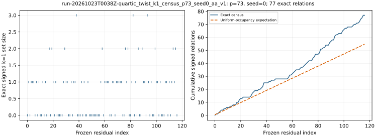

# run-20261023T0038Z-quartic_twist_k1_census_p73_seed0_aa_v1

[Raw record](../../quartic_twist_k1_census_p73_seed0_aa_v1.json) SHA-256 `2c49e75469b6d8a13ba33a3e9575435e79f9749107118a2a01a581e8e0698366`; [independent audit](../../quartic_twist_k1_census_p73_seed0_audit_aa_v1.json) SHA-256 `d73a65fe047db4624294ee57a20944391647fac7030a25d1607e89250358d962`.

Census protocol commit `09bf98c033`; independent scalar-audit amendment `547a52330a`; [point-keyed producer](../../../../examples/quartic_twist_k1_census.rs) SHA-256 `36f5cc62c06bab71fb560ef386d985ec6af5576d16ee117c33c305831fddda80`; [scalar-keyed auditor](../../../../examples/quartic_twist_k1_census_audit.rs) SHA-256 `411cea2d8e4709a479b639f0eed783d1f1f17ddc2c6807a49f41cb626615f49d`.

## Execution

Shared Intel Xeon Platinum 6975P-C host; L0 exploratory run. Entire frozen group-oracle stream, including queries after polynomial IC stopping.

Command: `target/release/examples/quartic_twist_k1_census research/twist_index_calculus_20261020/quartic_twist_mixed_v1.ndjson 73 0` with 8 GiB address-space cap and 1,200 s watchdog.

## Recorded observations

- Exact point-keyed group census and independent scalar-keyed audit both pass: 77 signed k=1 relations across 117 frozen residuals; 57 have zero.
- First hit at zero-based query 1; uniform-occupancy heuristic 54.708 relations, observed/heuristic 1.407.
- Independent BSGS verified 96 physical factor logs and the target log using a 5330-point baby table; all 117 complete signed-set digests match.
- Point-keyed census charged 437,664 setup and 106,603,795 query Fp multiplications; these are reference-oracle costs, not polynomial IC costs.

The dashed curve is a first-moment heuristic, not a fitted model or a confidence interval. Relations within a stream can be dependent. The group-oracle cost is outside the candidate polynomial IC pipeline.

[PDF](report.pdf).
