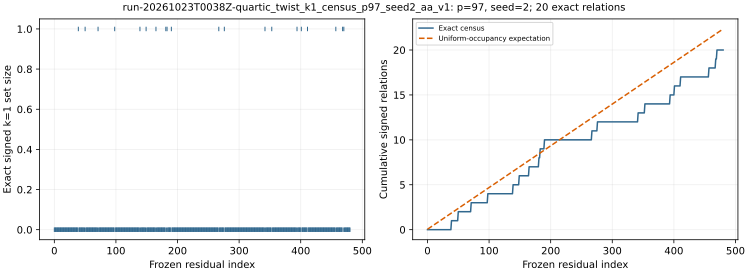

# run-20261023T0038Z-quartic_twist_k1_census_p97_seed2_aa_v1

[Raw record](../../quartic_twist_k1_census_p97_seed2_aa_v1.json) SHA-256 `6ea6a83d7a5eadeede640935d10b053977dcf5339f0f5422302c7a9167803367`; [independent audit](../../quartic_twist_k1_census_p97_seed2_audit_aa_v1.json) SHA-256 `9af0b819cea1e5f7a8d17d5dfcf3df03a70268a39ad03eac501256038bc52e63`.

Census protocol commit `09bf98c033`; independent scalar-audit amendment `547a52330a`; [point-keyed producer](../../../../examples/quartic_twist_k1_census.rs) SHA-256 `36f5cc62c06bab71fb560ef386d985ec6af5576d16ee117c33c305831fddda80`; [scalar-keyed auditor](../../../../examples/quartic_twist_k1_census_audit.rs) SHA-256 `411cea2d8e4709a479b639f0eed783d1f1f17ddc2c6807a49f41cb626615f49d`.

## Execution

Shared Intel Xeon Platinum 6975P-C host; L0 exploratory run. Entire frozen group-oracle stream, including queries after polynomial IC stopping.

Command: `target/release/examples/quartic_twist_k1_census research/twist_index_calculus_20261020/quartic_twist_mixed_v1.ndjson 97 2` with 8 GiB address-space cap and 1,200 s watchdog.

## Recorded observations

- Exact point-keyed group census and independent scalar-keyed audit both pass: 20 signed k=1 relations across 481 frozen residuals; 461 have zero.
- First hit at zero-based query 39; uniform-occupancy heuristic 22.343 relations, observed/heuristic 0.895.
- Independent BSGS verified 72 physical factor logs and the target log using a 9410-point baby table; all 481 complete signed-set digests match.
- Point-keyed census charged 244,440 setup and 249,233,829 query Fp multiplications; these are reference-oracle costs, not polynomial IC costs.

The dashed curve is a first-moment heuristic, not a fitted model or a confidence interval. Relations within a stream can be dependent. The group-oracle cost is outside the candidate polynomial IC pipeline.

[PDF](report.pdf).
