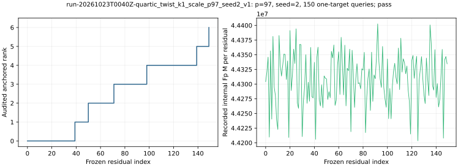

# run-20261023T0040Z-quartic_twist_k1_scale_p97_seed2_v1

[Raw record](../../quartic_twist_k1_scale_p97_seed2_v1.json) SHA-256 `25952aba063ec1e68d8be1b39cbb4dbc8a569686160288abab2a3e3dbceaf504`; [independent audit](../../quartic_twist_k1_scale_p97_seed2_audit_v1.json) SHA-256 `4ffb41ad817ffb2b8bb7456200cd447f1568da88afca075b05620ec41bfaea88`.

Measurement source: commit `a815598a57`; [producer](../../../../examples/quartic_twist_k1_scale.rs) SHA-256 `ed5a6f4daa9242ea94c3813daa1e2a066b01c43d5370e0db8aadc162e778ff5e`; [auditor](../../../../examples/quartic_twist_k1_scale_audit.rs) SHA-256 `4ba2a5734f35a52c575b1763973a6d0ee3d398ae17edc7b907c339a9586bd405`.

## Execution

Shared Intel Xeon Platinum 6975P-C host; L0 exploratory run. One public synthetic target `[271]G`.

Command: `target/release/examples/quartic_twist_k1_scale research/twist_index_calculus_20261020/quartic_twist_mixed_v1.ndjson 97 2` with 8 GiB address-space cap and 1,200 s watchdog.

## Recorded observations

- Native status `pass`; independent audit `pass`; 150 of 481 frozen residuals; anchored rank 6/6; recovered 271.
- Independent exact k=1 signed sets: 6 reference, 6 polynomial, 0 missing; 0 algebraic system failures.
- Counted IC: 6,696,848,851 Fp multiplications and 28,588 group operations. Same-process twist24 rho: 791,504 Fp multiplications and 5,395 group operations.
- All 72 physical factor logs were independently computed with a 9410-point BSGS baby table; the separate exact oracle built 2520 signed L0 pair entries.
- Public generator anchor log: 88538352; the first signed physical factor may be the generator or its negation.

The graph plots native recorded values only. L0 wall times in the raw record are not isolated, and hash/allocator CPU and calibrated GAE are absent. This is not a priced IC/rho or external-solver speed comparison.

[PDF](report.pdf).
